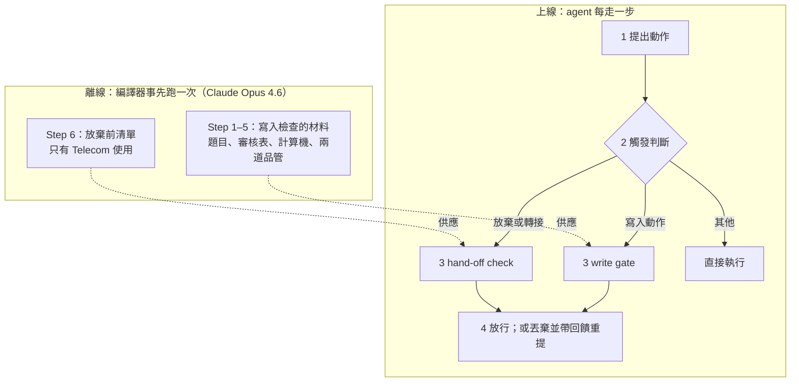
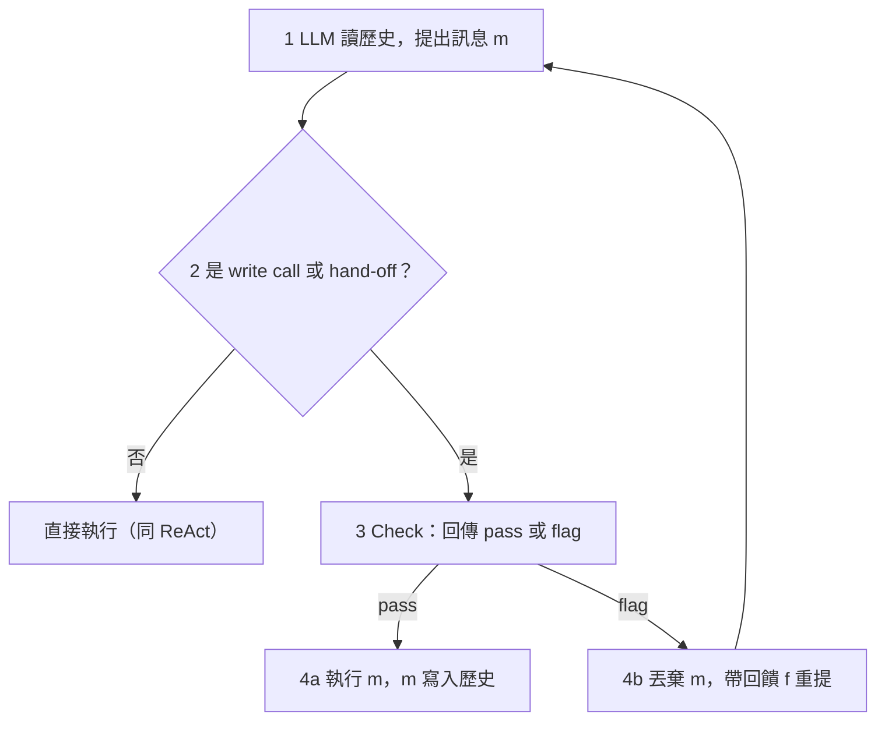
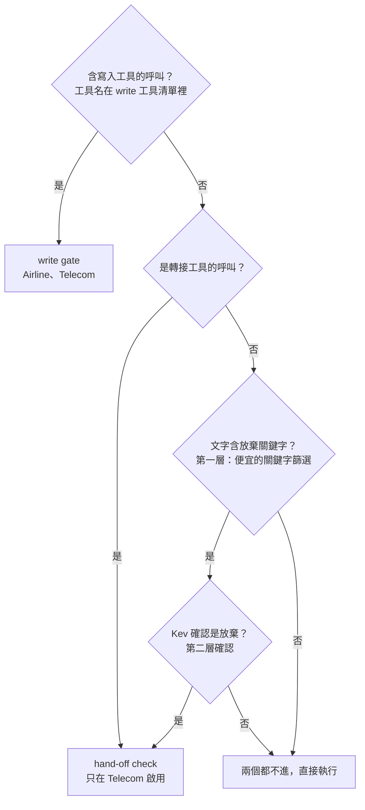
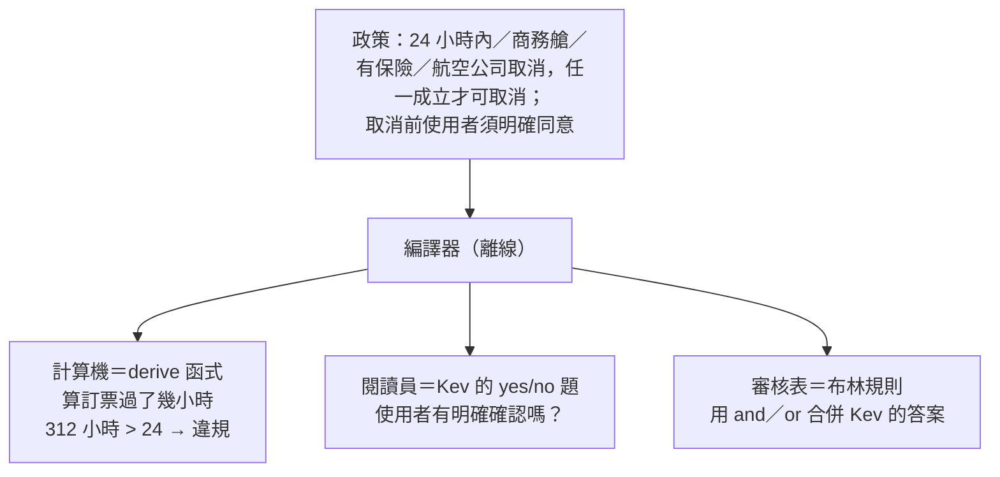
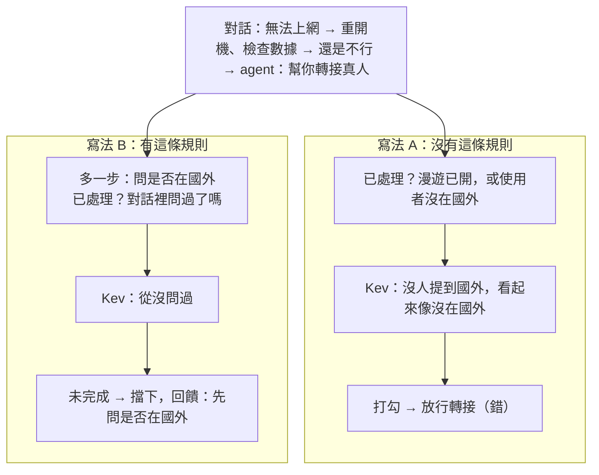
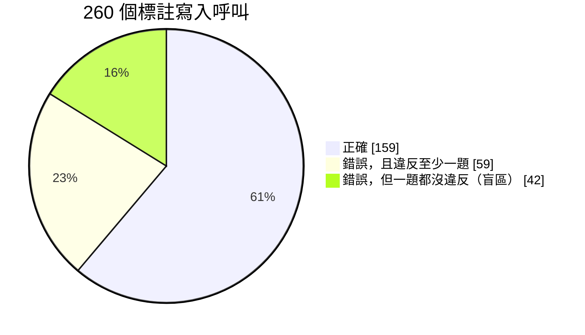
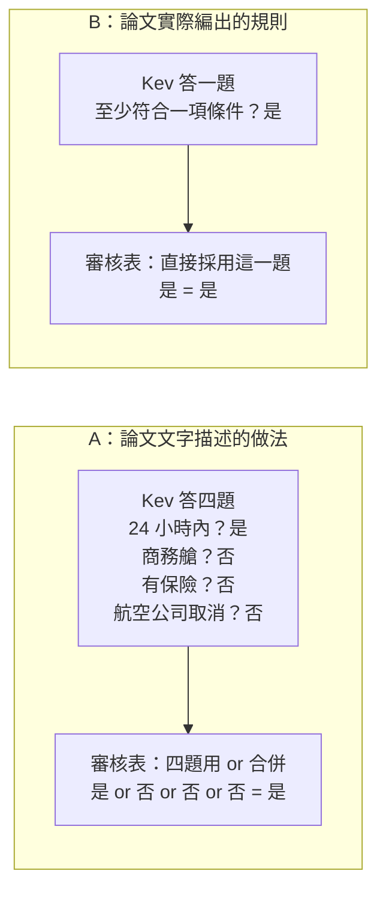

# JevAct：在 LLM Agent 動手之前，先過一道便宜的決策閘門

**來源**：[Think Before You Act: Decision Gate for LLM Agents](https://arxiv.org/abs/2610.38620)（IBM SIL，2026 年 10 月）

## 前言

LLM agent 最怕的不是說錯話，而是做錯事：訂錯票、取消了不該取消的訂位，或太早告訴使用者「沒辦法了」。IBM SIL 的 Iftach Shoham、Yuval David 等人提出的 JevAct，在 agent「提出動作」與「執行動作」之間加了一道閘門，只攔兩類難以挽回的動作：寫入型工具呼叫，以及放棄或轉接真人。

擔任裁判的是 Kev，一個外部開源的**決策模型**：讀一段 prompt，只跑一次 forward pass（只做 prefill，不生成文字），就給出每個固定選項的機率。JevAct 的做法分兩層。離線時，LLM 把領域政策編譯成檢查材料：給 Kev 回答的單一事實 yes/no 題、組合答案的布林規則、從工具紀錄計算事實的程式碼，以及一張「放棄前必做清單」，再用開發階段的紀錄做兩道品管。上線時，程式碼負責算硬事實，Kev 一次 forward pass 給出所有題目的機率；只有在有把握時才擋下，並附上一次性回饋，讓 agent 在有限次數內修正。

實驗用了三個 benchmark：$\tau^2$-bench 的 Airline（航空客服）與 Telecom（電信客服），以及 BFCL（工具呼叫能力測試）。結果並不是一面倒的好消息：Telecom 進步最大，Airline 好壞參半，BFCL 只是變得較穩定。消融顯示增益主要來自程式檢查，Kev 的額外貢獻依 agent 而定；從政策編出的題目，最多也只能抓到約 58% 的錯誤呼叫。

〈方法總覽：離線準備材料，上線逐步檢查〉的地圖是全文骨架，讀到細節迷路時可以回去看。文中的標示：（推論）是筆者的判斷；（自編）是為了說明而舉的示意例子；（一般知識）是比喻或背景常識，不是論文內容；「論文未說明」是原文沒有交代的地方。其餘都是論文內容。

## 問題：為什麼要在執行前擋

多數 agent 迴圈在 LLM 提出動作後立刻執行，「生成動作」與「確認該不該做」之間沒有任何檢查。說錯一句話，下一輪還能更正；有兩類動作卻難以挽回：

- **write call（寫入型工具呼叫）**：改變資料庫狀態，例如訂票、取消、改設定。
- **hand-off（放棄或轉接）**：轉給真人，或告訴使用者「沒辦法了」，等於結束這次嘗試。Telecom 任務最常見的失敗，就是 agent 太早放棄。

既有做法各缺一角：

| 做法 | 缺的那一角 |
| --- | --- |
| Self-Refine、Reflexion 這類反思方法 | 改善的是「之後的提案」，不會在某個動作執行前逐條對照政策 |
| 生成式 LLM-as-judge | 輸出自由文字，閘門還得再解讀一次；每一步都叫前沿模型也太貴 |

由此可以整理出三個挑戰（這個分類是筆者從論文的引言與方法節整理出來的，論文沒有列成編號）：

1. 檢查必須發生在執行前，並且對照領域政策。
2. 裁判的輸出要能直接開關閘門，而且要便宜。決策模型只回傳固定選項的機率，設個門檻就能用。
3. 決策模型給的機率不保證校準、也不保證正確，而且它不會算數，所以需要其他機制補位。

## 方法總覽：離線準備材料，上線逐步檢查

JevAct 分成兩層：離線時把政策編譯成檢查材料；上線時在 agent 每一步攔下危險動作，用這些材料檢查。agent 本身的 LLM、基礎 prompt 與工具都不改動。



*圖 1 — JevAct 的系統地圖：上半是離線編譯，下半是上線時每一步的四個階段。虛線表示離線產出的材料由哪個檢查使用。*

先把貫穿全文的名字定下來。write gate 用三種材料：**計算機**（編譯器寫出的 derive 函式）、**閱讀員**（Kev 回答的 yes/no 題）、**審核表**（把 Kev 的答案組合起來的布林規則），三者的分工見〈編譯器：一句政策拆成三種工作（Step 1–3）〉。hand-off check 用的是另一份材料：**放棄前清單**。Kev 這個名字的來歷，以及它和 Jev、JevLoop 的差別，見〈Jev、Kev、JevLoop、JevAct 四個名字〉。

各方塊的細節分散在後面幾節：決策迴圈與觸發見〈決策迴圈與觸發分流〉；Step 1–5 見〈編譯器：一句政策拆成三種工作（Step 1–3）〉與〈兩道品管：修正計算機、淘汰爛題目〉；Step 6 見〈放棄前清單：結構、產生方式、過濾〉；兩個 gate 上線時怎麼運作，見〈Kev 的輸入與門檻〉與〈兩個 gate 的完整運作〉。

## 決策迴圈與觸發分流

每一步都走四個階段：提出、觸發、檢查、放行或重提。只有 write call 與 hand-off 會被檢查，其餘訊息照 ReAct 原樣直接執行。ReAct 是提出動作就直接執行、中間沒有閘門的標準 agent 迴圈，也是本文實驗的對照組。



*圖 2 — 決策迴圈的四個階段。被擋下的提案會帶著回饋回到第 1 階段重提。*

提案與重提可以寫成：

$$
m \sim \pi(\cdot \mid h_t), \qquad m' \sim \pi(\cdot \mid h_t,\ f)
$$

- $\pi$：agent 的 LLM。
- $h_t$：第 $t$ 步之前的對話歷史。
- $m$：提出的訊息，可以是文字、工具呼叫，或兩者都有。
- $f$：檢查沒過時給的回饋。
- $m'$：看過回饋之後重提的訊息。

白話：第一次只看歷史；被擋之後，在歷史後面臨時接上回饋，再提一次。

圖上看不到的三個規則：

- 被擋的提案不執行，也不寫進歷史。
- 回饋只在那一次呼叫有效，不寫入 $h_t$，所以過去的批評不會在 context 裡越積越多。
- 每種檢查有修正預算 $R$：write gate 為 $R = 2$，hand-off check 為 $R = 1$。預算用完之後，下一個提案直接執行，不再檢查。

### 觸發分流：決定進哪個 gate

不是每次輸出都經過兩個 gate。訊息依類型分流，最多進其中一個；一般回覆與查詢類呼叫兩個都不進。



*圖 3 — 觸發分流：寫入與轉接看工具名稱就能判斷，用文字放棄則先過關鍵字篩選，再請 Kev 確認。*

用文字放棄沒有工具名稱可看，所以才需要兩層。論文未說明的有三件事：寫入工具清單怎麼認定（推論：沿用 benchmark 對工具的分類）、放棄關鍵字的實際清單，以及一則訊息同時含寫入與放棄時的處理順序。

## 編譯器：一句政策拆成三種工作（Step 1–3）

編譯器是 Claude Opus 4.6，離線執行，每個領域跑一次。它讀政策與工具 schema，為每個寫入工具產出三樣東西，各自交給最擅長的執行者。比喻（一般知識）：退款審核時，會計拿計算機算數字，審核員讀往來信件判斷意圖，最後照審核表打勾。



*圖 4 — 編譯器把一句取消政策拆給三個角色：計算機算時間、閱讀員讀對話、審核表組合答案。*

為什麼這樣拆：Kev 只會讀、不會算，日期與金額的比較交給程式；程式讀不懂「使用者是否真的同意」，交給 Kev；「任一條件成立即可」這種組合邏輯，則由規則來表達。

### 每個寫入工具實際配到的東西

1. **題目清單**：每個工具 12–20 題，Airline 的 6 個寫入工具共 86 題，Telecom 共 75 題，全部交給 Kev 回答。計算機不出題。
2. **審核表**：一條 Python 布林運算式，只合併 Kev 的答案。
3. **derive 函式（計算機）**：讀這次呼叫的參數與先前所有工具結果，計算事實並自行列出違規，不經過審核表。

判決規則：審核表不成立，或計算機回報違規，任一發生就擋下。兩者可能重疊，例如「是否在 24 小時內」既是 Kev 的一題，計算機也會檢查。Kev 不必自己算時間，因為輸入給它之前，系統已在每個日期旁標註「距今多久」。

### 題目的四個面向

下表的例題是論文中 `cancel_reservation` 的實際題目（中譯）：

| 面向 | 問什麼 | 例題 |
| --- | --- | --- |
| 政策條件 | 動作符不符合政策 | 根據工具結果，這張訂位還沒有任何航段已經飛了嗎？ |
| 參數來源 | 參數來自紀錄，還是 agent 自己編的 | 這個訂位編號，工具結果確認屬於這位使用者嗎？ |
| 使用者意圖 | 使用者真的要做這件事嗎 | 使用者真的要求取消，而不只是詢問？ |
| 前置步驟 | 該確認的都確認了嗎 | agent 列出取消細節後，使用者是否明確說了「是」？ |

每題附一個 `bad_if` 欄位，標記「答什麼代表違規」；上面四題都是答「否」才算違規。題目中的參數寫成占位符，例如 `{reservation_id}`，執行時先填入這次呼叫的實際值，再交給 Kev。

### 計算機的保守原則

計算機只在紀錄「確定」違規時回報。缺紀錄，或規則牽涉使用者說了什麼，一律不報，留給 Kev；程式拋出例外也當作沒有違規。程式只能用標準函式庫，並以白名單方式執行。（推論）計算機一回報就直接擋下動作，誤報的代價高，所以寧可漏報。

審核表的實際寫法和論文的文字說明並不一致，細節見〈審核表：文字說明與範例對不上〉。

## 兩道品管：修正計算機、淘汰爛題目

編譯器一次產出的材料難免有錯，所以再用開發階段的 agent 紀錄做兩道品管。兩道都**不需要正確答案的標註**。

### 品管一：修正計算機（Step 4）

修程式碼的仍是寫程式碼的同一個模型（Claude Opus 4.6），只是另外發一次 prompt：自己寫、自己修。

1. 用訓練集紀錄裡的寫入呼叫跑一遍計算機，挑出它回報違規的案例：最多 16 筆，每個工具的每種違規各一筆。
2. 交給模型的輸入：政策原文、整份計算機程式碼，以及每筆案例的呼叫內容、回報的違規，還有這次呼叫之前最近 8 筆工具呼叫與結果（每筆截斷到 700 字元）。
3. 模型逐筆對照政策與紀錄，判斷違規是否屬實：屬實就保留那段檢查，不屬實就找出 bug 修掉，最後交回修好的完整程式碼。只修一輪，也不提供正確答案。

論文舉了兩個被修掉的 bug：一是把「Error: User not found」這段錯誤訊息當成使用者資料來讀；二是用了一筆已經被後續查詢取代的舊訂位。效果很明顯：在 Airline 保留的測試任務上，計算機對「原本正確的寫入呼叫」的誤報率，從 11.3% 降到 1.4%。

### 品管二：淘汰爛題目（Step 5）

Kev-27B（Kev 的 270 億參數版本，見〈Kev 的輸入與門檻〉）對開發紀錄裡的每一次寫入呼叫回答所有題目。某一題「有把握地判定違規」的次數，如果超過該工具呼叫次數的 10%，整題刪除。被刪的題目上線後不再回報，在審核表裡一律當作「是」。

背後的假設是：真正的違規很少見，所以太常判違規的題目，多半是 Kev 從對話裡讀不出這件事，或政策根本沒這樣要求。比喻（一般知識）：十次裡有一次以上在響的煙霧偵測器，比較可能是偵測器壞了，而不是真的常常失火。

結果：Airline 的 86 題刪了 17 題；Telecom 的 75 題刪了 5 題（依據 175 筆開發寫入呼叫）。判違規的門檻 $P(\text{是}) \le 0.05$（見〈Kev 的輸入與門檻〉）與 10% 的淘汰線，都只在 Airline 設定一次，直接沿用到 Telecom。

## 放棄前清單：結構、產生方式、過濾

放棄前清單是離線 Step 6 的產物，上線時只供 hand-off check 使用，也只在 Telecom 啟用。比喻（一般知識）：客服主管規定，案件要結案為「無法解決」之前，重開機、檢查設定這些步驟都要確認試過。

### 怎麼產生

產生清單的 6a、6b 兩步只呼叫 Claude Opus 4.6，不需要標註。

1. **6a 抽出前置關係**（只有 Telecom）：找出「排查問題 B 之前要先修好問題 A」這類規定，讓 A 的步驟也被標記為 B 的必做步驟。
2. **6b 生成清單**：讀政策、前置關係與 agent 的工具名稱，輸出固定格式的 JSON。

```json
{
  "problems": { "no_data": "手機無法上網", "no_sms": "無法傳簡訊" },
  "steps": [
    {
      "id": "ask_traveling",
      "step": "詢問使用者目前是否在國外",
      "problems": ["no_data"],
      "settled": "對話中是否已確認使用者在不在國外？",
      "agent_tools": []
    }
  ]
}
```

上面的內容是自編的，欄位則是論文規定的；Telecom 實際有 8 種問題類型。各欄位的作用：

- `problems`：判斷這一步和使用者的問題是否相關。
- `settled`：交給 Kev 回答的「已處理？」題。試過、確認沒問題，或確定不適用，任一成立就算已處理。
- `agent_tools`：上線時怎麼使用，論文未說明。

6b 的 prompt 有四條主要規定：

1. 照政策的順序列出所有步驟。
2. 身分驗證與單純的資訊請求不列。
3. 後續步驟依賴的事實，要把「問使用者」列成獨立的一步。
4. `settled` 題要遵守「沒談過，不算已排除」。

### 最關鍵的規則：沒談過，不算已排除

先看一個比喻（一般知識）：開盤尼西林之前的確認單，如果寫「病人不過敏，或病人沒提過自己過敏？」，醫生只要沒問，這格就自動打勾。正確的寫法是「醫生問過病人有沒有過敏嗎？」。

回到 Telecom。政策寫「若使用者在國外，開啟漫遊」，這是有前提的步驟。最直覺的檢查題是「做了，或前提不成立」，但前提可能從頭到尾都沒被確認過。下面把同一段對話（自編：使用者其實在國外，對話裡從沒提到）套上兩種寫法：



*圖 5 — 同一段對話套上兩種 settled 題寫法：寫法 A 讓沒問過的前提自動過關，寫法 B 把「問使用者」變成必做的一步。（自編例子）*

規則的寫法是：「或前提不成立」這種逃生口，只能寫成「對話已確認前提不成立」。論文原文只說寫法 A「看起來已處理，但其實沒人問過」；圖中 Kev 的判讀是依這句話補上的示意。

### 過濾：拿成功場次測出會亂擋的步驟

最後仍成功解決的對話，裡面的轉接視為正確。正確的轉接本來就該通過清單，所以清單在這種轉接上判某步「未完成」，就算一次亂擋。亂擋比例超過 5% 的步驟，整步刪除。

下表是自編的 8 次成功場次轉接，示範怎麼算：

| 成功場次的轉接 | 重開機 | 開漫遊 | 飛航模式 | 檢查欠費 |
| --- | --- | --- | --- | --- |
| #1 | 已處理 | 已處理 | 已處理 | 已處理 |
| #2 | 已處理 | 已處理 | **未完成** | 已處理 |
| #3 | 已處理 | 已處理 | 已處理 | **未完成** |
| #4 | 已處理 | 已處理 | **未完成** | 已處理 |
| #5 | 已處理 | 已處理 | **未完成** | 已處理 |
| #6–#8 | 已處理 | 已處理 | #7 未完成 | 已處理 |
| 亂擋比例 | 0/8 | 0/8 | 4/8 | 1/8 |
| 結果 | 保留 | 保留 | 刪除 | 刪除 |

論文的實際數字：用 GPT-4.1 與 Opus 4.6 在 74 個訓練任務上跑 6 次開發實驗，每場只取第一次轉接，共 217 次；其中 36 次發生在成功場次，這 36 次就是計算比例的分母。$36 \times 5\% = 1.8$，所以亂擋 2 次以上就刪。最後共刪 7 步：飛航模式、APN 設定、SIM 狀態、門號停用、欠費、合約到期日、繳費後恢復門號。

這道過濾和品管二有一個關鍵差異：它**需要結果標註**，因為要知道哪一場成功。

## Kev 的輸入與門檻

Kev 讀的輸入包括：政策、整段對話、所有工具結果，以及這次要執行的呼叫。輸入前先做兩項預處理：在日期旁標註「距今多久」，並把清單類結果預先排序（例如價格由低到高）。同一工具的所有題目共用一次 forward pass，題目變多，成本也不會增加。論文使用的 Kev-27B 由 Qwen3.8-27B 微調而來，作者沒有再訓練它。

Kev 對每一題給出答「是」的機率。但 write gate 只有在 Kev 非常確定答案是「否」時，才把這題算作「否」並擋下；其他情況一律當作「是」：

$$
\text{答案} = \begin{cases} \text{否（擋下）} & P(\text{是}) \le 0.05 \\ \text{是（放行）} & \text{其他} \end{cases}
$$

- $P(\text{是})$：Kev 給這題答「是」的機率。
- $0.05$：門檻，只在 Kev-27B 上設定過。

白話：Kev 要有 95% 以上的把握認為「不是」，才算「否」。

下面三個自編例子，題目都是「使用者有沒有明確確認要取消？」：

| Kev 給的 $P(\text{是})$ | Kev 的意思 | 0.05 門檻下的判決 | 若改用 0.5 門檻 |
| --- | --- | --- | --- |
| 0.97 | 很確定使用者確認過 | 放行 | 放行 |
| 0.03 | 很確定使用者沒確認 | 擋下 | 擋下 |
| 0.20 | 有 80% 機率認為沒確認 | 放行 | 擋下 |

論文只說機率讓檢查「只在有把握時出手」，沒有解釋門檻為什麼設得這麼偏。（推論）擋錯正確動作的代價被視為比較高；代價是 0.20 這類「大概沒確認」的情況會被放過。門檻要有意義，前提是 Kev 的機率校準良好；換成較小的 Kev 時同一門檻會不會失準，見〈其他實驗快速總結〉。

## 兩個 gate 的完整運作

### write gate

三步依序執行：計算機算事實並列出確定的違規 → Kev 回答該工具的題目，套用 0.05 門檻 → 審核表判決。計算機回報違規，或審核表不成立，任一發生就擋下。

回饋的格式是：先列出已確定的違規與沒過的題目，再給 agent 三條路：修正呼叫、向使用者補問，或說明為什麼無法辦理。agent 如果認為原本的呼叫是對的，可以原封不動再送一次。第二次被擋時，回饋改成要求 agent「回覆使用者，不要再呼叫這個工具」。

逐步演算一次（自編：使用者一開口就要取消，agent 沒先確認就呼叫）：

1. 使用者：幫我取消訂位 ABC（2 小時前剛訂）。
2. agent 提出 `cancel_reservation(ABC)`，屬寫入動作，進 write gate。
3. 計算機：訂票才 2 小時，符合取消資格，沒有違規。
4. Kev：「使用者有沒有明確確認？」$P(\text{是}) = 0.02$，算「否」；其他題都高於 0.05。
5. 判決：審核表要求「已確認」，不成立，擋下並附上回饋。
6. agent 重提：不呼叫工具，改問「要取消 ABC、全額退款，確定嗎？」。這是一般訊息，直接送出。
7. 使用者回「確定」；agent 再次提出 `cancel_reservation(ABC)`，Kev 給 $P(\text{是}) = 0.96$，三步全過，執行取消。

### hand-off check

觸發條件是轉接工具的呼叫，或經過關鍵字篩選與 Kev 確認的文字放棄（見〈決策迴圈與觸發分流〉）。Kev 在一次請求中回答三件事：

1. 使用者遇到的是哪種問題（含「其他」）。
2. 使用者是否說了問題已解決。
3. 清單上每一步是否已處理。

如果問題沒解決，而且有任一相關步驟未完成，就擋下，回饋列出未完成的步驟。步驟 $k$ 判為「未完成」的條件是：

$$
\sum_{p \,\in\, \text{需要 } k \text{ 的問題}} P(p) \ \ge\ 0.5 \quad \text{且} \quad P(\text{步驟 } k \text{ 已處理}) \ \le\ 0.5
$$

- $P(p)$：Kev 判斷使用者遇到問題 $p$ 的機率。
- 左式：把所有需要步驟 $k$ 的問題機率加總，代表這一步和使用者問題的相關程度。
- 右式：這一步已處理的機率。

白話：這一步跟使用者的問題有關，而且大概還沒做。

自編例子：Kev 給出的問題機率是「無法上網」0.7、「無法傳簡訊」0.2、「其他」0.1；$P(\text{已解決}) = 0.05$，判定未解決。

| 步驟 | 需要它的問題 | 相關度（加總） | $P(\text{已處理})$ | 結果 |
| --- | --- | --- | --- | --- |
| 重開機 | 上網、簡訊 | 0.7 + 0.2 = 0.9 | 0.95 | 已處理 |
| 詢問是否在國外 | 上網 | 0.7 | 0.10 | **未完成** |
| 檢查簡訊設定 | 簡訊 | 0.2（低於 0.5） | 0.10 | 不相關，跳過 |

判決：問題未解決，且有一步未完成，所以擋下，回饋「還沒詢問使用者是否在國外」。

另外三點：

- 這裡兩個門檻都是 0.5，和 write gate 的 0.05 不同；判斷「已解決」用的門檻，論文未說明。
- 修正預算 $R = 1$：修正一次之後，下一次放棄就直接執行。
- 只在 Telecom 啟用：在 Airline 的離線測試中，原本成功的場次有 26% 的轉接被它擋下，誤擋太多，所以關閉。

## BFCL：沒有政策時的通用檢查

BFCL（Berkeley Function Calling Leaderboard）測的是模型呼叫工具的能力。論文用它的多輪版本：沒有政策文件，使用者每一輪說什麼都是事先寫死的。因此 BFCL 上不跑編譯器，改用兩個固定問題的通用檢查，分別是 write gate 與 hand-off check 的簡化版。

|  | 未要求動作閘門 | 結束回合檢查 |
| --- | --- | --- |
| 對應 | write gate 的簡化版 | hand-off check 的簡化版 |
| 觸發 | 每次改變狀態的呼叫之前 | agent 結束回合時，仍有含「needs to」或「must」的工具錯誤未處理 |
| Kev 回答 | 這個動作是使用者要求的，或工具錯誤要求的嗎？（是／否） | 工具清單中哪一個能滿足錯誤裡的要求？（多選一：該任務的各工具名稱，加上「都不能」） |
| 門檻 | $P(\text{是}) \le 0.05$ 才擋 | 某工具 $P \ge 0.6$ 就擋 |
| 回饋 | 只做使用者要求或必要的事 | 請呼叫該工具，不要去問使用者 |

兩個自編例子：

- **未要求動作**：使用者只說「讀一下這個檔案」，agent 卻順手刪掉暫存檔。Kev 給 $P(\text{是}) = 0.02$，擋下。
- **結束回合**：agent 想發文，工具回傳「必須先登入」，agent 卻直接結束回合去問使用者。Kev 從工具清單選出 `login`（$P = 0.8$），擋下並要求呼叫 `login`。

結束回合檢查的選項，是每個任務自己的工具清單。可見決策模型的選項可以在執行時動態填入，只要在提問的當下確定就行。

論文未說明這兩題的原文、由誰撰寫，以及修正預算 $R$。（推論）既然是「固定問題、不經編譯」，最可能是作者手寫好模板，執行時只把當下的對話、工具清單與錯誤訊息套進去。

## 實驗

先講結論：增益主要來自程式檢查；Kev 的額外貢獻依 agent 而定；Telecom 的大幅進步要打折看。

### 指標

每個任務跑 3 次：

- **pass@3**：3 次中至少成功 1 次的任務比例，量的是「做不做得到」。
- **$\text{pass}^3$**：3 次全部成功的任務比例，量的是「穩不穩定」。
- **$\text{pass}^1$**：單次執行的平均成功率。

所有比較都是同一個 agent LLM 分別跑 ReAct 與 JevAct，只差在外層執行框架（harness）。$\tau^2$-bench 的使用者由另一個 LLM 扮演，稱為使用者模擬器。

### 主結果


*表 1 — 主結果（%），每組比較使用同一個 LLM，只差在 harness。（來源：原始論文 Table 2。）*

| Benchmark | 結果 | 要打折的地方 |
| --- | --- | --- |
| Telecom（114 題） | 8 個 agent 兩項指標全部進步；平均 pass@3 +16.0、$\text{pass}^3$ +16.9 個百分點 | 見下方兩點 |
| Airline（50 題） | $\text{pass}^3$ 有 4 個 agent 進步、2 個退步 | 1 題就差 2 個百分點，看不出差異 |
| BFCL（800 題） | $\text{pass}^3$ 九個 agent 全部進步（+0.1 到 +9.6） | pass@3 有 5 個退步：變穩了，但沒有多解出新題 |

Telecom 的數字有兩個打折因素：

- 換用 gpt-oss-120b 當使用者模擬器時，$\text{pass}^3$ 的變化是 −1.8（95% 信賴區間 −7.9 到 +4.4），增益消失。論文未說明這一組用的是哪個 agent。
- 附錄 A.1 末段另外提到，放棄前清單在一次結果檢討後修改過，但沒說檢討了哪些任務。（推論）如果其中包含測試集，Telecom 的數字會偏高。

### 功勞拆解：增益從哪來

| 設定 | $\text{pass}^1$ |
| --- | --- |
| ReAct（無 gate） | 50.0 |
| 只用計算機 | 68.0 |
| 只用 Kev 題目 | 57.1 |
| 完整 JevAct | 72.0 |
| 安慰劑：每個寫入都擋一次，不看對錯 | 50.0 |

*表 2 — Airline 上以 GPT-4.1 為 agent 的單次 write gate 消融。（來源：原始論文 Table 3。）*

22 個百分點的增益中，計算機單獨就貢獻 18 點；Kev 在計算機之上再多 4 點，相當於 50 題中的 2 題，落在雜訊範圍內。

論文正文另有一組跑 3 次的補充實驗，使用者模擬器固定為 gpt-oss-120b，比較兩個 agent。結果顯示 Kev 有沒有用取決於 agent：

| agent | 安慰劑（$\text{pass}^3$） | 完整 gate（$\text{pass}^3$） | 解讀 |
| --- | --- | --- | --- |
| GPT-4.1 | 26 → 28，幾乎無效 | 升到 40 | Kev 的判斷有貢獻 |
| gpt-oss-120b | 32 → 42（以 gate 相同比例隨機擋亦同） | 32 → 42 | 功勞全來自「多一次重來的機會」 |

### 政策檢查的盲區（42／101）

除了功勞怎麼分，題目本身還有天花板：從政策編出的題目，最多只能抓到約 58% 的錯誤呼叫，因為 101 個錯誤中有 42 個一題都沒違反。問題不在 Kev 答錯，而是根本沒有題目在問那件事。

資料來自 Airline 開發階段 260 個人工標註的寫入呼叫：159 個正確、101 個錯誤（附錄 A.4，即表 6 的資料；42 這個數字出自論文的結論節）。



*圖 6 — 260 個標註寫入呼叫的組成：101 個錯誤呼叫裡，有 42 個落在任何題目都檢查不到的盲區。*

論文的解釋是：題目編碼的是政策，不是使用者的要求。題目在離線時從政策編出，每個任務共用一套；使用者當下的具體要求（最便宜、最早、靠窗）各不相同，離線時無從預知，也就沒有題目去檢查它。

自編例子：使用者說「回程改成 5/20 最便宜的那班」，agent 挑了第二便宜的班次，使用者回「好」，接著 agent 呼叫 `update_reservation_flights`。會員等級允許改票、艙等不變、付款有效、訂位編號正確，政策相關的題目全數通過，呼叫卻是錯的；政策裡沒有「必須選最便宜」，所以不會有這一題。

天花板是：即使 Kev 每題都答對，這套題目最多也只抓得到 $59/101 \approx 58\%$ 的錯誤呼叫。論文未說明計算機能不能抓到這 42 個。（推論）計算機同樣只檢查政策相關的事實，應該也抓不到。

### 其他實驗快速總結

| 實驗 | 結果 | 要留意的地方 |
| --- | --- | --- |
| judge 選擇（表 3） | Kev-27B 的準確度和生成式 judge 相當；每題成本 0.0003–0.0017 美元，API judge 為 0.0127–0.0231 美元 | 約便宜 10 倍，但不含 agent 本身的成本 |
| judge 大小（表 4、表 5） | 模型越大不一定越好，Telecom 上小 Kev 常常更好；9B 與 27B 的決策一致率 97.0% | 線上分數的差異，無法用判斷品質解釋 |
| 長輸入（附錄 A.3、表 6） | Airline 有 41% 的輸入超過 8,192 tokens；在長輸入上，9B 的 AUROC 是 0.61，27B 是 0.85 | 小模型主要輸在 context 長度；在短輸入上重調門檻可以補回一部分 |

AUROC（一般知識）：把「錯誤呼叫排在正確呼叫前面」的能力量成 0 到 1 的分數，不需要設門檻；0.5 等於亂猜。

judge 選擇的原表如下，比較的是同一個 write gate 換成不同 judge 回答題目時的成績與成本：


*表 3 — 同一個 write gate 換用不同 judge 的結果。（來源：原始論文 Table 4。）*

judge 大小的線上結果在表 4；檢查與門檻全都固定為 Kev-27B 設定的版本，只換 Kev 的大小：


*表 4 — judge 大小消融，編譯出的檢查與門檻都固定為 Kev-27B 設定的版本。（來源：原始論文 Table 5。）*

表 5 則是離線重播：同一批 Telecom 轉接狀態交給三種大小的 Kev，看各自擋下幾次、和 Kev-27B 的決策有多一致：


*表 5 — 三種 Kev 大小離線重播同一批 Telecom 轉接狀態。（來源：原始論文 Table 7。）*

長輸入的比較在表 6，把 260 個標註寫入呼叫依輸入是否超過 8,192 tokens 分成兩組；這也是〈政策檢查的盲區（42／101）〉用的同一批資料：


*表 6 — 260 個標註寫入呼叫上的離線比較，分短輸入與長輸入兩組。（來源：原始論文 Table 8。）*

表 7 列出主結果各組實驗中，agent 與 Kev 平均每場用掉的 token 數，估算部署成本時可以直接查；本文不再逐格拆解。BFCL 的細節數字則詳見原論文。


*表 7 — 主結果各組實驗的平均每場 token 用量（千）。（來源：原始論文 Table 9。）*

### 研究面的保留

論文的核心問題是「決策模型能不能當驗證器」，但數據沒有好好回答它。除了前面已經談過的三點（增益大多來自計算機、Kev 的貢獻因 agent 而異、Telecom 數字要打折），還有兩個問題：

- 模型大小的結果互相矛盾，論文也沒有解釋。
- 消融只在 50 題上跑一次。

## 延伸概念

這兩段可以脫離主線單獨閱讀。

### Jev、Kev、JevLoop、JevAct 四個名字

四個名字裡，只有 JevAct 是這篇論文的貢獻；Kev 是實際拿來當裁判的外部開源模型，Jev 與 JevLoop 只被引用。

| 名字 | 是什麼 | 誰做的 | 在論文中的角色 |
| --- | --- | --- | --- |
| Jev | 原版決策模型（System One Model） | TypeSafe AI | 只被引用 |
| Kev | 開源的「Jev 類」決策模型 | Jared Palmer（GitHub：jaredpalmer/kev），不是論文作者 | 實際擔任裁判 |
| JevLoop | 讓決策模型「選動作」的 agent runtime | ZJUNLP | 只用來對比定位，沒有做實驗比較 |
| JevAct | 在執行前審核動作的閘門 | 論文作者（IBM SIL） | 主角 |

**定位差異**：JevLoop 把「選哪個動作」交給決策模型；JevAct 的動作仍由 agent 的 LLM 提出，Kev 只負責審核，也因此 agent 不會審自己的提案。

**Kev 的事實**：介面和 Jev 相同，給一段 prompt 加幾個固定選項的問題，一次 forward pass 回傳每個選項的機率，不生成文字；同一段 prompt 的多個問題共用這一次 pass。Kev 有 0.8B、9B、27B 三種尺寸，論文主要用 Kev-27B（由 Qwen3.8-27B 微調）。驗證過的 context 長度：0.8B 與 9B 為 8,192 tokens，27B 為 65,536 tokens。

論文未說明 Kev 如何訓練，也沒說和 Jev 的訓練方法是否相同。（推論）論文選 Kev 的理由只寫了「開源」，Jev 本身可能無法自架或自由使用，但原文沒有明說。

### 審核表：文字說明與範例對不上

論文文字說，「任一條件成立即可」這類多選一邏輯，在審核表裡用 or 組合；但它附上的 `cancel_reservation` 實際規則裡沒有 or，而是交給 Kev 一題總結題來回答。

取消政策是：24 小時內、航空公司取消、商務艙、有保險，四者任一成立即可取消。用同一張票比較兩種寫法（自編：3 小時前訂的經濟艙、沒保險、航空公司沒取消）：



*圖 7 — 同一張票套上兩種審核表寫法：A 由審核表用 or 組合四題，B 由 Kev 一次看完四個條件再回答。（自編例子）*

兩邊結論相同，差別在「四選一」由誰判斷。實際規則保留了總結題，拿掉了四個單一條件題：

```python
user_id_obtained and reservation_id_correct and reservation_retrieved and no_flown_segments and cancellation_reason_obtained and at_least_one_cancel_condition_met and user_requested_cancellation and user_confirmed_cancellation
```

論文未說明範例為什麼選 B；可以確定的只有：編規則的 prompt 允許拿掉「判斷時用不到」的題目。（推論）「24 小時內」牽涉時間判斷，即使有「距今多久」的標註，這仍不是 Kev 的強項；但計算機也會獨立檢查取消資格，所以就算 Kev 判斷錯了，還有計算機兜底。

## 結論

- JevAct 只攔兩類難以挽回的動作：寫入型工具呼叫與放棄或轉接。其餘訊息照 ReAct 直接執行，agent 本身完全不改。
- 離線時，編譯器把政策拆給三個角色：計算機算硬事實、Kev 回答 yes/no 題、審核表組合答案；再用不需要正確答案的兩道品管修程式、刪爛題。放棄前清單另外靠成功場次過濾。
- 上線時，Kev 一次 forward pass 回答所有題目，只在 $P(\text{是}) \le 0.05$ 這種很有把握的情況下才擋；回饋只用一次，修正次數有上限。
- 實驗上，Telecom 進步最大但有兩個打折因素，Airline 好壞參半，BFCL 只是變穩。Airline 的增益大多來自純程式的計算機，Kev 的貢獻依 agent 而定。
- 最值得記住的限制：題目編碼的是政策，不是使用者當下的要求，所以 101 個錯誤呼叫中有 42 個任何題目都抓不到。

```figure-map
[
  {
    "id": "img-004",
    "references_manifest_caption": "Table 2: Main results (%). pass@3: tasks solved in at least one of three runs. passˆ3: tasks solved in all three runs. Both arms use the same LLM and differ only in the harness; the higher value of each pair is in bold.",
    "why_used": "主結果原表，支撐實驗節對三個 benchmark 進退的摘要。",
    "agent_match_hint": "一張大表，依 τ2-Airline、τ2-Telecom、BFCL 分組，每列一個 LLM，ReAct 與 JevAct 各有 pass@3 與 pass^3 欄。"
  },
  {
    "id": "img-006",
    "references_manifest_caption": "Table 4: The same JevAct write gate on τ 2-Airline with different judges answering its compiled questions. Each LLM judge uses its own label-free list of dropped questions. Judge cost per task is estimated from logged requests and tokens; see Section A.6. ReAct is run separately for each block; only the first block’s baseline is shown (the GPT-4.1 baseline for the Kev-size block is 52.7%). Best judge per block and column in bold.",
    "why_used": "judge 選擇實驗的原表，對應快速總結中 Kev-27B 與生成式 judge 的準確度與成本比較。",
    "agent_match_hint": "一張比較不同 judge（Kev 與 API LLM）在 Airline 上成績與每任務成本的表格。"
  },
  {
    "id": "img-007",
    "references_manifest_caption": "Table 5: Judge size ablation. JevAct uses Kev-0.8B, Kev-9B or Kev-27B; compiled checks, thresholds and dropped checklist steps (all set with Kev-27B) are fixed across arms. On Airline the judge answers the write gate’s questions; on Telecom it also answers the hand-off checklist. Best value of each row and metric is in bold.",
    "why_used": "judge 大小消融的原表，支撐「模型越大不一定越好」的快速總結。",
    "agent_match_hint": "一張以 Kev-0.8B、Kev-9B、Kev-27B 為欄、Airline 與 Telecom 各 agent 為列的成績表。"
  },
  {
    "id": "img-009",
    "references_manifest_caption": "Table 7: Offline replay of the same 609 telecom hand-off states for each Kev size.",
    "why_used": "支撐 9B 與 27B 決策一致率 97.0% 的數字。",
    "agent_match_hint": "一張小表，欄為 Kev-27B、Kev-9B、Kev-0.8B，列有 Hand-offs flagged、Same flag/pass decision 等。"
  },
  {
    "id": "img-010",
    "references_manifest_caption": "Table 8: Offline comparison on the same 260 labeled Airline write calls.",
    "why_used": "長輸入與 AUROC 的原表，也是盲區分析所用的 260 個標註寫入呼叫。",
    "agent_match_hint": "一張分短輸入與長輸入兩組欄位的表，列分成 A. Ranking、B. Deployed threshold、C. Own best threshold 三段。"
  },
  {
    "id": "img-011",
    "references_manifest_caption": "Table 9: Mean tokens per run, in thousands, for the runs in Table 2. Agent usage is logged; Kev input is logged on τ 2-bench and rebuilt on BFCL. Drafts sent back and checks not rebuilt are counts per run.",
    "why_used": "筆記指向原論文的 token 用量細節，放原表讓讀者不必翻論文。",
    "agent_match_hint": "一張長表，列出各 benchmark 與 agent 每場平均的 agent token、Kev token（千）與送回重提次數。"
  }
]
```
