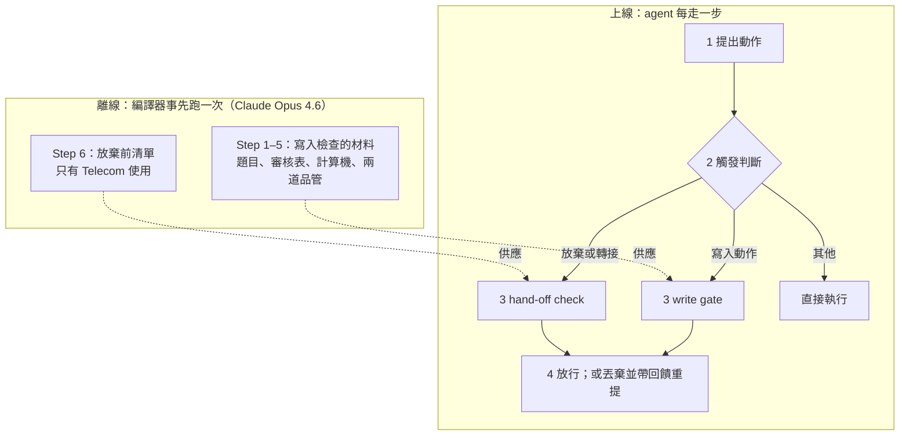
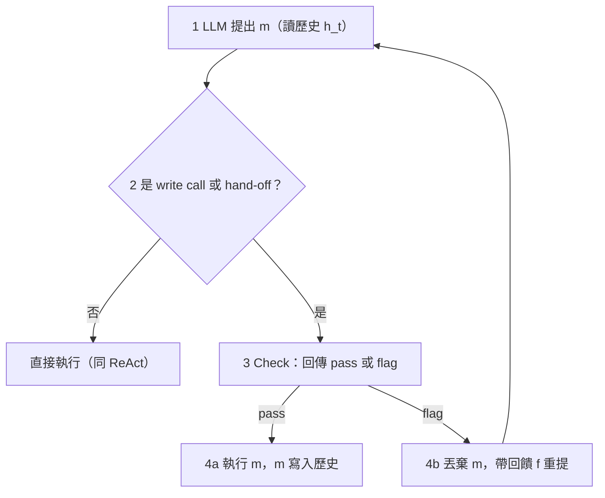
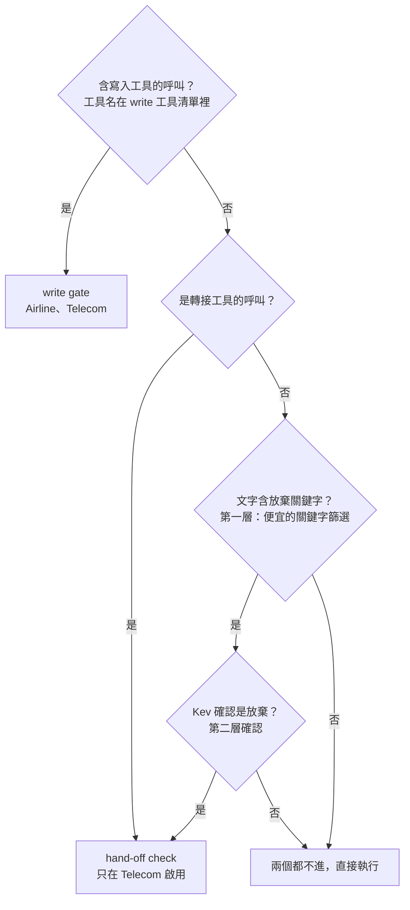
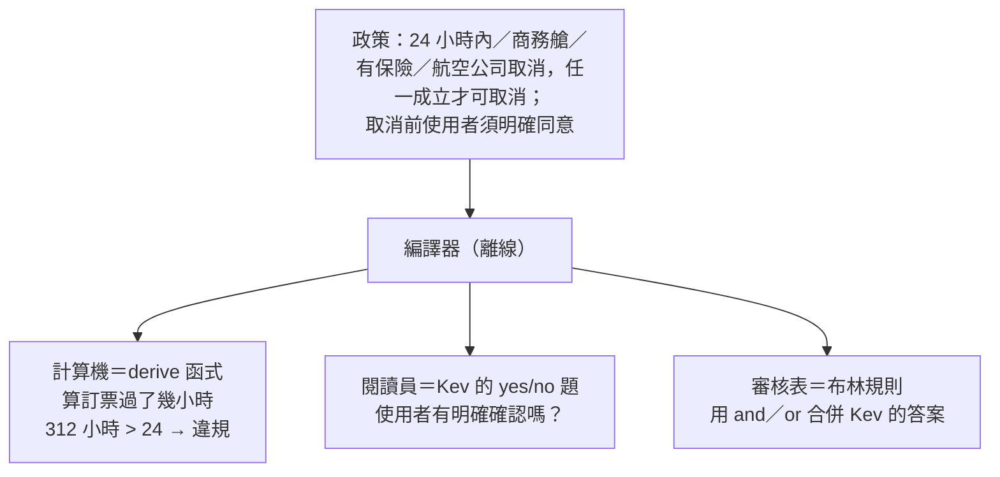
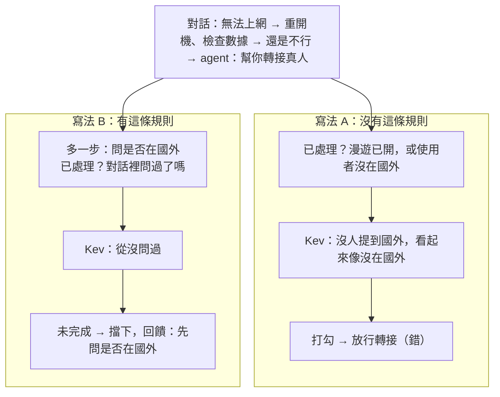
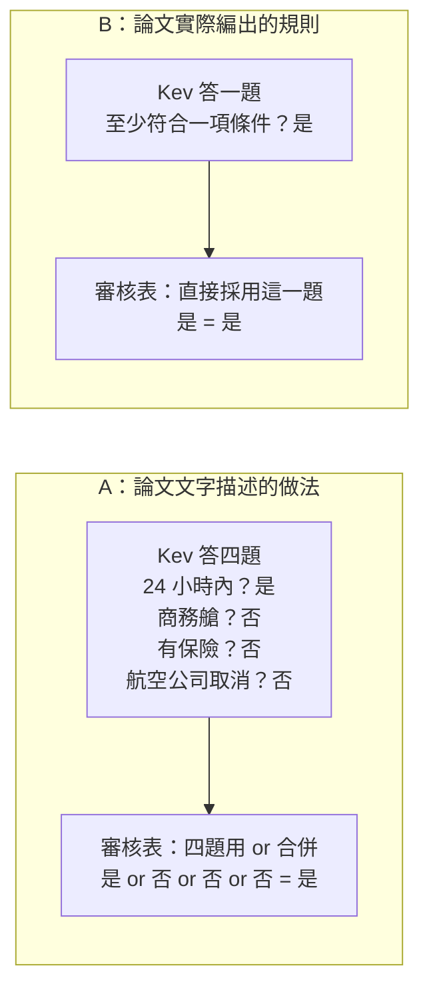
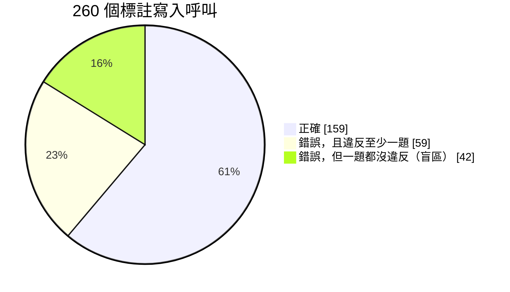

# JevAct 筆記：Think Before You Act — Decision Gate for LLM Agents

Nov 5, 2026 · @YHHW

## 論文資訊

- 標題：Think Before You Act: Decision Gate for LLM Agents
- 作者：Iftach Shoham、Yuval David 等，IBM SIL，2026 年 10 月
- 連結：[arXiv:2610.38620](https://arxiv.org/abs/2610.38620)

## 三十秒版本

JevAct 在 agent「提出動作」與「執行動作」之間加了一道閘門，只攔兩類難以挽回的動作：寫入型工具呼叫，以及放棄或轉接真人。

離線時，LLM 把政策編譯成四樣東西：給決策模型 Kev 回答的單一事實 yes/no 題、組合答案的布林規則、從工具紀錄計算事實的程式碼，以及一張「放棄前必做清單」。之後再用開發階段的紀錄做兩道品管，修正程式碼、淘汰答不好的題目。

上線時，程式碼負責算硬事實，Kev 只跑一次 prefill 就給出所有題目的機率。只有在有把握時才擋下，並附上一次性回饋，讓 agent 在有限次數內修正。

實驗中 Telecom 進步最大，Airline 好壞參半，BFCL 只是變得較穩定。消融顯示增益主要來自程式檢查，Kev 的額外貢獻依 agent 而定；從政策編出的題目最多只能抓到約 58% 的錯誤呼叫。

## 怎麼讀

全文只回答一個問題：怎樣在 agent 執行不可逆動作之前，用便宜的方式擋下違規。第一節到第九節依「問題 → 方法 → 細節」排列，第十節是實驗。第二節的地圖是全文骨架，迷路時回去看它。

標示規則：「論文未說明」表示原文沒有交代；「推論」是筆者的判斷，不是論文內容；「自編例子」的數字為示意用。

**【概念】索引**（可脫離主線單獨閱讀）

- 【概念 1】Jev、Kev、JevLoop、JevAct 四個名字的差別
- 【概念 2】審核表 A／B：論文的文字說明與它的範例對不上
- 【概念 3】政策檢查的盲區：101 個錯誤呼叫中有 42 個一題都沒違反

## 一、問題：為什麼要在執行前擋

多數 agent 迴圈在 LLM 提出動作後立刻執行，「生成動作」與「確認該不該做」之間沒有任何檢查。說錯一句話，下一輪還能更正；有兩類動作卻難以挽回：

- **write call（寫入型工具呼叫）**：改變資料庫狀態，例如訂票、取消、改設定。
- **hand-off（放棄或轉接）**：轉給真人，或告訴使用者「沒辦法了」，等於結束這次嘗試。Telecom 任務最常見的失敗就是太早放棄。

既有做法各缺一角：Self-Refine、Reflexion 這類反思方法改善的是「之後的提案」，不會在某個動作執行前逐條對照政策；生成式 LLM-as-judge 輸出自由文字，閘門還得再解讀一次，而且每步都叫前沿模型太貴。

由此可整理出三個挑戰（分類為筆者整理自引言與方法節，論文未列成編號）：

1. **C1**：檢查必須發生在執行前，並對照領域政策。
2. **C2**：裁判的輸出要能直接開關閘門，而且要便宜。決策模型只回傳固定選項的機率，設門檻即可使用。
3. **C3**：決策模型的機率不保證校準或正確，而且它不會算數，所以需要其他機制補位。

## 二、方法總覽：離線準備材料，上線逐步檢查

JevAct 分成兩層：離線時把政策編譯成檢查材料，上線時在 agent 每一步攔下危險動作、用這些材料檢查。agent 的 LLM、基礎 prompt 與工具都不改動。



虛線表示離線產出的材料由哪個檢查使用。各方塊的細節：決策迴圈與觸發見第三節，Step 1–5 見第四、五節，Step 6 見第六節，兩個 gate 的上線運作見第七、八節。

## 三、決策迴圈與觸發分流

每一步都走四個階段：提出、觸發、檢查、放行或重提。只有 write call 與 hand-off 會被檢查，其餘訊息照 ReAct 原樣直接執行。



```latex
m \sim \pi(\cdot \mid h_t), \qquad m' \sim \pi(\cdot \mid h_t,\ f)
```

π 是 agent 的 LLM，h\_t 是第 t 步之前的對話歷史，m 是提出的訊息（文字、工具呼叫或兩者），f 是檢查沒過時的回饋，m′ 是看過回饋後重提的訊息。白話：第一次只看歷史；被擋後在歷史後面臨時接上回饋再提一次。

圖上看不到的三個規則：

- 被擋的提案不執行，也不寫進歷史。
- 回饋只在那一次呼叫有效，不寫入 h\_t，過去的批評不會在 context 裡累積。
- 每種檢查有修正預算 R：write gate 為 2，hand-off check 為 1；預算用完後，下一個提案直接執行，不再檢查。

**觸發分流：決定進哪個 gate**

不是每次輸出都經過兩個 gate。訊息依類型分流，最多進其中一個；一般回覆與查詢類呼叫兩個都不進。



寫入與轉接看工具名稱就能判斷；用文字放棄沒有工具名稱，所以先用關鍵字篩，再請 Kev 確認。論文未說明：寫入工具清單如何認定（推論：沿用 benchmark 對工具的分類）、放棄關鍵字的實際清單、以及一則訊息同時含寫入與放棄時的處理順序。

## 四、編譯器：一句政策拆成三種工作

編譯器（Claude Opus 4.6，離線、每個領域跑一次）讀政策與工具 schema，為每個寫入工具產出三樣東西，各交給一種最擅長的執行者。比喻（一般知識）：退款審核由會計拿計算機算數字、審核員讀往來信件判斷意圖、最後照審核表打勾。



為什麼這樣拆：Kev 只會讀、不會算，日期與金額比較交給程式；程式讀不懂「使用者是否真的同意」，交給 Kev；「任一條件成立即可」這種組合邏輯，由規則表達。

**每個寫入工具實際配到的東西**

1. **題目清單**（每工具 12–20 題；Airline 6 個工具共 86 題，Telecom 共 75 題）→ 全部交給 Kev 回答。計算機不出題。
2. **審核表**：一條 Python 布林運算式，只合併 Kev 的答案。
3. **derive 函式**：讀這次呼叫的參數與先前所有工具結果，計算事實並自行列出違規，不經過審核表。

判決：審核表不成立，或計算機回報違規，任一發生即擋下。兩者可能重疊，例如「是否在 24 小時內」既是 Kev 的一題，計算機也會檢查；Kev 不必計算，因為輸入前系統已在每個日期旁標註「距今多久」。

**題目的四個面向**（例題為論文中 cancel\_reservation 的實際題目，中譯）

| 面向 | 問什麼 | 例題 |
| --- | --- | --- |
| 政策條件 | 動作符不符合政策 | 根據工具結果，這張訂位還沒有任何航段已經飛了嗎？ |
| 參數來源 | 參數來自紀錄，還是 agent 編的 | 這個訂位編號，工具結果確認屬於這位使用者嗎？ |
| 使用者意圖 | 使用者真的要做這件事嗎 | 使用者真的要求取消，而不只是詢問？ |
| 前置步驟 | 該確認的都確認了嗎 | agent 列出取消細節後，使用者是否明確說了「是」？ |

每題附 bad\_if 欄位，標記「答什麼代表違規」（上面四題都是答「否」才違規）。題目中的參數寫成佔位符，例如 {reservation\_id}；執行時先填入這次呼叫的實際值，再交給 Kev。

**計算機的保守原則**：只在紀錄「確定」違規時回報。缺紀錄、或規則牽涉使用者說了什麼，一律不報，留給 Kev；程式拋出例外也當作沒有違規。只能用標準函式庫，以白名單執行。推論：計算機回報會直接擋下動作，誤報的代價高，所以寧可漏報。

審核表的實際寫法與論文文字說明不一致，見【概念 2】。

## 五、兩道品管：修正計算機、淘汰爛題目

編譯器一次產出的材料難免有錯，所以再用開發階段的 agent 紀錄做兩道品管。兩道都**不需要正確答案的標註**。

**品管一：修正計算機（Step 4）**

修程式碼的仍是寫程式碼的同一個模型（Claude Opus 4.6），只是另發一次 prompt：自己寫、自己修。

1. 用訓練集紀錄裡的寫入呼叫跑一遍計算機，挑出它回報違規的案例：最多 16 筆，每個工具每種違規各一筆。
2. 交給模型的輸入：政策原文、整份計算機程式碼，以及每筆案例的呼叫內容、回報的違規、這次呼叫之前最近 8 筆工具呼叫與結果（每筆截斷到 700 字元）。
3. 模型逐筆對照政策與紀錄，判斷違規是否屬實：屬實就保留那段檢查，不屬實就找出 bug 修掉，最後交回修好的完整程式碼。只修一輪，不提供正確答案。

論文舉的 bug：把「Error: User not found」這段錯誤訊息當成使用者資料讀；用了已被後續查詢取代的舊訂位。效果：在 Airline 保留的測試任務上，計算機對「原本正確的寫入呼叫」的誤報率從 11.3% 降到 1.4%。

**品管二：淘汰爛題目（Step 5）**

Kev-27B 對開發紀錄裡每一次寫入呼叫回答所有題目。某題「有把握地判定違規」的次數，若超過該工具呼叫次數的 10%，整題刪除。被刪的題目上線後不再回報，在審核表裡一律當作「是」。

假設：真正的違規很少見，所以太常判違規的題目，多半是 Kev 從對話讀不出這件事，或政策根本沒要求。比喻（一般知識）：十次有一次以上在響的煙霧偵測器，比較可能是壞了。

結果：Airline 86 題刪 17 題；Telecom 75 題刪 5 題（依據 175 筆開發寫入呼叫）。判違規門檻 P(是) ≤ 0.05 與淘汰線 10% 只在 Airline 設定一次，直接沿用到 Telecom。

## 六、放棄前清單：結構、產生方式、過濾

放棄前清單是離線 Step 6 的產物，上線時只供 hand-off check 使用，只在 Telecom 啟用。比喻（一般知識）：客服主管規定，結案為「無法解決」之前，重開機、檢查設定等步驟都要確認試過。

**怎麼產生**：全程只呼叫 Claude Opus 4.6，不需要標註。

1. **6a 抽出前置關係**（只有 Telecom）：找出「排查問題 B 前要先修好問題 A」這類規定，讓 A 的步驟也標記為 B 的必做步驟。
2. **6b 生成清單**：讀政策、前置關係與 agent 工具名稱，輸出固定格式的 JSON。

```json
{
  "problems": { "no_data": "手機無法上網", "no_sms": "無法傳簡訊" },
  "steps": [
    {
      "id": "ask_traveling",
      "step": "詢問使用者目前是否在國外",
      "problems": ["no_data"],
      "settled": "對話中是否已確認使用者在不在國外？",
      "agent_tools": []
    }
  ]
}
```

內容為自編例子，欄位是論文規定的；Telecom 實際有 8 種問題類型。problems 欄位判斷這一步與使用者問題是否相關；settled 是交給 Kev 回答的「已處理？」題（試過、確認沒問題、或確定不適用，任一即算已處理）。agent\_tools 上線時如何使用，論文未說明。

6b 的 prompt 有四條主要規定：照政策順序列出所有步驟；身分驗證與單純資訊請求不列；後續步驟依賴的事實，要把「問使用者」列成獨立一步；settled 題遵守「沒談過不算已排除」。

**最關鍵的規則：沒談過，不算已排除**

比喻（一般知識）：開盤尼西林前的確認單若寫「病人不過敏，或病人沒提過自己過敏？」，醫生只要沒問，這格就自動打勾。正確寫法是「醫生問過病人有沒有過敏嗎？」。

政策寫「若使用者在國外，開啟漫遊」。這是有前提的步驟，最直覺的檢查題是「做了，或前提不成立」，前提卻從未被確認。下面是同一段對話（自編：使用者其實在國外，對話從未提及）套上兩種寫法：



規則的寫法：「或前提不成立」這種逃生口，只能寫成「對話已確認前提不成立」。論文原文只說寫法 A「看起來已處理，但其實沒人問過」，圖中 Kev 的判讀是依此補上的示意。

**過濾：拿成功場次測出會亂擋的步驟**

最後一場仍成功解決的對話，其中的轉接視為正確；正確的轉接本該通過清單，所以清單在這種轉接上判「未完成」，就算一次亂擋。亂擋超過 5% 的步驟整步刪除。

| 成功場次的轉接（自編，8 次） | 重開機 | 開漫遊 | 飛航模式 | 檢查欠費 |
| --- | --- | --- | --- | --- |
| #1 | 已處理 | 已處理 | 已處理 | 已處理 |
| #2 | 已處理 | 已處理 | **未完成** | 已處理 |
| #3 | 已處理 | 已處理 | 已處理 | **未完成** |
| #4 | 已處理 | 已處理 | **未完成** | 已處理 |
| #5 | 已處理 | 已處理 | **未完成** | 已處理 |
| #6–#8 | 已處理 | 已處理 | #7 未完成 | 已處理 |
| 亂擋比例 | 0/8 | 0/8 | 4/8 | 1/8 |
| 結果 | 保留 | 保留 | 刪除 | 刪除 |

論文的實際數字：用 GPT-4.1 與 Opus 4.6 在 74 個訓練任務上跑 6 次開發實驗，每場只取第一次轉接，共 217 次；其中 36 次發生在成功場次，是計算比例的分母。36 × 5% = 1.8，所以亂擋 2 次以上就刪。共刪 7 步：飛航模式、APN 設定、SIM 狀態、門號停用、欠費、合約到期日、繳費後恢復門號。

與品管二不同，這道過濾**需要結果標註**（要知道哪場成功）。

## 七、Kev 的門檻

Kev 對每題給出「是」的機率，但只有在它非常確定答案是「否」時，write gate 才把這題算作「否」並擋下；其他情況一律當作「是」。

Kev 讀的輸入：政策、整段對話、所有工具結果、這次要執行的呼叫。輸入前先做兩項預處理：在日期旁標註「距今多久」，把清單類結果預先排序（例如價格由低到高）。同一工具的所有題目共用一次 forward pass，題目變多成本也不增加。本文使用的 Kev-27B 由 Qwen3.8-27B 微調而來，未再訓練。

```latex
\text{答案} = \begin{cases} \text{否（擋下）} & P(\text{是}) \le 0.05 \\ \text{是（放行）} & \text{其他} \end{cases}
```

P(是) 是 Kev 給這題答「是」的機率；0.05 是門檻，只在 Kev-27B 上設定過。白話：Kev 要有 95% 以上把握認為「不是」，才算「否」。

&#91;embedded content: write gate 的門檻 · 三個自編例子\]

自編例子，題目為「使用者有沒有明確確認要取消？」。0.97 很確定有確認，放行；0.03 很確定沒確認，擋下；0.20 表示 Kev 有 80% 機率認為沒確認，仍然放行，若用 0.5 門檻則會擋下。

論文只說機率讓檢查「只在有把握時出手」，沒解釋門檻為何設得這麼偏。推論：擋錯正確動作的代價被視為較高，代價是 0.20 這類「大概沒確認」的情況會被放過。門檻要有意義，前提是 Kev 的機率校準良好；換成較小的 Kev 時同一門檻是否失準，見第十節。

## 八、兩個 gate 的完整運作

### write gate

三步依序執行：計算機算事實並列出確定的違規 → Kev 回答該工具的題目（套用 0.05 門檻）→ 審核表判決。計算機回報違規，或審核表不成立，任一發生就擋下。

回饋格式：先列出已確定的違規與沒過的題目，再給 agent 三條路——修正呼叫、向使用者補問、說明為何無法辦理；agent 若認為原呼叫正確，可原封不動再送一次。第二次被擋時，回饋改為要求 agent「回覆使用者，不要再呼叫這個工具」。

自編走查（使用者開口就要取消，agent 未先確認就呼叫）：

1. 使用者：幫我取消訂位 ABC（2 小時前剛訂）。
2. agent 提出 cancel\_reservation(ABC)，屬寫入動作，進 write gate。
3. 計算機：訂票 2 小時，符合取消資格，無違規。
4. Kev：「使用者有沒有明確確認？」P(是) = 0.02，算「否」；其他題都高於 0.05。
5. 判決：審核表要求「已確認」，不成立，擋下並附回饋。
6. agent 重提：不呼叫工具，改問「要取消 ABC、全額退款，確定嗎？」；這是一般訊息，直接送出。
7. 使用者回「確定」；agent 再提 cancel\_reservation(ABC)，Kev 給 P(是) = 0.96，三步全過，執行取消。

### hand-off check

觸發於轉接工具呼叫，或經關鍵字篩選與 Kev 確認的文字放棄（第三節）。Kev 在一次請求中回答三件事：使用者是哪種問題（含「其他」）、使用者是否說問題已解決、清單上每一步是否已處理。若問題未解決且有任一相關步驟未完成，就擋下，回饋列出未完成的步驟。

步驟 k 判為「未完成」的條件：

```latex
\sum_{p \,\in\, \text{需要 } k \text{ 的問題}} P(p) \ \ge\ 0.5 \quad \text{且} \quad P(\text{步驟 } k \text{ 已處理}) \ \le\ 0.5
```

P(p) 是 Kev 判斷使用者遇到問題 p 的機率；左式把所有需要步驟 k 的問題機率加總，代表這一步與使用者問題的相關程度；右式是這一步已處理的機率。白話：這一步跟使用者的問題有關，而且大概還沒做。

自編例子：Kev 給出問題機率「無法上網」0.7、「無法傳簡訊」0.2、「其他」0.1；P(已解決) = 0.05，判定未解決。

| 步驟 | 需要它的問題 | 相關度（加總） | P(已處理) | 結果 |
| --- | --- | --- | --- | --- |
| 重開機 | 上網、簡訊 | 0.7 + 0.2 = 0.9 | 0.95 | 已處理 |
| 詢問是否在國外 | 上網 | 0.7 | 0.10 | **未完成** |
| 檢查簡訊設定 | 簡訊 | 0.2（低於 0.5） | 0.10 | 不相關，跳過 |

判決：問題未解決，且有一步未完成，擋下，回饋「還沒詢問使用者是否在國外」。

- 兩個門檻都是 0.5，與 write gate 的 0.05 不同；判斷「已解決」所用的門檻，論文未說明。
- 修正預算 R = 1：修正一次後，下一次放棄直接執行。
- 只在 Telecom 啟用：在 Airline 的離線測試中，原本成功的場次有 26% 的轉接被它擋下，誤擋太多而關閉。

## 九、BFCL：沒有政策時的通用檢查

BFCL（Berkeley Function Calling Leaderboard）測模型呼叫工具的能力，本文用其多輪版本：沒有政策文件，使用者每輪說什麼是事先寫死的。因此不跑編譯器，改用兩個固定問題的通用檢查，分別是 write gate 與 hand-off check 的簡化版。

|  | 未要求動作閘門 | 結束回合檢查 |
| --- | --- | --- |
| 對應 | write gate 的簡化版 | hand-off check 的簡化版 |
| 觸發 | 每次改變狀態的呼叫之前 | agent 結束回合時，仍有含「needs to」或「must」的工具錯誤未處理 |
| Kev 回答 | 這個動作是使用者要求的，或工具錯誤要求的嗎？（是／否） | 工具清單中哪一個能滿足錯誤裡的要求？（多選一：該任務的各工具名稱，加上「都不能」） |
| 門檻 | P(是) ≤ 0.05 才擋 | 某工具 P ≥ 0.6 就擋 |
| 回饋 | 只做使用者要求或必要的事 | 請呼叫該工具，不要去問使用者 |

自編例子：使用者只說「讀一下這個檔案」，agent 卻順手刪掉暫存檔，Kev 給 P(是) = 0.02，擋下。agent 想發文，工具回傳「必須先登入」，agent 卻直接結束回合去問使用者，Kev 從工具清單選出 login（P = 0.8），擋下並要求呼叫 login。

結束回合檢查的選項是每個任務自己的工具清單，可見固定選項模型的選項可以在執行時動態填入，只要問的當下確定即可。

論文未說明：兩題的原文、由誰撰寫、修正預算 R。推論：既然是「固定問題、不經編譯」，最可能是作者手寫好模板，執行時只把當下的對話、工具清單與錯誤訊息套進去。

## 十、實驗

增益主要來自程式檢查；Kev 的額外貢獻依 agent 而定，Telecom 的大幅進步要打折看。

指標（每個任務跑 3 次）：pass@3 = 3 次中至少成功 1 次的任務比例，量「做不做得到」；pass^3 = 3 次全成功的任務比例，量「穩不穩定」；pass^1 = 單次執行的平均成功率。所有比較都是同一個 agent LLM 跑 ReAct 與 JevAct。

**主結果**（Table 2：「Main results (%)」）

- **Telecom（114 題）**：8 個 agent 兩項指標全部進步，平均 pass@3 +16.0、pass^3 +16.9 個百分點。打折因素：換用 gpt-oss-120b 當使用者模擬器，pass^3 變化為 −1.8（95% 信賴區間 −7.9 到 +4.4），增益消失（論文未說明該組用哪個 agent）；附錄 A.1 末段另說清單在一次結果檢討後修改過，未說明檢討了哪些任務，推論：若含測試集，Telecom 數字偏高。
- **Airline（50 題）**：pass^3 有 4 個 agent 進步、2 個退步；1 題就差 2 個百分點，看不出差異。
- **BFCL（800 題）**：pass^3 九個 agent 全部進步（+0.1 到 +9.6），pass@3 有 5 個退步——變穩，但沒有多解出新題。

**功勞拆解**（Table 3：「Single-trial write-gate ablation on Airline with GPT-4.1 as the agent」）

| 設定 | pass^1 |
| --- | --- |
| ReAct（無 gate） | 50.0 |
| 只用計算機 | 68.0 |
| 只用 Kev 題目 | 57.1 |
| 完整 JevAct | 72.0 |
| 安慰劑：每個寫入都擋一次，不看對錯 | 50.0 |

22 個百分點的增益中，計算機單獨就貢獻 18 點；Kev 在計算機之上再多 4 點，相當於 50 題中的 2 題，落在雜訊範圍。正文另一組跑 3 次的補充實驗（gpt-oss-120b 當使用者模擬器）顯示，Kev 是否有用取決於 agent：GPT-4.1 的安慰劑幾乎無效（pass^3 26 → 28），完整 gate 升到 40；gpt-oss-120b 用安慰劑、或以 gate 相同比例隨機擋，增益與完整 gate 相同（32 → 42），功勞全來自「多一次重來的機會」。

題目本身的天花板：101 個錯誤呼叫中有 42 個一題都沒違反，見【概念 3】。

**快速總結**

| 實驗 | 結果 | 保留 |
| --- | --- | --- |
| judge 選擇（Table 4） | Kev-27B 準確度與生成式 judge 相當；每題成本 $0.0003–0.0017，API judge 為 $0.0127–0.0231 | 約便宜 10 倍，不含 agent 本身成本 |
| judge 大小（Table 5、Table 7） | 模型越大不一定越好，Telecom 上小 Kev 常更好；9B 與 27B 決策一致率 97.0% | 線上分數差異無法用判斷品質解釋 |
| 長輸入（A.3、Table 8） | Airline 41% 的輸入超過 8,192 tokens；長輸入上 9B 的 AUROC 0.61，27B 為 0.85 | 小模型主要輸在 context 長度；短輸入重調門檻可補回一部分 |

**研究面的保留**：論文的核心問題是「決策模型能不能當驗證器」，但數據沒有好好回答。元件消融顯示大部分增益來自純程式的計算機；Kev 的判斷是否有用因 agent 而異，對 gpt-oss-120b 隨便擋一次就有同樣增益；模型大小的結果互相矛盾，論文也未解釋；最亮眼的 Telecom 數字有兩個打折因素；消融只在 50 題上跑一次。

BFCL 細節數字、token 用量（Table 9）、Table 4 與 Table 5 的逐格數字詳見原論文。

## 【概念 1】Jev、Kev、JevLoop、JevAct

四個名字只有 JevAct 是本文的貢獻；Kev 是實際拿來當裁判的外部開源模型，Jev 與 JevLoop 只被引用。

| 名字 | 是什麼 | 誰做的 | 在本文的角色 |
| --- | --- | --- | --- |
| Jev | 原版決策模型（System One Model） | TypeSafe AI | 只被引用 |
| Kev | 開源的「Jev 類」決策模型 | Jared Palmer（GitHub: jaredpalmer/kev），非本文作者 | 實際擔任裁判 |
| JevLoop | 讓決策模型「選動作」的 agent runtime | ZJUNLP | 只用來對比定位，未做實驗比較 |
| JevAct | 在執行前審核動作的閘門 | 本文作者（IBM SIL） | 主角 |

**定位差異**：JevLoop 把「選哪個動作」交給決策模型；JevAct 的動作仍由 agent 的 LLM 提出，Kev 只負責審核，也因此 agent 不會審自己的提案。

**Kev 的事實**：介面與 Jev 相同——給一段 prompt 加幾個固定選項的問題，一次 forward pass 回傳每個選項的機率，不生成文字；同一段 prompt 的多個問題共用這一次 pass。有 0.8B、9B、27B 三種尺寸，本文主要用 Kev-27B（由 Qwen3.8-27B 微調）。驗證過的 context 長度：0.8B 與 9B 為 8,192 tokens，27B 為 65,536 tokens。

論文未說明 Kev 如何訓練，也未說明與 Jev 的訓練方法是否相同。推論：論文選 Kev 的理由只寫「開源」，Jev 本身可能無法自架或自由使用，但原文沒有明說。

## 【概念 2】審核表 A／B：文字說明與範例對不上

論文文字說「任一條件成立即可」這類多選一邏輯在審核表用 or 組合；但它附上的 cancel\_reservation 實際規則沒有 or，而是交給 Kev 一題總結題回答。

取消政策：24 小時內、航空公司取消、商務艙、有保險，四者任一成立即可取消。用同一張票比較兩種寫法（自編：3 小時前訂的經濟艙、沒保險、航空公司沒取消）：



兩邊結論相同，差別在「四選一」由誰判斷：A 由審核表用 or 組合；B 由 Kev 一次看完四個條件再回答，審核表裡完全沒有 or。實際規則保留了總結題，拿掉了四個單一條件題：

```python
user_id_obtained and reservation_id_correct and reservation_retrieved and no_flown_segments and cancellation_reason_obtained and at_least_one_cancel_condition_met and user_requested_cancellation and user_confirmed_cancellation
```

論文未說明範例為何選 B；可確定的只有：編規則的 prompt 允許拿掉「判斷時用不到」的題目。推論：「24 小時內」需要算時間，本是 Kev 的弱項，但計算機也會獨立檢查取消資格，所以 Kev 判斷錯了仍有計算機兜底。

## 【概念 3】政策檢查的盲區：42／101

從政策編出的題目最多只能抓到約 58% 的錯誤呼叫：101 個錯誤中有 42 個一題都沒違反。問題不在 Kev 答錯，而是根本沒有題目在問那件事。

資料：Airline 開發階段 260 個人工標註的寫入呼叫，159 個正確、101 個錯誤（附錄 A.4，Table 8：「Offline comparison on the same 260 labeled Airline write calls」；42 這個數字出自結論節）。



論文的解釋：題目編碼的是政策，不是使用者的要求。題目離線時從政策編出、每個任務共用一套；使用者當下的具體要求（最便宜、最早、靠窗）各不相同，離線時無從預知，也就沒有題目檢查它。

自編例子：使用者說「回程改成 5/20 最便宜的那班」，agent 挑了第二便宜的班次，使用者回「好」，接著呼叫 update\_reservation\_flights。會員等級允許改票、艙等不變、付款有效、訂位編號正確，政策相關題目全數通過，呼叫卻是錯的；政策裡沒有「必須選最便宜」，所以不會有這一題。

天花板：即使 Kev 每題都答對，這套題目最多抓到 59/101 ≈ 58% 的錯誤呼叫。論文未說明計算機能否抓到這 42 個；推論：計算機同樣只檢查政策相關事實，應該也抓不到。
