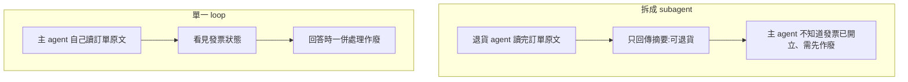
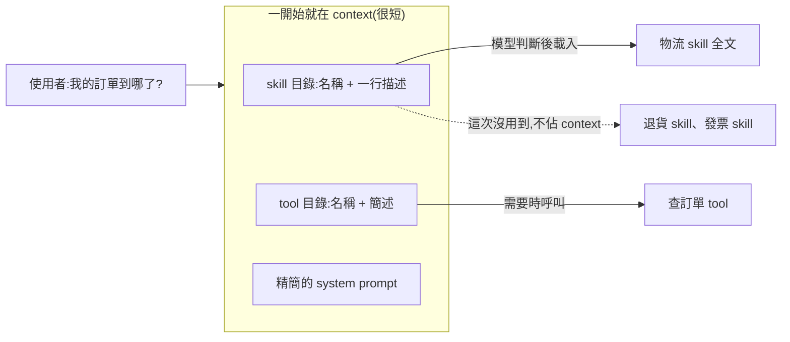
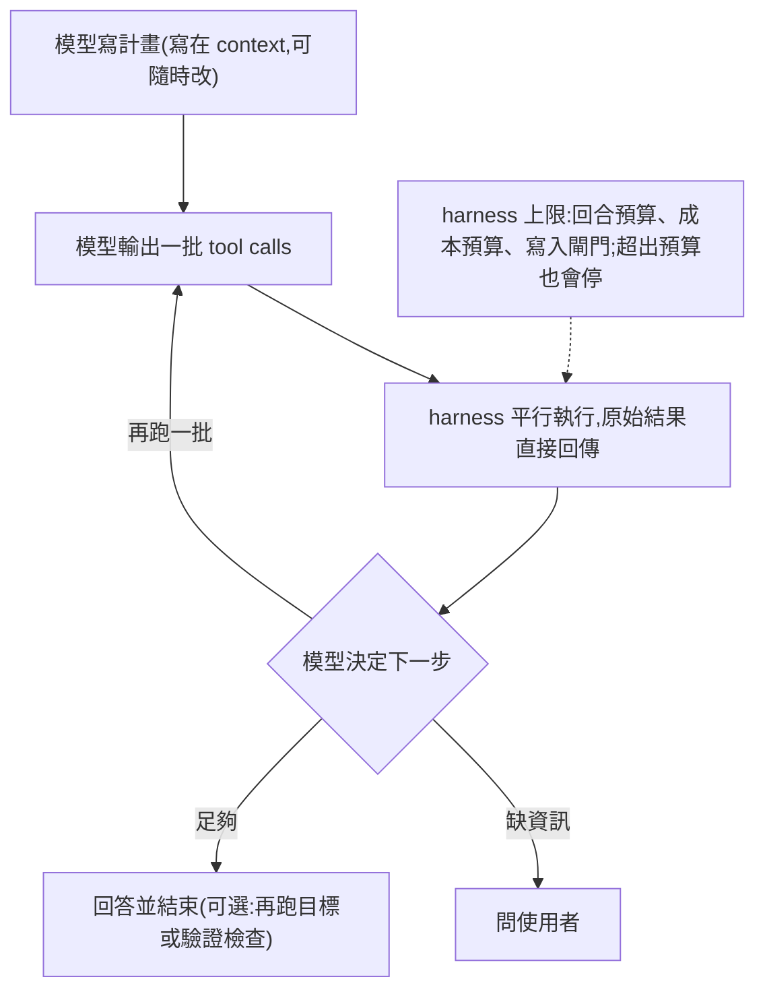
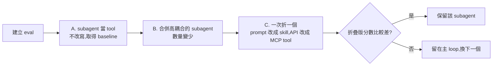
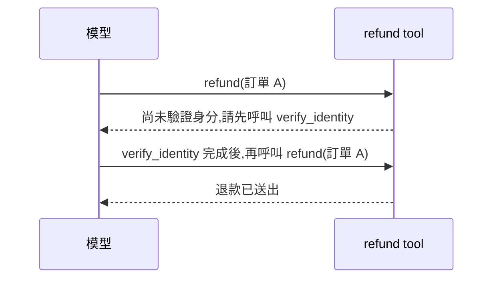
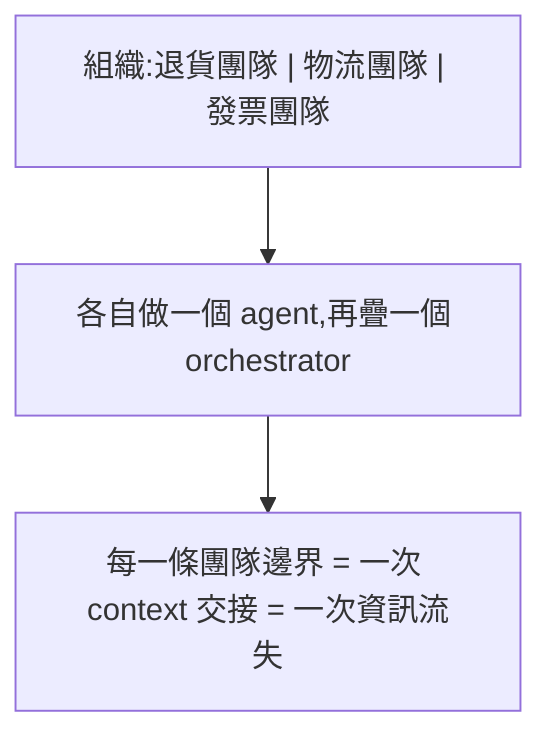
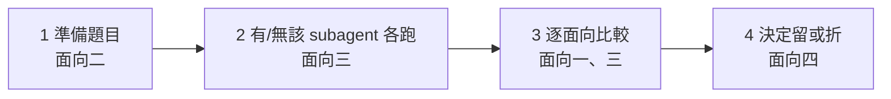

# 把 Subagent 折回主 Agent Loop:單一 Loop、漸進式揭露與分階段遷移

Nov 1, 2026 · @YHHW

來源:Anthropic,〈Building agents: When to fold subagents into your main agent loop〉,Diane Sarkis,2026-10-22。https://claude.com/resources/articles/building-agents-when-to-fold-subagents-into-your-main-agent-loop

## 三十秒版本

由多個 subagent 組成的企業 agent,很多時候可以折回單一 agent loop:一個模型、一個 context window,領域知識寫成 skills,能力做成 tools,兩者都是平常只放目錄、需要時才載入。

這麼做的理由是,每一條 subagent 邊界都是一次有損的 context 交接,而這些邊界常常只是組織圖的投影(Conway's law),並不是技術上的需要。

遷移要分階段進行:先建立 eval,接著把 subagent 當 tool 呼叫來取得 baseline,再合併高度耦合的 subagent,最後一次折一個成 skill 加 tool,只有折疊版分數比較差時才保留 subagent。比較時要逐題看哪些任務翻轉,而且每題要多跑幾次。

仍應保留 subagent 的情況有三種:context 膨脹造成可量測的退化、需要平行且各自乾淨的 context,或者 agent 選不對工具、指令互相衝突。

## 怎麼讀與索引

**主軸**:多 subagent 架構的根本問題是有損的 context 交接;解法是單一 loop 加上按需載入,再用 eval 把關、分階段遷移。主線每一節回答一個問題:

1. 問題:多 subagent 架構為什麼會出問題?
2. 目標架構:單一 loop 長什麼樣、為什麼撐得住?
3. 怎麼折疊:怎麼從現有的多 agent 系統安全地遷移過去?
4. 多團隊怎麼貢獻:沒有各自的 agent 之後,各團隊要負責什麼?
5. 值得帶走:Conway's law。

**概念詳解**

- 【概念 1】折疊 subagent 時要 eval 的面向

**標示**:「推論」是作者以外的推斷,「自編例子」是為說明而設計的情境,「文章未說明」表示原文沒有交代;其餘皆為文章內容。

## 一、問題:多 subagent 架構為什麼會出問題

大型組織常讓每個團隊各做一個 subagent,再由平台團隊疊一個 orchestrator。這看起來最省事,實際上會把複雜度一路往上堆。

| 失敗模式 | 發生了什麼 |
| --- | --- |
| Context 管理 | 要決定 agent 之間交換哪些資訊,來回傳遞時細節會掉 |
| Subagent 氾濫 | 每個團隊各出一個,最後有大量功能重疊、沒標準、沒負責人的 subagent |
| Frankenprompt | 每個團隊往 system prompt 加一句,規則互相衝突,語氣不一致 |
| Eval 過度局部 | 各團隊只為自己的子任務調分數,沒人維護整體,決策依據是被稀釋的分數 |
| 延遲 | 多層架構本身就增加時間;一個客戶把多 agent harness 換成單一 loop,執行時間約快 2 倍(單一案例,比較條件文章未說明) |

五項中最根本的是第一項:每次交接都是一次有損摘要。以下用自編例子說明。使用者問「這筆訂單能不能退,發票怎麼處理」:

圖 1:差別在於摘要由別人寫,主 agent 拿不到被省略的細節。(自編例子)

這些交接邊界從哪裡來,見第五節 Conway's law。

## 二、目標架構:單一 loop 與漸進式揭露

目標是一個模型、一個 context window,在 loop 裡反覆「呼叫工具、看結果、決定下一步」;知識和工具平常只放目錄,需要時才載入。

### 2.1 漸進式揭露

Agent 一開始只看到每個 skill 和 tool 的名稱加一行描述,真正需要時才把全文或完整定義載入。以下為自編的客服例子:

圖 2:只有被用到的 skill 和 tool 進入 context。(自編例子)

- **Skill**:給 agent 看的做事說明,包含步驟、規則與判斷方式;原本寫在 subagent prompt 裡的專業知識搬到這裡。
- **Tool search**:同一個概念套用在工具上,工具定義延遲到需要時才搜尋並載入。

拆 subagent 的主要理由,原本是「所有專業知識塞進一個 prompt 會太長」。知識改為按需載入後,這個理由就不成立了。

### 2.2 為什麼比拆 subagent 好

| 理由 | 內容 | 文章給的證據 |
| --- | --- | --- |
| 共享 context | 前面每一步的原始結果都在同一個視窗,agent 能把它們串起來(圖 1) | 多個企業部署的比較中,單一 agent 加 skills 在品質上「經常」勝過單一大 prompt 與 subagent 設計,成本與延遲「常常」較低;沒有數字、任務或模型資訊 |
| 防止 context 膨脹 | 知識放在按需載入的 skill,不必一次塞進 prompt | Claude Code 對較強模型的 system prompt 縮減超過 80%;縮減「包含」漸進式揭露,不全是它的功勞 |
| 模型更強 | 一個 loop 能管的事變多,不需要 harness 替它拆步驟 | 見下 |

關於第三點:文章說從 Opus 4.5 起,模型能在單一 loop 中處理的事比多數團隊預期得多;近期模型會邊做邊交代進度、檢查自己的結果,讓部分 harness 設計變成多餘。每出一代新模型,就能把更多決策從 harness 移到模型;過於死板的多 agent 結構,常是新模型無法發揮的原因。

文章沒有跨模型比較,也沒有給「模型要多強才能折疊」的門檻,而是用症狀和 eval 取代門檻:折疊後分數較差才保留 subagent,並搭配三個保留條件判斷(見三十秒版本)。推論:較弱的模型會更早出現這些症狀,流程依然適用,只是能折進去的 subagent 較少。

### 2.3 Loop 怎麼運作

圖 3:決策都由模型做,harness 只負責執行與設上限。

和 orchestrator 架構最大的差別:寫計畫的模型就是執行計畫的模型。原本 planner 寫好計畫交給 specialist 執行,中途發現不對很難改;現在模型每看到新結果就能當場修改計畫。

寫入閘門(write gate)文章未定義;推論是修改資料前的檢查或核准。

### 2.4 原本的元件搬去哪

| 原本的元件 | 搬去哪 | 理由 |
| --- | --- | --- |
| router、意圖分類器 | 模型讀目錄自己挑 skill 和 tool | 選擇本身就是模型擅長的判斷(推論;文章只說 router 被折進主 loop) |
| 依規則改寫計畫的程式碼 | 不需要 | 模型每一步自己決定 |
| 步驟順序、領域流程 | skills | 這是「團隊怎麼做事」的知識 |
| 硬限制(驗證、核准閘門) | tools 內部 | 必須百分之百遵守,不能靠模型記得 |
| 對話中途才需要的事(如查記憶) | tools | 需要時才呼叫 |
| 便宜、幾乎每次都用到的東西(如 entity resolution) | 程式碼預先載入 | 不值得讓模型每次決定 |
| 機械式處理(組 API 請求、解析串流、問完使用者後接回流程) | 程式碼,包在 tool 裡 | 固定步驟 |

Entity resolution 是把使用者口中的「上週那張單」對應到系統裡具體的訂單 ID(一般知識)。「問完使用者後接回流程」原文為 resuming a clarification,文章未解釋,此為推論的理解。

硬限制放進 tool 的意思:規則寫在 prompt 只是請模型遵守,寫在 tool 的程式碼裡則是在條件不符時直接擋下,並回傳模型看得懂的訊息(做法見 4.2)。

判斷規則:需要判斷的交給模型或 skill,絕對不能違反的寫進 tool 程式碼,固定機械式的步驟留給一般程式碼。

## 三、怎麼折疊:eval 與分階段遷移

遷移的原則是一次改一件事,每一步都用 eval 確認沒有退步;「要不要折」由分數決定,不由直覺決定。

### 3.1 先建 eval

Eval 分兩層:中央團隊維護一套端到端 eval,各團隊出貨 skill 時附上只測該 skill 的小 eval。起步用 10 個 golden examples(人工確認過正確答案的範例)就夠。要量哪些指標、題目要涵蓋什麼、怎麼比較,見【概念 1】。

### 3.2 三種遷移做法,依序進行

圖 4:每一步都有 eval 把關,最後只留下折疊後會退步的 subagent。

文章說可以「合併、當 tool 呼叫,或用 skills 和 tools 取代」,沒有明說三者是選項還是階段。此處採分階段的讀法,依據是文章稱 A 為好的第一步,且該節講的是分階段遷移(推論)。

- **A. subagent 當 tool**:主 agent 把 subagent 當工具呼叫,自己持續握著和使用者的對話。不必改寫 subagent,還能先拿到 baseline,並統一 subagent 的回應格式、讓主 agent 用真實資料核對結論。只有 subagent 必須親自和使用者對話時,才讓它直接接手對話(full handoff)。剩下的問題:每個 specialist 仍有自己的 prompt、owner 與 eval;回傳仍是有損摘要;每次呼叫都是一層巢狀 loop,增加延遲。
- **B. 合併 domain agents**:從使用量最大的開始,合併會串接彼此輸出、碰同一份資料、常被一起呼叫的 specialist。判斷方式是看生產流量:若很大一部分流量是「specialist 1 做完接著叫 specialist 2」,這兩個就是緊密耦合的一對。
- **C. 折成 skills 加 tools**:一次一個,有和沒有該 subagent 各跑一次 eval,再決定去留。

### 3.3 比較時看哪些任務翻轉

折疊後不能只看總分,要逐題比對哪些任務從通過變失敗、哪些從失敗變通過。自編例子,eval 共 20 題:

|  | 折疊前 | 折疊後 |
| --- | --- | --- |
| 通過題數(分母 20) | 15 | 15 |
| 第 3、7 題 | 通過 | 失敗 |
| 第 11、18 題 | 失敗 | 通過 |

總分相同,但若第 3、7 題是絕對不能錯的流程,總分就把退步藏起來了。

文章的實例:一個示範用的客服 agent,把一個 subagent 折進另一個之後延遲下降,但一個原本通過的流程壞掉。主 agent 手上已有查訂單的 tool,就自己回答,沒有去問物流 specialist 實際的送達日期。這個失誤在兩次執行中只出現一次。教訓:模型手上的資訊「看起來夠用」時,會跳過原本設計好的步驟。

## 四、多團隊怎麼貢獻同一個 agent

各團隊不再擁有一個 agent,而是貢獻 skills、tools 或知識庫;一個小型中央團隊擁有 system prompt 與端到端品質,每個新的 skill、tool、eval 出貨前都經它審核。中央團隊保持小,迭代才快、協調成本才低。

### 4.1 三種載體怎麼選

| 載體 | 適合放什麼 | 自編例子 |
| --- | --- | --- |
| MCP tool | 要執行動作、讀即時資料,或要回傳固定格式的結果 | 查訂單狀態、送出退款 |
| Skill | 團隊「怎麼做事」:步驟、規則、判斷方式 | 退貨流程與例外判斷 |
| 知識庫 | 偶爾才需要的參考資料:政策、指標定義、產品規格 | 退貨政策全文 |

知識庫有兩種放法:放在搜尋或查詢 tool 後面讓模型自己呼叫,或當成參考檔案放進 skill。文章要求避免「由程式碼先檢索、再直接貼進 prompt」;理由文章未在此說明,推論是讀不讀、讀哪段應交給模型按需決定。

判斷規則:要做事或拿資料用 tool,要知道怎麼做用 skill,偶爾查一下的放知識庫。

### 4.2 Tool 的設計

**依使用者意圖分組,不要一支 API 一個 tool。** System prompt 裡的 tool 定義超過 30 到 50 個,工具選擇的準確度通常會下降(文章未說明是哪個模型、哪類任務的觀察)。不常用的 tool 再用 tool search 延遲載入。

| 做法 | tool 長什麼樣(自編例子) | 模型要做的選擇 |
| --- | --- | --- |
| 一支 API 一個 | get\_order、get\_shipment、get\_carrier\_status | 自己判斷要串哪幾個、什麼順序 |
| 依意圖分組 | track\_order,內部依序呼叫三支 API | 只要判斷使用者想追包裹 |

**前置條件寫進 tool。** 若 Y 需要 X 的輸出,由 Y 的 tool 自己檢查,缺少時回傳模型能照著做的指示。硬性前置條件要盡量少,只保留真正必要的。

圖 5:規則不靠模型記得,而是由 tool 的程式碼擋下並指路。(自編例子)

**權限檢查寫進 tool。** 每個 tool 檢查呼叫者能看什麼、能做什麼,不行就回傳一句白話的拒絕。同一個 loop 因此能服務不同權限的使用者,不必每個權限等級各做一個 agent。

遷移期間,tool 也可以用來包住尚未折進去的 subagent(3.2 的做法 A)。

### 4.3 Skills 怎麼維護、不氾濫

Subagent 拆掉後,氾濫問題可能以 skill 的形式重演。文章的做法:

- 每個團隊指定一位 DRI(Directly Responsible Individual,直接負責人,來自管理領域的用語)負責自己的 skill,確保寫得好、不和其他 skill 重疊,並附上 eval。
- 維護交還給寫 skill 的人,重活由 Claude 用專門的 skill 去建立、測試、刪減其他 skill。
- 依使用量與成本資料決定去留,刪掉沒人用的 skill。

Anthropic 提供對應的指令:建立與整理 skill(/skill-creator)、看成本與使用頻率(/skill-doctor)、建 eval、找出為舊模型寫的指令、對著 eval 反覆改進描述、成本優化;實際名稱與用法以官方文件為準。

Skill 描述怎麼寫才會在對的時機被觸發,文章沒有給寫作規則,而是用 eval 反覆調整描述,直到折疊版的分數追上或超過原本的 subagent。

## 五、值得帶走:Conway's law

設計系統的組織,做出來的系統結構會複製組織自己的溝通結構。Agent 架構變成組織圖的複製品,就是這個定律在 agent 上的表現。

**來源**(一般知識,不是文章內容):Melvin Conway 於 1968 年提出,屬於軟體工程與組織設計領域,在討論微服務如何切分時十分常見;在 AI agent 領域仍少見。文章以它作為真正的診斷,不是借詞裝飾。

**為什麼成立**(一般知識加推論):

1. 每個團隊只能輕鬆修改自己擁有的部分。
2. 跨團隊的介面要協調,成本高,系統邊界於是落在團隊邊界上。
3. 每個團隊只為自己那一塊負責,也只為那一塊優化,例如寫只測自己子任務的 eval。

結果是系統邊界依「誰負責什麼」劃分,而不是依技術需求劃分。

**放到 agent 上特別傷**:一般軟體的團隊邊界變成 API 邊界,資料能完整傳過去;agent 的邊界卻是 context 的邊界,每一條團隊邊界都成為一次有損的摘要交接(圖 1)。

圖 6:組織圖投影成 agent 架構,團隊邊界變成資訊流失點。

文章的例子:一家公司的客服 agent 底下有十幾個 specialist subagent,品牌語氣難以保持一致,延遲也傷害使用者體驗。

**檢查問題**:要多切一個 agent 時,先問「如果整個系統只由一個團隊負責,這條邊界還會存在嗎?」

- 會存在:有技術理由,例如可量測的 context 膨脹、需要平行且乾淨的 context、工具太多選不準。這種邊界可以留。
- 不會存在:這條邊界只是組織圖的投影,應該改掉。

**要改的往往是組織,不只是架構**:文章不是叫團隊消失,而是改變團隊擁有的單位。團隊從「擁有一個 agent」改為「擁有 skills 和 tools」,中央團隊擁有 system prompt 與端到端品質。組織邊界換了,系統邊界才不會被拉回原狀。

## 【概念 1】折疊 subagent 時要 eval 的面向

每折一個 subagent,就跑一次同樣的四步;五個面向分別對應其中的步驟。

圖 7:面向五(誰維護 eval)不在流程內,而是讓流程持續可跑的前提。

**面向一:量什麼**

| 類別 | 要回答的問題 | 指標 | 何時用 |
| --- | --- | --- | --- |
| 結果 | 最後的回覆好不好 | Rubric 評分:依評分標準給最終回覆打分 | 全程 |
| 結果 | 事情有沒有真的辦成 | Task-completion(任務完成率) | 比較架構時最重要 |
| 過程 | 有沒有分派給對的 subagent | Routing accuracy(路由準確率) | 折疊前 |
| 過程 | 有沒有載入對的 skill、呼叫對的 tool | 選擇正確率 | 折疊後 |
| 過程 | 該走的步驟有沒有走完 | 串接題目(見面向二) | 折疊後 |
| 效率 | 有沒有變快、變便宜 | 每任務延遲、每任務成本 | 全程 |

Rubric 與 task-completion 的差別文章未明確定義。推論:rubric 看回答寫得好不好,task-completion 看事情有沒有辦成;回答漂亮但退款沒送出,rubric 可能給高分,task-completion 判失敗。

**面向二:題目要涵蓋什麼**

- 生產環境中每一條會一起執行的 agent 串接都要有題目,這是抓「跳過步驟」的關鍵(3.3 的客服實例)。
- Agent 絕對不能違反的每一條規則都要有題目。

**面向三:怎麼比**

- 有和沒有該 subagent 各跑一次,其他條件固定。
- 逐題看翻轉,不只看總分(3.3)。
- 每題跑不只一次,偶發失誤才抓得到;文章沒說要跑幾次才夠。
- 一次只改一件事。

**面向四:怎麼判斷要留 subagent**

- 主規則:折疊版分數比較差,才保留 subagent。
- 輔助訊號:context 膨脹造成可量測的退化、選不對工具、prompt 指令互相衝突,都能從面向一的指標看出來。
- 需要平行且乾淨的 context 是架構需求,不是 eval 分數,要另外判斷(推論;文章只是把它和另外兩個條件並列)。

**面向五:誰維護 eval**

- 中央團隊維護端到端 eval,各團隊出貨 skill 時附上自己的小 eval。
- 起步用 10 個 golden examples 就夠。
- 內部系統難重播、使用者互動難模擬時,在重要事件上記錄時間戳,之後拿來重播成針對性的 eval;文章未說明如何重播,推論是用時間戳還原當下的系統狀態再重跑。
