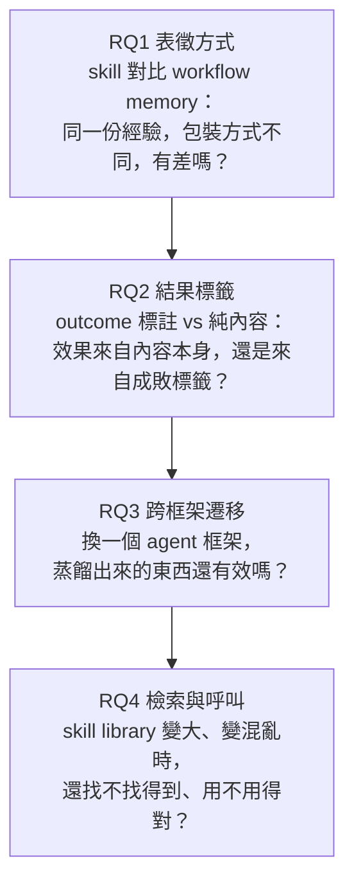
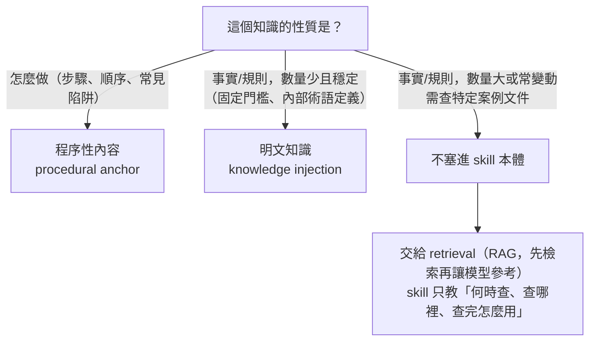

# Agent Skill 為什麼有效，又為什麼會失效：一套可以搬走的配對分析法

## 前言

Anthropic 那種 SKILL.md 格式的 agent skill（把可重用的程序知識打包成一份文件，讓 agent 在需要時翻開來用）已經是很多人的日常工具。但現行的評估方式幾乎都是黑箱式的：給 agent 一批 skill，看解題成功率有沒有變高，變高就說有用。這種評法回答不了三件實務上很關鍵的事：skill 到底改變了 agent 行為的哪個環節？同一個 skill 為什麼在 A 任務有效、在 B 任務反而有害？它有效，是因為補了新知識，還是因為把行為固定下來了？

《Demystifying Agent Skills: Why They Work—Until They Don't》（arXiv 2608.14036v1，Princeton、Stanford、USC、Johns Hopkins，2026 年 8 月）就是衝著這個缺口來的。它的做法是「同一個任務、三種條件」配對比較：完全沒有先驗經驗、給原始執行紀錄、給蒸餾過的 skill，再把差異拆到機制層級去看。

這篇文章會先走一遍論文的實驗設計與三組主要發現，過程中把論文沒講清楚、或證據比標題暗示的更弱的地方標出來。其中最該先知道的一點是：論文的 headline 是 skill 有效，但它自己算出來的統計結果顯示，skill 相對於「完全不給先驗經驗」並不顯著，站得住腳的是 skill 顯著優於直接塞原始執行紀錄。後半段則抽出幾個跟這篇論文是否可信無關、單獨拿出來都值得帶走的方法與觀念。如果你只想要後者，可以直接跳到〈脫離這篇論文也成立的方法與觀念〉。

---

## 先把對照組與研究問題搞清楚

### 先定義四個詞

這篇論文反覆出現四個詞，後面每一節都會用到。其中 trajectory 跟 transcript 指的是同一件事，也就是一次執行的完整過程記錄，一次執行叫一個 trial：

| 詞 | 意思 | 用途 |
| --- | --- | --- |
| Agent transcript（也叫 trajectory） | 一次 trial 執行的完整過程記錄：下了哪些終端機指令、呼叫哪些工具、推理過程中可見的文字、程式輸出 | 後續判斷「這筆為什麼成功或失敗」的主要證據來源 |
| Raw arm | agent 完全沒拿到任何先驗經驗（沒有 workflow memory、沒有 skill），從零開始解題 | 對照組的 baseline |
| Workflow arm | agent 拿到的是清理過的原始 trajectory，直接當作程序記憶插進去 | 測「不特別包裝、只把過去的執行紀錄丟給它」有沒有用 |
| Skill arm | agent 拿到的是同一批 trajectory，但蒸餾成標準化的 SKILL.md（有步驟、有檢查清單） | 測「包裝成標準格式」跟 workflow 比有沒有差 |

Raw、Workflow、Skill 這三個 arm 是全篇最核心的對照條件。


*圖 1 — 論文的兩條實驗流程：上方是 skill 對 workflow memory，下方是 skill 檢索。（來源：原始論文 Figure 1。）*

### 四個研究問題

論文把「skill 為什麼有效」拆成四個階段，每個研究問題（RQ）對應 skill 生命週期的一段，而且都用「固定其他變因、只變一個」的方式做控制實驗：



RQ1 和 RQ2 問的是經驗怎麼被包裝與標註，RQ3 和 RQ4 問的是包裝完的 artifact 到了下游怎麼被使用。串起來看，剛好是 skill 從「產生」到「被檢索」再到「被實際呼叫」的完整生命週期。

---

## 分析方法：從 8,135 筆雜亂紀錄到「skill 改變了什麼」

這一節抓大方向就好，不用記每個實作細節。先交代論文用的任務：三個 benchmark（Terminal-Bench 2.0、SkillsBench、Terminal-Bench-Pro）都是終端機操作、debug、API 呼叫這類讓 agent 在 Docker 環境裡實際動手的任務。每個任務有一個 verifier（自動驗證程式）事後檢查結果，給出一個 reward，正數才算成功，不採信 agent 自己的說法。

整套流程分四步：

1. **資料正規化。** 把三個 benchmark、三種 arm（Raw、Workflow、Skill）、六種先驗經驗組成比例（見下）的執行紀錄，統一整理成一張 8,135 筆的資料表。六種比例從 `5s0f` 到 `0s5f`，`s` 是成功（success）、`f` 是失敗（failure）的來源 trajectory 數，意思是「5 個成功案例加 0 個失敗案例」一路到「0 個成功加 5 個失敗」。成功與否一律以 verifier 的 reward 為準。
2. **Open coding（開放編碼）。** 從 8,135 筆裡分層抽樣 240 筆，讓 LLM 不套用任何預設分類、自由產生短標籤，得到 238 筆有效標籤。精神是先讓資料自己講話，不要先射箭再畫靶。
3. **兩階段分類法歸納。** 238 個自由標籤先分批（每批約 60 筆）各自歸納出批次分類，再把「批次分類的名稱加定義」（不再重讀原始資料）送進第二輪合併，收斂成 12 個正式分類（mode），分成三大類：SC1 是成功的程序引導，SC2 是執行層與驗證失敗，SC3 是呼叫與邊界失敗。
4. **528 組三方配對比較。** 對每個 benchmark 與 task，湊出一組 Raw、Workflow、Skill 的「三胞胎」，同一任務的三種版本放在一起比。LLM judge 同時看三筆 trajectory，除了各自標 mode，還要標一個機制標籤，並記錄這個處理修好了哪些失敗模式、又引入了哪些新的。

這套分類法有經過人工驗證：238 筆標籤的 grounding（標籤是否真的有 trajectory 證據支持）全數通過，共抽查 714 次；分類一致性是 95.8% 完全吻合，Cohen's $\kappa = 0.952$（$\kappa$ 是扣掉隨機碰巧一致之後的一致性指標，越接近 1 越好）。

528 組配對這套管線的目的，是回答「skill 改變了行為的哪個環節」這種機制層級的問題，所以只有〈核心發現 A〉用得到它。〈核心發現 B〉（跨框架遷移）、〈核心發現 C〉（檢索與下游執行）以及標籤消融問的是不同性質的問題：換框架還有效嗎、找不找得到、標籤重不重要。這些用成功率或檢索精準度這類聚合指標就能回答，不需要逐筆分類「這次失敗屬於哪個 mode」，所以論文另外設計獨立實驗去測。

### 8,135 筆資料的三種切法

這批資料可以用三個彼此獨立的角度去切，每個角度加起來都是 8,135（見表 1）：


*表 1 — 清單建構與 artifact 連結後的資料涵蓋統計。（來源：原始論文 Table 7。）*

| 切法 | 分項 | 筆數 |
| --- | --- | --- |
| 按 benchmark | Terminal-Bench 2.0、Terminal-Bench-Pro、SkillsBench | 3,254、2,993、1,888 |
| 按 execution arm | Raw、Workflow memory、Skill | 1,883、2,658、3,594 |
| 按結果 | 成功、失敗 | 4,541、3,594 |

就像同一班學生可以按班級分、按及格與否分，各自加總都是全班人數，彼此沒有包含關係。另外還有三個數字屬於「資料完不完整」的計數，不是分類：有 agent transcript 可用的 7,837 筆、有 task instruction 可用的 6,210 筆、Skill arm 裡有連結到 skill 檔案的 3,570 筆。

> **小心巧合。** Skill arm 是 3,594 筆，失敗數也是 3,594 筆；Raw 加 Workflow 是 1,883 + 2,658 = 4,541，剛好等於成功數。這純屬巧合，Arm 跟結果是兩個獨立的維度（Skill arm 的成功率還是三個 arm 裡最高的，61.9%）。

### Open coding 那一步到底叫 LLM 輸出什麼

不是自由文字分析，而是固定結構的 JSON：

```json
{
  "freeform_reasoning_short": "1-2 句話摘要發生了什麼事",
  "primary_mode_candidate": "開放式短標籤，例如 'missing python dependency'",
  "secondary_factors": ["次要影響因素"],
  "evidence_spans": [{"source": "codex.txt", "quote": "逐字擷取，<=160字元"}],
  "skill_effect_judgment": "helps | neutral | hurts | not_applicable",
  "skill_effect_reason": "一句話",
  "capability_vs_knowledge": "knowledge_missing | knowledge_present_but_misused | capability_limit | environmental"
}
```

核心是 `primary_mode_candidate`：刻意留成開放式，讓詞彙自然浮現，而不是從預設選單裡挑。另外一個小坑：乾淨的一次成功，`capability_vs_knowledge` 四個選項沒有一個字面上對得上「知識存在、而且一次用對」，論文只提到成功時可以填 `knowledge_present_but_misused`，前提是 agent 曾經用錯又自己修正。

---

## 核心發現 A：Skill 為什麼有效，是 Procedural Anchor（RQ1）

### 兩套成功率互相印證

論文用兩套獨立算出來的成功率互相對照：

| 名稱 | 怎麼算 | Raw、Workflow、Skill |
| --- | --- | --- |
| Oracle-status success rate | 直接用 verifier reward 判定（客觀、二元） | 59.1%、55.9%、61.9% |
| Taxonomy-mode successful-procedure proportion | 528 組配對裡，LLM judge 把該筆歸到 SC1（成功程序引導）的比例 | 59.1%、55.7%、61.7% |

兩組數字的差距都在 0.2 個百分點以內。這代表分類法標出來的「這筆算不算成功」，跟 verifier 的客觀判定是一致的，後面的機制數字才有底氣。

### 核心數字：procedural anchor 遠大於 knowledge injection

528 組配對裡，每一筆 Workflow 或 Skill 除了標 mode，還要另外標一個機制標籤，回答「這份 artifact 是怎麼影響這次執行的」：


*表 2 — 用來描述先驗經驗如何影響執行的機制標籤。（來源：原始論文 Table 2。）*

圖中是英文原表，下面用中文重述這五個標籤：

| 機制標籤 | 意思 |
| --- | --- |
| `procedural_anchor` | 給了可執行的程序：步驟順序、檢查清單、工具呼叫序列 |
| `knowledge_injection` | 補了 agent 原本缺的具體領域知識 |
| `failure_warning` | 提醒了某個會踩到的陷阱，agent 因此避開 |
| `none` | 這份 artifact 根本沒被實際用到 |
| `counterproductive` | 誤導了 agent，讓結果變得更差 |

結果是：`procedural_anchor` 佔 skill 機制的 65.7%，`knowledge_injection` 只佔 4.5%。換算一下，skill 發揮作用的案例裡，大約每 3 筆就有接近 2 筆是靠「給步驟」在幫忙，每 22 筆才有 1 筆是靠「給知識」，兩者差了約 14.6 倍。剩下約 29.8% 分散在另外三個標籤，論文全文沒有給出這三者各自的精確比例，這也是它沒交代清楚的地方。

來看論文附錄的一個具體例子：`react-performance-debugging` 任務（SkillsBench，`1s4f` 設定即 1 個成功、4 個失敗的來源案例，Skill arm，成功）。注入的 SKILL.md 寫了 *"Start promises early, await late"*（提早發起 promise，晚一點再 await），agent 依此把 checkout 路由裡原本依序等待的兩個 API 呼叫，改成部分平行化。底下是 Skill 引導下的最終版本：

```javascript
export async function POST() {
  const userPromise = fetchUserFromService();
  const configPromise = fetchConfigFromService();
  const user = await userPromise;
  const profilePromise = fetchProfileFromService(user.id);
  const [config, profile] = await Promise.all([
    configPromise,
    profilePromise,
  ]);
  return NextResponse.json({
    success: true,
    user: { id: user.id, name: user.name },
    profile,
    config: { currency: config.currency },
  });
}
```

最後 11 項驗證測試全過。這裡 skill 沒有在教 agent 什麼領域知識（agent 本來就會 `Promise.all`），而是告訴它遇到這類情境該用哪種操作順序，是典型的 `procedural_anchor`。論文原文並沒有標出這筆的機制標籤，這個歸類是我們拿例子內容對照定義做的判斷。

這個發現最重要的解讀是：skill 有效，主要不是因為它教會 agent 原本不會的東西，而是把 agent 本來就會、但做起來容易不穩的行為固定下來，例如先跑哪個檢查、工具照什麼順序呼叫、中間要驗證什麼。

### 這個比例能搬到企業內部知識庫嗎

一個很自然的質疑是：企業內部場景裡，如果 skill 只寫程序性內容，agent 沒有 private domain knowledge，一樣會犯錯吧？沒錯，65.7% 對 4.5% 這個數字不能直接套到企業內部場景。

論文用的三個 benchmark 都是終端機操作、debug、API 呼叫這類任務，需要的知識幾乎都是公開、agent 訓練時很可能看過的東西。所以 agent 卡關通常不是因為「不知道」，而是「知道，但沒穩定照著對的順序做」。這正是 `knowledge_injection` 只有 4.5% 的根本原因：不是知識注入沒用，是這批任務裡本來就沒有多少真正缺的知識可以注入。

企業內部知識庫就完全是另一回事。內部系統代號、特定業務規則、專有門檻值，不管 skill 的步驟寫得多標準化，agent 到了該填入具體資訊的那一步，還是會憑空猜測或用錯，而論文完全沒有測試這種場景。所以企業 skill 很可能需要程序骨架與明確知識兩塊兼備。論文不是叫你只寫前者，只是在它測的這批任務裡，光有骨架就贏了大部分場。知識該放進 skill 本體還是交給檢索，後面〈脫離這篇論文也成立的方法與觀念〉有一個判斷框架。

### Workflow memory 也能成功，但比較雜

兩個成功類 mode 都屬於 SC1：`skill_guided_success` 在 Skill arm 裡佔 61.6%，`workflow_guided_success` 在 Workflow arm 裡佔 54.5%。兩個都不低，所以 workflow memory 本身有相當高的機率讓 agent 抄對答案，並不是沒用的東西。

差別在乾淨度。Workflow memory 保留的是接近原始執行過程的內容，裡面夾著跟這次任務無關的探索、走過的死路、沒用上的嘗試。這些雜訊不會讓 agent 完全學不到東西（所以還有 54.5%），但會拖累：agent 得多花力氣過濾，容易超時。Skill 是蒸餾過的版本，把探索過程與失敗嘗試都剪掉，只留下「這樣做會成功」的部分。

如果你的系統打算保留原始執行紀錄這種形式的記憶，它不是沒用，但該預期它比蒸餾過的 skill 更容易讓 agent 讀太多、抓不到重點，進而拖慢或跑偏。

### Skill 的能力邊界：治得好「粗心」，治不好「不會」

先看三種 arm 在三大類 mode 上的整體分布：


*圖 2 — 三種 arm 在不同 trajectory 組成比例下的分類標籤分布。（來源：原始論文 Figure 2。）*

SC2（執行層與驗證失敗）整體佔比，Raw 是 37.3%，Workflow 是 33.3%，Skill 降到 23.5%。拆開看，skill 對不同類型的 SC2 失敗效果差很多。環境與流程類、屬於「容易忘記」型的失敗，被壓得很乾淨：

| Mode | Raw | Workflow | Skill |
| --- | --- | --- | --- |
| 環境與基礎設施失敗 | 5.3% | 1.7% | **0.2%**（降了 26 倍） |
| 輸出格式不符 | 7.4% | 3.8% | 3.2% |
| 背景服務生命週期失敗 | 2.7% | 2.5% | **0.8%** |

深層推理與驗證類、要靠判斷力的失敗，幾乎沒改善：

| Mode | Raw | Workflow | Skill |
| --- | --- | --- | --- |
| 演算法邏輯錯誤 | 8.3% | 11.0% | 7.4% |
| 只做靜態檢查、沒跑 runtime | 12.5% | 12.5% | **11.7%**（三個 arm 幾乎沒差） |

原因是 procedural anchor 的作用在於固定「本來就會、但容易做不穩」的行為。演算法寫錯、該跑實際測試卻只做表面檢查，根源是 agent 當下的推理與判斷能力本身不夠，skill 沒辦法把一個寫錯的演算法變對。這是這個機制本身的天花板，不是 skill 這個工具沒用好。各 mode 在三種 arm 下的完整比例見表 3：


*表 3 — 528 組配對樣本上的 skill 使用分類表。（來源：原始論文 Table 11。）*

### 在 skill 裡明確寫「記得驗證」有用嗎

既然 skill 修不好驗證類失敗，直覺的補救是在 skill 裡明確提醒要驗證。但論文用來產生 SKILL.md 的 skill-creator 工具，格式上本來就固定要求輸出一個 `## Verify` 段落（怎麼確認這個 skill 執行成功），也就是實驗裡的 skill 已經內建了驗證提醒，這個做法某種程度上已經被測過了。

結果是 12.5%、12.5%、11.7% 幾乎沒動。跟環境失敗那組（5.3% 降到 0.2%）相比，差別可能不在有沒有寫提醒，而在這個提醒能不能被機械式地執行：

|  | 環境設置類指令 | 驗證類指令 |
| --- | --- | --- |
| 典型內容 | 「先跑 `npm install`，再跑 `npm run build`」 | 「跑完後執行 runtime 驗證確認結果」 |
| 執行方式 | 照抄指令、照順序執行 | 要自己判斷測試設計得夠不夠嚴謹、輸出算不算真的通過 |
| 出錯空間 | 幾乎沒有模糊地帶 | agent 可能跑了測試，但寫得太鬆，或只看部分輸出就結案 |

以上是我們從數字規律推出來的解釋，論文本身沒有點明。它也沒有拆開看「這個 mode 底下的案例，skill 的 `## Verify` 欄位寫得多具體、有沒有被 agent 認真執行」，所以這個問題只能說資料不足，既證實不了也推翻不了。

### Skill 引入的新失敗面

SC3（呼叫與邊界失敗）這一大類，Skill arm 明顯最高：78 / 528，約 14.8%，Raw 只有約 3.6%。拆開看兩個關鍵 mode：

| Mode | Raw | Workflow | Skill |
| --- | --- | --- | --- |
| skill 指引被誤用或忽略 | 0.8% | 0.4% | **10.0%** |
| 逾時與預算耗盡 | 1.7% | **10.6%** | 4.4% |

兩種失敗的性質不同。Skill 的失敗是「內容乾淨，但 agent 用歪了」（`skill_guidance_misapplied_or_ignored`）：skill 給了合理的指引，但 agent 機械式照搬、漏看適用條件，或把已經不成立的假設也搬過去。Workflow 的失敗則是「內容太雜，agent 來不及讀完就先燒完預算」，呼應前面講的乾淨度問題。

### 那 10% 真的能算在 skill 頭上嗎

直覺的讀法是「這是 skill 帶來的新失敗面，設計時要特別注意」，但證據其實比這個說法弱很多，要拆開看。

合理的部分：如果純粹是「agent 是機率模型，本來就會隨機犯錯」，你會預期這種誤用錯誤在三個 arm 之間大致平均。實際上差了 12 到 25 倍（Raw 0.8%、Workflow 0.4%、Skill 10.0%），而且集中在 Skill arm。單用「模型是機率性的」解釋不完這個集中現象，因為 Workflow arm 同樣有給指引內容（內容量通常還更大），理論上也該有類似比例，結果它反而是三者最低。

站不住腳的部分：這個 mode 的名字本身就叫 `skill_guidance_misapplied_or_ignored`，字面上就綁了「skill」。LLM judge 在標 Raw 或 Workflow arm 時，理論上根本沒有 skill 可以被誤用，那 0.8% 與 0.4% 這兩個非零數字是怎麼標出來的、標準是什麼，論文完全沒解釋。這代表這個 mode 的判定標準可能本身就偏袒 Skill arm，不是三個 arm 用同一把尺量出來的客觀差異。論文也沒有任何實驗去區分「這 10% 是壓縮抽象化造成的過度套用」還是「模型隨機犯錯、剛好被貼上這個標籤」。

所以比較誠實的結論是：「有一個標籤使用率偏高」是真的，但它反映的是真實的機制差異，還是分類法定義上的偏誤，論文的資料不足以判斷。

## 統計檢驗：headline 站得住嗎

回頭看前言提到的 headline。論文用配對成功率差加上 1,000 次重抽樣的 bootstrap 信賴區間（用重複抽樣估計「這個差距有多少是運氣」的方法，區間不含 0 才算顯著）來檢驗：


*表 4 — 各 execution arm 之間配對成功率差的 95% bootstrap 信賴區間。（來源：原始論文 Table 10。）*

- Skill 對 Workflow memory：+6.06 個百分點（pp），95% 信賴區間 [+0.76, +11.36]，不含 0，**顯著**。
- Skill 對 Raw：+2.84 pp，95% 信賴區間 [-2.27, +7.95]，包含 0，**不顯著**。

這跟論文標題與摘要給人的印象有落差（區間數字見表 4），也是讀這篇論文最容易被誤導的地方。真正站得住腳的統計結論是「skill 顯著贏過 workflow memory」，不是「skill 顯著贏過完全沒有先驗經驗」。

---

## 核心發現 B：跨框架遷移（RQ3）

這一節純粹比較成功率。

實驗設計是：用 Codex 加 GPT-5.3-Codex 產生的 workflow memory 和 skill（原封不動、同一批 artifact），拿到 Gemini CLI 加 Gemini-3.1-Pro-Preview 上執行。來源經驗固定不變，只換 agent 框架（prompting 風格、工具介面、執行迴圈都不同）。


*圖 3 — 跨框架遷移：在 Codex 建構的先驗經驗拿到 Gemini CLI 上評測的成功率。（來源：原始論文 Figure 4。）*

圖上的實際數字（成功率，%）：

| Trajectory 組成 | 0s5f | 1s4f | 2s3f | 3s2f | 4s1f | 5s0f |
| --- | --- | --- | --- | --- | --- | --- |
| Workflow memory | 60 | 58 | 60 | 56 | 70 | 54 |
| Skill | 62 | 76 | 76 | 76 | 74 | 84 |
| Raw 基準線（Gemini） | 56 | 56 | 56 | 56 | 56 | 56 |

Skill 全程穩定贏過 Raw 基準線，最低的 62% 也比 56% 高。Workflow memory 就不穩了：`3s2f` 時打平（56% 對 56%），`5s0f` 時甚至跌破基準線（54% 對 56%）。也就是說，把原始 trajectory 直接搬到另一個框架，有時候比完全不給任何先驗經驗還糟，蒸餾過的 skill 則從沒發生過這種情況。這就是「skill 比 workflow memory 更能跨框架搬」的具體數字證據。

這張圖裡有一個論文沒解釋的異常點。`5s0f`（全部由成功案例做出來的先驗經驗）照理內容品質最好，但 workflow memory 在這個設定下反而是六個裡面最差的（54%）；同一個設定下 skill 卻是最好的（84%，也是全圖差距最大的 +30）。為什麼「全成功案例」建出來的 workflow memory，換框架後反而最難搬？論文沒有給答案。

---

## 核心發現 C：檢索與下游執行（RQ4）

這一節用 SkillsBench 自帶的 task 與 skill 正解標註來算 precision、recall 和 F1。三個指標先白話交代：precision 是「選出來的裡面有幾成是對的」，recall 是「該選的裡面有幾成被選到」，F1 是兩者的調和平均，用來一個數字看整體。

### 三組獨立實驗：「找不找得到」和「用不用得到」是兩件事

每個任務配一個 candidate pool（1 個正解 skill 加 $k-1$ 個干擾項，$k$ 從 5 測到 100）。三組實驗互相獨立，輸出不會傳給下一組：

| 實驗 | 做什麼 | 分母（precision 除以誰） | 測什麼 |
| --- | --- | --- | --- |
| Arm 1：embedding 檢索 | 純演算法，不涉及 agent，也不執行任務。用 Qwen3-Embedding-0.6B 把任務描述和每個 skill 描述轉成向量，算 cosine similarity，排名最高的當作「選中」 | 固定是 1 | 用最陽春的語意相似度排序，選不選得中正解 |
| Arm 2：agent 明確選擇 | 把整個 candidate pool 的清單（名稱加描述）攤給 agent 看，問它會選哪幾個，同樣不執行下游任務 | agent 自己明確選出的數量 | agent 讀完候選清單，判斷得出哪個有用嗎 |
| Arm 3：實際執行 | 整個 pool 直接放進 agent 的執行環境，不事先篩選，agent 邊解題邊決定要不要打開哪個 skill；事後解析 trajectory 看它實際用到哪些 | agent 在真實解題中實際打開或呼叫過的 skill 種類數 | 真實解題時 agent 用了什麼、有沒有用對，以及任務最後有沒有成功 |

Arm 1 和 Arm 2 問的是離線的識別能力，不牽涉實際解題；Arm 3 問的是線上、真實執行時的使用行為，這才會連到任務成功與否。三組的分母定義完全不同，所以 precision 的數字不能直接並排比較。


*圖 4 — SkillsBench 上的 skill 檢索與執行期使用。左：Arm 1 與 Arm 2 的 precision；右：Arm 3 的 precision 與下游成功率。（來源：原始論文 Figure 3。）*

$k=5$ 時三組 precision 就差很多（88.3%、70.0%、29.6%），原因就是上面的分母。Arm 1 的分母固定是 1，候選少時語意最相近的通常就是對的；Arm 2 的 agent 會自己挑，70.0% 代表挑出來的七成猜對；Arm 3 的 agent 沒被要求精簡，就算 pool 只有 5 個也可能多翻幾個，29.6% 大致是平均翻看的候選裡，正解佔不到三分之一。不是 Arm 3 比較差，是它問的問題本來就跟前兩者不同。

### 反直覺的發現：precision 崩盤，成功率卻沒動

Pool 從 5 放大到 100，三組 precision 的變化：

| 實驗 | $k=5$ | $k=100$ | 變化 |
| --- | --- | --- | --- |
| Arm 1（embedding 檢索） | 88.3% | 76.9% | 小幅下降 |
| Arm 2（agent 明確選擇） | 70.0% | 63.7% | 小幅下降 |
| Arm 3（實際執行，用到什麼） | 29.6% | 3.3% | 崩盤，將近 9 倍 |

但同一時間，Arm 3 的下游任務成功率是 36.4% 變成 39.3%，不只沒崩，還微幅上升。選不選得中「標準答案」skill，跟任務最後做不做得出來，幾乎是兩件不相關的事。

關鍵是 recall 撐住了。$k=100$ 時，Arm 3 的 precision 平均只剩 3.3%（依 agent 與干擾項情境不同，落在 0.7% 到 8.1%），recall 卻仍有 54.3% 到 73.6%。意思是 agent 雖然解題時東摸西碰、碰過一大堆不相關的 skill（precision 低），但正解本身大部分時候還是有摸到（recall 高），只是被淹沒在雜訊裡。

論文原文的判讀是 *"exact ground-truth skill invocation is neither sufficient nor strictly necessary for success"*：精準呼叫正解 skill，既不是成功的充分條件（就算叫對了，agent 的執行判斷力不夠一樣會失敗，呼應核心發現 A 講的能力邊界），也不是必要條件：沒精準鎖定正解、摸了一堆不相關候選，只要正解有被摸到過就有機會用上。其他相關的 skill 有時也能提供類似幫助，任務照樣做得出來。

### 真正的壓力來源：pool 變大，還是干擾項太像正解


*表 5 — 干擾項組成與 pool 大小對 SkillsBench 的影響。（來源：原始論文 Table 4。）*

表 5 拆開了三種干擾項情境。在 $k=100$ 時，各情境的 Arm 3 precision 是：

| 干擾項類型 | Arm 3 precision |
| --- | --- |
| random | 4.4% |
| similar | 3.7% |
| dissimilar | 1.7%（居然是最低） |

如果直覺是「干擾項太像正解，agent 分不清楚才多翻幾個」，那一看就跟正解無關的 dissimilar 應該崩得最少才對，實際上它崩得最兇。這代表驅動 Arm 3 precision 崩盤的主因不是「像不像」，而是 pool 裡東西變多這件事本身。

Arm 1 和 Arm 2 的規律剛好相反，讓它們崩的不是 pool 變大，是干擾項像不像正解。以 Arm 1 的 precision 從 $k=5$ 到 $k=100$ 為例：

| 干擾項類型 | $k=5$ | $k=100$ | 掉幅 |
| --- | --- | --- | --- |
| random | 97.7% | 84.1% | 13.6 pp |
| similar | 70.5% | 53.4% | 17.1 pp，起點就低很多 |
| dissimilar | 96.6% | 93.2% | 3.4 pp，幾乎沒掉 |

論文原文直接點出這個對比：*"similar distractors are the dominant stressor for the offline identification diagnostics [Arm 1/2], whereas Arm 3 precision collapses across all three regimes as the pool grows"*。離線檢索被「像不像」卡住，Arm 3 被「pool 大小本身」卡住，兩種機制不一樣。

不要把 Arm 3 的崩盤讀成 agent 主動探索。論文的資料只能支持「pool 變大時，agent 實際碰過或呼叫過的 skill 種類數自然變多」這個現象，沒有證據顯示那是 agent 刻意的決定，論文自己也沒做進一步的行為分析。比較貼近資料的因果鏈是：pool 變大，環境裡候選變多，agent 解題過程中自然接觸到的候選變多，precision 的分母被稀釋。

把整張圖拼起來：

| 實驗 | 壓力來源 | 結果 |
| --- | --- | --- |
| 離線檢索與選擇（Arm 1、Arm 2） | 干擾項像不像正解（語意混淆） | pool 單純變大、但干擾項好分辨時，影響有限 |
| 實際執行（Arm 3） | pool 有多大本身 | 不管干擾項像不像，agent 摸過的候選種類數都會被稀釋；但 recall 撐住，成功率沒跟著崩 |

還有一個細節：$k=100$ 時，Arm 2 的 selection recall 仍有 70.5% 到 85.2%。論文的解讀是 agent 常把正解跟一堆干擾項一起選進去，而不是完全漏掉它。這跟 Arm 3 的 recall 撐住是同一種模式，只是一個發生在選擇層級，一個發生在執行層級。

---

## RQ2 與成本：outcome 標籤重不重要，以及 token 的取捨

這一節回答 RQ2（效果到底來自內容本身，還是成敗標籤），再補一段 token 成本。篇幅不長，但 RQ2 的答案在這裡。

### No-hint 消融：成敗標籤本身是關鍵訊號

問題是：建構 skill 時，如果不告訴它這批 trajectory 哪些是成功案例、哪些是失敗案例，效果會差多少？


*圖 5 — 建構 skill 時是否顯示成敗標籤對成功率的影響。（來源：原始論文 Figure 5。）*

結論是：來源全是成功案例時，有沒有標籤差別不大；只要摻進失敗案例，有標籤（normal）就明顯優於沒標籤（no-hint），而且失敗案例摻得越多，差距通常越大。代表性數字：Gemini 在 Terminal-Bench-2、`3s2f` 設定下，normal 是 74.6%，no-hint 只有 40.0%，差了將近一倍。

意涵是，「這是成功還是失敗的案例」這個標籤，是 skill 能不能從失敗案例裡正確提煉出「不要這樣做」的關鍵訊號。這也反過來印證核心發現 A：skill 的價值主要來自把行為固定住，而「固定對的行為、避開錯的行為」高度依賴明確的成敗標籤。

### Token 成本的取捨

這段分析限定在 83 個「三個 arm 都有完整 token 記錄」的任務子集，不是全部 8,135 筆：


*表 6 — 配對任務上的成功率與 token 成本比較。（來源：原始論文 Table 13。）*

| Arm | 成功率 | 總 token |
| --- | --- | --- |
| Raw | 64.1% | 555.7K |
| Workflow | 64.8% | 426.2K（比 Raw 省 23%） |
| Skill | 69.6% | 521.5K（比 Raw 省 6%，比 Workflow 多花 22%） |

Workflow memory 最省 token，但效果普通；Skill 效果最好，比 Raw 省一點，但比 Workflow 貴不少。論文的定調是：skill 用多一點 context，換到更高的成功率，這筆交易划算。不過這只是 83 個任務的子集，Skill 比 Raw 高的 5.5 pp 沒有對應的顯著性檢驗可以引用，再對照前面 Skill 對 Raw 整體並不顯著的結果，「划算」比較像論文的定調，而不是統計上確立的結論。

---

## 脫離這篇論文也成立的方法與觀念

這一節的東西跟論文結論可信與否無關，是讀完之後沉澱下來、可以直接拿去別的場合用的。如果你只想帶走這部分，可以單獨讀。

### 成敗判定要綁外部可驗證的訊號

任何拿 agent trajectory 做後續分析的 pipeline，成敗都該由 verifier 這類外部訊號判定，而不是 agent 自己說的「我做完了」。地基不穩，後面所有分類與統計都不可信。

### Open coding：先讓資料自己講話

這個詞借自社會科學的質性研究（grounded theory，紮根理論）：研究者逐行讀訪談稿，不套用預設類別，等標籤累積夠多再回頭歸納主題。論文把「研究者逐行讀」換成「LLM 逐筆判讀」。任何「不確定資料裡實際有哪些模式」的分類任務都適用，因為自己先想一套分類法，很容易只看到自己預期的模式，漏掉資料裡真正出現的型態。

### 兩輪批次歸納：讓 LLM 分類任務可以規模化

第二輪只吃「分類名稱加定義」，輸入量因此大幅縮小，不必重處理原始資料。要從大量非結構化資料歸納出一套固定分類時，都可以直接套這個模式。

### Precision 不等於下游成功率

這篇論文用很硬的數字示範了：「選得準不準」和「任務做不做得出來」可以是幾乎不相關的兩件事（Arm 3 precision 崩了將近 9 倍，成功率幾乎不動）。衡量系統時，要先想清楚指標問的是識別準不準（precision、recall，離線可測），還是結果好不好（success rate，需要真實執行）。兩者可能給出完全相反的優化方向，如果把資源全砸在把 top-1 檢索做到完美，你可能是在優化一個跟最終結果關係不大的指標。

### 企業知識該放進 skill，還是交給 retrieval

這是根據前面的機制定義做的延伸推論，不是論文原文。判斷的起點是這份知識的性質：



數量大、常變動的知識塞進 skill 本體，會過期、會塞爆 context，所以交給 retrieval，skill 只負責教 agent 什麼時候該查、查哪個知識庫、查完怎麼用。

---

## 結論

整篇論文可以收成幾件事。最紮實的貢獻是方法論本身：把「skill 有沒有用」從單一聚合成功率，拆成配對三方比較加兩層標籤，這套東西可以直接遷移到自己的 eval 系統。具體發現裡，最站得住腳的是 procedural anchor（65.7%）遠大於 knowledge injection（4.5%），但這個比例是終端機與工具類任務的特性，換到私有領域知識場景不能直接套用。

其他幾個結論，各用一句話帶過：

- **能力邊界：** skill 對環境設置類失敗壓制效果驚人（5.3% 降到 0.2%），對演算法邏輯錯誤和只做靜態驗證幾乎沒改善，能治粗心，治不了不會。
- **跨框架：** skill 穩贏 Raw 基準，workflow memory 有時比 Raw 還差。
- **檢索：** pool 放大時 precision 崩盤、成功率卻不太動，因為 recall 撐住；離線檢索怕的是「像不像」，實際執行怕的是「pool 多大」。

最後，也是最容易被標題誤導的一點：skill 對 workflow memory 的優勢在統計上顯著，對完全不給先驗經驗的優勢則不顯著。另外，Skill arm 那個 10% 的「被誤用或忽略」，到底是真實的新失敗面，還是分類標準的偏誤，論文的資料判斷不了。

```figure-map
[
  {
    "id": "img-001",
    "references_manifest_caption": "Figure 1: Experimental pipelines. Top: skill versus procedural memory. We execute each task in a fixed Docker environment, collect successful and failed trajectories, and form a fixed-budget composition grid. The same trace pool is distilled either into Workflow Memory or into a reusable SKILL.md, which are then evaluated on matched tasks under the same protocol. Bottom: skill retrieval. Each task is paired with a candidate pool containing its ground-truth skill and k −1 real distractors (random, similar, or dissimilar). Matched pools are evaluated independently in three procedures: (A) embedding-based ranking without task execution, (B) explicit agent selection without Docker execution or verification, and (C) full-pool real execution with skill-use parsing after task verification. Outputs from (A) and (B) are not passed to (C).",
    "why_used": "支撐「三個對照條件與兩條實驗流程」的說明，讓讀者先有整體實驗設計的圖像。",
    "agent_match_hint": "一張雙層流程圖，上半部是 skill 對 workflow memory 的蒸餾與評測流程，下半部是 skill 檢索評測。"
  },
  {
    "id": "img-012",
    "references_manifest_caption": "Table 7: Coverage statistics after manifest construction and artifact linking.",
    "why_used": "支撐「8,135 筆資料三種切法」的段落，提供各分項筆數的原始出處。",
    "agent_match_hint": "一張兩欄的統計表（維度與筆數），列出 benchmark、arm、成敗與資料完整度的計數。"
  },
  {
    "id": "img-005",
    "references_manifest_caption": "Table 2: Mechanism labels used to characterize how injected prior experience affects execution.",
    "why_used": "支撐機制標籤定義的段落，讓讀者看到 procedural_anchor 等五個標籤的原始定義。",
    "agent_match_hint": "一張兩欄表格（機制標籤與意思），列出五個機制標籤。"
  },
  {
    "id": "img-002",
    "references_manifest_caption": "Figure 2: Taxonomy label distribution across trajectory mixtures and experimental arms. Stacked bars show trajectory-level labels for Raw, Workflow Memory, and Skill across the six source-trajectory mixtures from 5s0f to 0s5f. Labels are grouped into three high-level categories; per-mode percentages are reported in Appendix Table 11.",
    "why_used": "支撐 SC1、SC2、SC3 三大類在三種 arm 之間分布差異的說明。",
    "agent_match_hint": "一組堆疊長條圖，三個面板分別是 Raw、Workflow Memory、Skill，右側有三大類圖例。"
  },
  {
    "id": "img-016",
    "references_manifest_caption": "Table 11: Contrastive skill-use taxonomy over 528 paired triples. SC abbreviates Skill-use Category, the top-level taxonomy label assigned to a trajectory; each SC groups the fine-grained modes listed in the table. Percentages are computed within each arm over the same paired-triple sample. SC1 denotes successful procedural anchoring, SC2 execution-layer and verification failures, and SC3 invocation, applicability, and boundary failures.",
    "why_used": "作為 12 個細分 mode 在三種 arm 下完整百分比的出處，支撐能力邊界與新失敗面的數字。",
    "agent_match_hint": "一張長表格，欄位為 SC、Mode、Raw、WF、Skill，列出 12 個 mode 的百分比。"
  },
  {
    "id": "img-015",
    "references_manifest_caption": "Table 10: Paired success-rate deltas between execution arms.",
    "why_used": "支撐「skill 對 workflow 顯著、對 raw 不顯著」的統計說明。",
    "agent_match_hint": "一張小表格，欄位為比較對象、平均配對差、95% bootstrap 信賴區間。"
  },
  {
    "id": "img-007",
    "references_manifest_caption": "Figure 4: Cross-framework transfer of procedural experience. Prior-experience artifacts constructed in one agent framework are evaluated in another. Dashed lines indicate the target framework’s Raw baseline.",
    "why_used": "支撐跨框架遷移結果，直接呈現 workflow memory 在某些比例下跌破 Raw 基準線。",
    "agent_match_hint": "一張雙色長條圖，x 軸六種 trajectory 組成比例，橫向虛線為 Raw 基準線。"
  },
  {
    "id": "img-006",
    "references_manifest_caption": "Figure 3: Skill retrieval and execution-time skill use on SkillsBench. Left: precision for the two offline diagnostics. Right: parsed actual-use precision (solid lines) and downstream success (dashed lines) for Arm 3. Curves average over random, similar, and dissimilar pool regimes; outputs are not passed between experiments.",
    "why_used": "支撐三組檢索實驗隨 pool 大小變化的 precision 與成功率走勢。",
    "agent_match_hint": "一張雙面板折線圖，左為 Arm 1 與 Arm 2 的 precision，右為 Arm 3 的 precision 實線與成功率虛線。"
  },
  {
    "id": "img-009",
    "references_manifest_caption": "Table 4: Effect of pool composition and size on Skills- Bench. Entries report percentages for the indicated retrieval arm, pool composition, and pool size. Arms 2 and 3 are arithmetic means over the reported agent– model pairings. Full recall and F1 values are given in Appendix Table 15.",
    "why_used": "支撐「pool 大小對上干擾項相似度」哪個才是壓力來源的比較數字。",
    "agent_match_hint": "一張表格，列為 Random、Similar、Dissimilar 三種干擾項，欄為 pool 大小 5 到 100，內含 Arm 1、2、3 的 precision。"
  },
  {
    "id": "img-008",
    "references_manifest_caption": "Figure 5: Effect of outcome labels during skill creation. Panels compare skills created with outcome labels visible (normal) or withheld (no-hint) across trajectory mixtures and benchmarks. Dashed lines indicate the corresponding Raw baselines. Terminal-Bench-Pro entries use 130 trials per condition; missing or infrastructure-error trials count as failures.",
    "why_used": "支撐 no-hint 消融：標籤可見與否在含失敗案例時的成功率差異。",
    "agent_match_hint": "一組六面板長條圖，每個面板有 normal 與 no-hint 兩種長條與 Raw 基準虛線。"
  },
  {
    "id": "img-018",
    "references_manifest_caption": "Table 13: Matched success and token-cost comparison. Entries are computed on the 83-task intersection with equal task weighting. Token counts are per-task averages reported in thousands (K); “pp” denotes percentage points.",
    "why_used": "支撐 token 成本與成功率取捨的比較數字。",
    "agent_match_hint": "兩個子表，上方為三種 arm 的成功率與 token 用量，下方為兩兩比較的差值與解讀。"
  }
]
```
