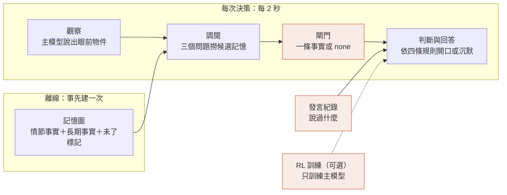
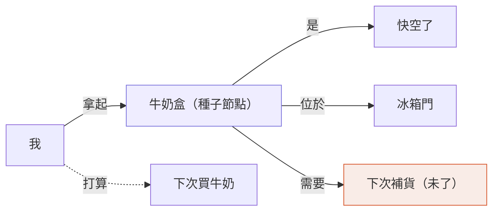
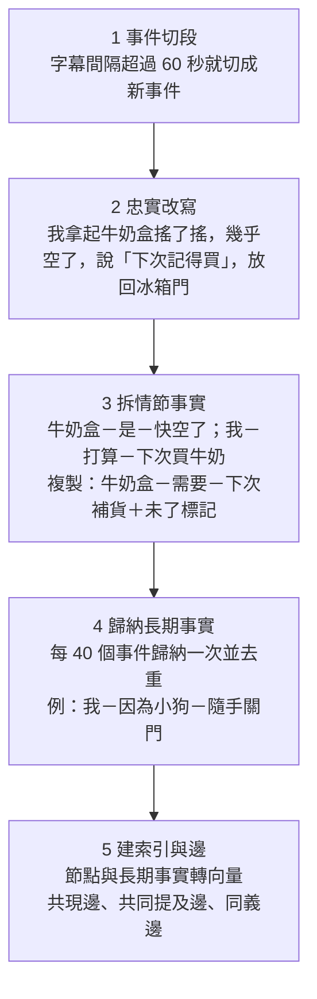
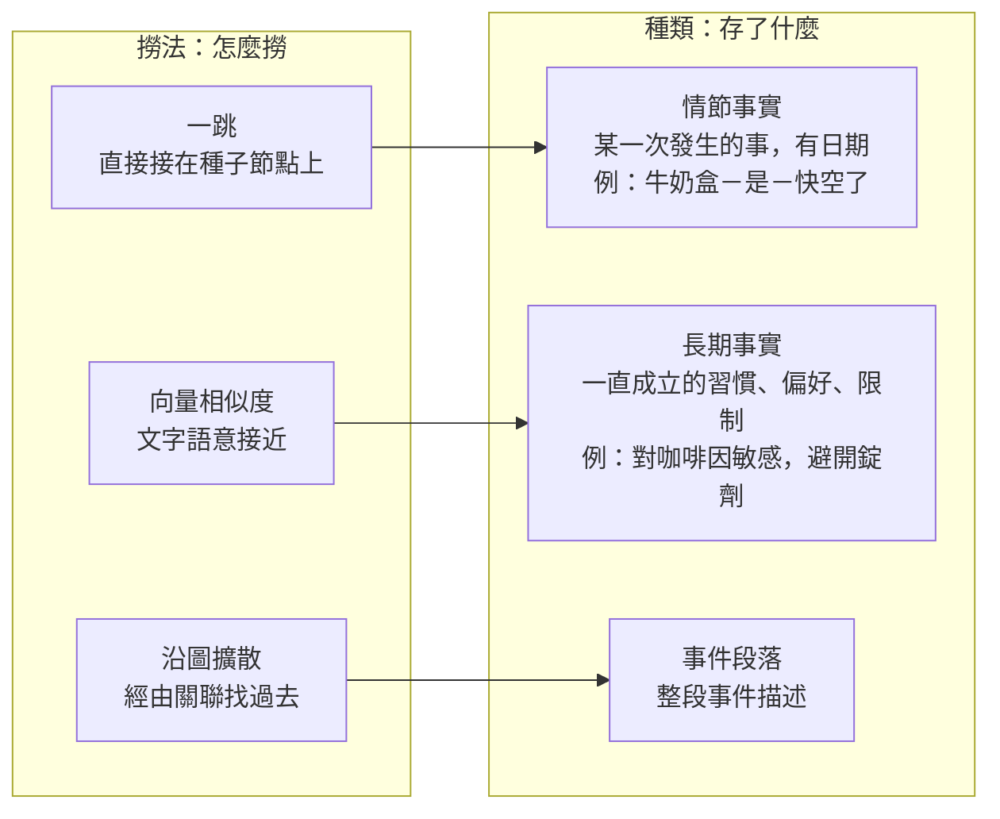

# MemoProAgent：在對的時間交給 Agent 對的證據

Nov 14, 2026 · @YHHW

## 論文資訊

| 項目 | 內容 |
| --- | --- |
| 標題 | MemoProAgent: Toward Memory-Driven Proactive Assistance |
| 作者單位 | Meta Reality Labs、Meta Superintelligence Labs、Michigan State University 等（通訊作者 Shenglai Zeng） |
| 版本 | arXiv 2610.22671v2，2026 年 10 月 |
| 論文 | [arxiv.org/abs/2610.22671](https://arxiv.org/abs/2610.22671) |
| 程式碼 | [facebookresearch/Memo-Pro-Agent](https://github.com/facebookresearch/Memo-Pro-Agent) |
| 資料集 | [facebook/MemProBench](https://huggingface.co/datasets/facebook/MemProBench) |

## 三十秒版本

**情境：** 想像一副 AI 眼鏡。沒有人問它問題，它要自己判斷「現在該不該開口、要說什麼」。判斷的依據藏在使用者一整年的生活紀錄裡。例如記憶裡有「昨天喝完最後一瓶氣泡水」，那麼經過超市貨架時，就該提醒補貨。

**核心發現：** 模型很會說話，難的是在對的時間拿到對的證據。在對的時刻把正確記憶交給 GPT-5.3，成功率是 96%；改成讓它自己挑時機，掉到 38%；改成讓它自己找記憶，掉到 15%。內容和時機缺一不可。

**方法：** MemoProAgent 照這個診斷設計，不改模型權重，由三個元件分工：

- **記憶圖：** 負責找到對的內容
- **閘門：** 只在「值得打斷」時才把證據交給模型
- **發言紀錄：** 防止重複開口

在 Qwen3.8-27B 上，嚴格成功率（只說一次、時機對、內容對）從 7.0% 提升到 37.5%。再加上只訓練主模型的 RL，達到 42.4%。

## 怎麼讀

全文的主軸只有一句話：**主動式 Agent 能否在對的時間說對的話，取決於能否在對的時間點交給它對的證據。** 第一節證明這件事，第二節說明怎麼做到，第三節說明做到多少。

**【概念】索引**

- 【概念 1】記憶的「種類」與「撈法」要分開設計

**標示慣例：**「自編例子」是為了說明而設計的情境；「推論」是作者以外的判斷；「論文未說明」是原文沒有交代的細節。除了這三種標示，其餘內容都直接取自原文。

## 一、問題：關鍵在於對的時間給對的證據

**任務：** 系統每 2 秒看一次第一人稱畫面，在「沉默」和「說一句提醒」之間二選一。沒有使用者提問，開口的理由必須從一整年、約 61.8 萬 token 的個人記憶中找出來，而真正相關的證據平均只佔其中 0.19%。主動開口等於打斷使用者，所以絕大多數時刻，沉默才是正確答案。

**主結論：** 作者合成記憶，因此手上有「哪段記憶是答案」的標準答案。他們用 150 段影片做了一個 2×2 對照，兩個變因分別是：給模型的證據是正確答案還是 RAG 撈的，以及證據只在該開口的時段出現，還是每一步都出現。

| 內容 ＼ 時機（Perfect %） | 時機給定 | 模型自己挑時機 |
| --- | --- | --- |
| 正確記憶 | 96.0 | 38.0 |
| RAG 撈的記憶 | 15.3 | 8.0 |

模型為 GPT-5.3-Chat，出自 Table 4（caption：Content × timing on Qwen3.8-27B and GPT-5.3-Chat (Perfect, %; n = 150 clips)）。

**結論：** 把話講好不是瓶頸。拿掉時機或拿掉內容，表現都會崩。方法要解決的問題因此很明確：在真實場景中，讓正確的證據只在該開口時出現。

## 二、方法：MemoProAgent

MemoProAgent 不改模型權重，只在模型外面包一層框架。這層框架的工作，是在值得開口時才把整理好的證據交給模型；另外有一段可選的 RL 訓練，用來加強模型的開口紀律。

### 2.1 系統地圖



紫色元件處理「內容」，橘色元件處理「時機」。「觀察」和「判斷與回答」是同一個主模型，因為一次決策被拆成兩輪對話：主模型先說出眼前有什麼，等證據回來後，再決定要不要開口。

### 2.2 一次決策走一遍

自編例子：記憶中有「昨晚喝完最後一瓶氣泡水，打算補貨」，該開口的時段是第 2 到 8 秒。

| 時間 | 觀察輸出 | 閘門交出的證據 | 發言紀錄 | 回答 |
| --- | --- | --- | --- | --- |
| 0 秒 | 購物車、穀片盒 | none | 空 | NO\_REMINDER |
| 2 秒 | S.Pellegrino 氣泡水 | 昨晚喝完最後一瓶，打算補貨 | 空 | 「你昨晚喝完最後一瓶氣泡水了，記得帶一些」 |
| 4 秒 | S.Pellegrino 氣泡水 | 同上 | 已有上一句 | NO\_REMINDER |

主模型預設沉默。以下四條全部成立才開口（Table 7 prompt 的中文消化版）：

1. 證據提到的物件，現在就在畫面裡。
2. 證據寫的是一件現在就能處理的具體未了事項。
3. 這件事還沒說過。
4. 發言紀錄中已涵蓋同一個需求時，不論畫面上是什麼、換什麼說法，都不能再說。

提醒句必須複述證據中的事實，不能給泛泛的建議。從例子可以看出分工：太早開口主要靠閘門擋（0 秒時閘門交出 none），重複開口主要靠發言紀錄擋（4 秒時已經說過）。

### 2.3 閘門：相關不等於值得打斷

調閱只能回答「這段記憶跟眼前物件有沒有關」；閘門要回答的是「這段記憶值不值得打斷使用者」。有兩種記憶雖然相關卻不值得開口：物件只是剛好和過去某次紀錄一起出現過，或者過去的未了事項已經解決了。

閘門就是一次 LLM 呼叫，不需要訓練，主實驗中使用和主模型相同的 Qwen3.8-27B。它的輸入是物件名稱加上候選記憶，輸出只有一行：`FACT: <具體事實＋發生時間>` 或 `FACT: none`。

| 候選記憶的情況 | 閘門輸出 |
| --- | --- |
| 有關於這個物件的未了事項、偏好、注意事項、過去失誤、不適經驗、缺貨，或「下次要記得」的規則 | 一定輸出 FACT |
| 過去的失誤 | 轉寫成「現在仍適用的規則」再輸出 |
| 後來的記憶顯示事情已解決 | none |
| 未了事項屬於別的物件 | none，不扯到無關物件 |

規則出自 Table 6（caption：Shared Gate prompt used by MemoProAgent）。

- **原文例子（Figure 10，廚房）：** 記憶是「6 天前沒放杯子就啟動咖啡機，結果溢出」。閘門依「過去失誤轉規則」，輸出相當於「啟動前先在出水口放乾淨的杯子」的事實，主模型在第 24 秒照這條提醒。
- **自編例子：** 候選記憶有「昨晚喝完最後一瓶氣泡水、說要補貨」和「晚餐用玻璃杯」，閘門只留下前者。如果候選中還有「今天早上已買一箱」，閘門就輸出 none。

閘門讓「證據出現」本身成為開口的訊號，等於在真實場景中重現第一節的「時機給定」。最終要不要開口，仍由主模型依 2.2 的四條規則決定。

### 2.4 記憶圖與調閱：三個問題

記憶圖以物件為節點，把一整年的紀錄串成一張圖。調閱開始前先做一步準備：把主模型說出的物件名稱轉成向量，和圖上所有節點比對，取最接近的幾個節點當「種子節點」。這一步解決叫法不同的問題，例如 Stay Awake 提神錠對到「咖啡因錠劑」。

接著，調閱同時回答三個問題。以下用原文 Figure 3 右側的例子：使用者在超市拿起一盒 Stay Awake 提神錠。

| 調閱的問題 | 撈法 | 撈到的記憶種類 | 提神錠例子 |
| --- | --- | --- | --- |
| ① 這個東西本身以前發生過什麼？ | 一跳：直接接在種子節點上的事實 | 情節事實（有日期） | 7 天前吃了咖啡因錠，整晚心悸、睡不好 |
| ② 有沒有關於這類東西的長期原則？ | 實體連結或文字向量相似度 | 長期事實（無日期） | 對咖啡因敏感，避開高濃度錠劑 |
| ③ 還有沒有沒提到這個名字、但有關係的事？ | PPR：沿圖往外擴散（可選） | 事件段落 | 自編例子：上週熬夜後隔天精神很差，透過「睡眠」節點連過來 |

三個問題的答案合併後交給閘門，順序依序是事件段落、長期事實、情節事實。

**「一跳」的範圍**（例子取自 Table 19 的牛奶盒）：



實線直接碰到種子節點，一跳就拿得到。虛線的 \[我, 打算, 下次買牛奶\] 只連到「我」，屬於兩跳，一跳拿不到。所以建圖時會把這個打算另外複製一份掛到牛奶盒上（見 2.5）。

- **為什麼需要 ②：** 長期事實是從很多事件歸納出來的，用詞比較概括（例如「咖啡因錠劑」），常常不包含眼前商品的名稱，只靠節點連結會漏掉。見【概念 1】。
- **一跳的排序：** 情節事實依三個條件排序，分別是和物件名的相似度、有沒有未了標記、時間有多近。論文未說明三者如何加權、最後保留幾條，以及長期事實取幾條（k）。
- **論文前後不一致：** Algorithm 1 只寫了長期事實用相似度取前 k 條；附錄 I.2 則寫「實體連結或相似度」兩種都用。論文未說明以哪一處為準。

### 2.5 記憶圖怎麼建

在任何決策開始之前，先把一整年的字幕流加工成記憶圖，總共五道工序（附錄 I.1、Table 18）。例子取自 Table 19：



1. **事件切段：** 一年約 2.8 萬行字幕，先依時間間隔切成一件一件的事。
2. **忠實改寫：** 把零碎字幕串成一段第一人稱描述，保留物件、狀態、地點、說過的話、打算與結果。這段描述會附在後續的事實上當作出處，調閱時可以把整段事件一起帶出。
3. **拆情節事實：** 用 OpenIE（Open Information Extraction，源自 NLP，不預設關係種類，直接抽出主詞—關係—受詞）拆成三元組，每條附上日期、時間、事件編號。這一步還有兩個關鍵動作：
   - **複製到物件：** 把「我打算……」另外掛到打算的對象上，讓物件一跳就能找到自己的未了事項。
   - **打未了標記：** 表達未解決的打算、限制或物件狀態的事實，會被打上標記。這個標記只是調閱排序的線索，不代表「有標記就開口」。
4. **歸納長期事實：** 每 40 個事件為一組，歸納出長期成立的習慣、偏好、飲食或安全限制、人際關係、反覆出現的打算，並去重。
5. **建索引與邊：** 把節點和長期事實轉成向量，供種子節點比對與 ② 使用。另外加上三種邊供 ③ 的擴散使用：同一事件出現過的共現邊、同一條長期事實提到的共同提及邊、向量很接近的同義邊。

論文未說明改寫、拆事實、複製、打標記各用哪個模型，也未說明「打算的對象是哪個物件」如何判斷，只說遵循 HippoRAG 2 等常見做法。

**注意：** 複製與未了標記都依賴記憶裡有人明確說出「我打算……」。benchmark 的合成記憶常把這句話直接寫出來，真實生活不一定如此。推論：搬到真實場景後效果可能下降。

### 2.6 RL 訓練：加強主模型的開口紀律

閘門不可能每次都把證據遞得剛剛好，而主模型本身有亂開口的傾向。第一節中，正確證據每一步都在眼前，GPT-5.3 仍從 96 掉到 38。所以要另外訓練主模型；閘門保持凍結，調閱和記憶圖也不變。

**每一步的標準動作：** 只有「在該開口的時段內，而且還沒說過」的那一步該開口，其他每一步都該沉默。因此在該開口的時段內重複說，和在時段外亂說，受到同樣的懲罰。

**獎勵只有兩檔：** 該沉默時沉默，得 +1；該開口時開口，而且裁判判為 GOOD，得 +1；其他所有情況一律 −1，包括錯過、亂開口、內容不夠好、格式錯誤。時機錯的發言不送裁判，直接給 −1。只用兩檔分數，是為了壓低 reward hacking 的空間，讓模型無法靠「說得稍微好一點」賺部分分數。

自編例子：該開口的時段是第 2 到 8 秒。

| 時間 | 標準動作 | 主模型的動作 | 獎勵 |
| --- | --- | --- | --- |
| 0 秒 | 沉默 | 沉默 | +1 |
| 0 秒 | 沉默 | 開口 | −1（太早，不送裁判） |
| 2 秒 | 開口 | 開口，GOOD | +1 |
| 2 秒 | 開口 | 開口，BASIC | −1 |
| 2 秒 | 開口 | 沉默 | −1（錯過） |
| 4 秒（2 秒已說過） | 沉默 | 又開口 | −1（重複） |

**訓練資料：** 共 3,465 個決策時刻，取自 904 段訓練影片，與評測集不重疊。每個時刻之前「說過什麼」，由系統直接按標準答案填好。推論：這等於單步決策的訓練，而不是讓模型從頭到尾跑完整段影片。

| 類型 | 數量 | 標準動作 |
| --- | --- | --- |
| 時段內、還沒說過 | 1,283 | 開口 |
| 時段之前 | 642 | 沉默 |
| 時段內、已經說過 | 1,283 | 沉默 |
| 沒有證據的保護樣本 | 257 | 沉默 |

**GRPO：同一題答 4 次，組內比較。** GRPO（Group Relative Policy Optimization，出自 DeepSeekMath）不需要另外訓練價值網路，直接以同一題多次作答的平均分當基準：

```latex
A_i = \frac{R_i - \mathrm{mean}(R_1,\dots,R_G)}{\mathrm{std}(R_1,\dots,R_G)}
```

- R\_i：第 i 次作答的獎勵（+1 或 −1）
- G：同一題作答次數，這裡是 4
- A\_i：比平均好多少；正數代表強化這種答法，負數代表抑制

自編例子：在第 2 秒（該開口），4 次作答分別是開口 GOOD、沉默、開口 BASIC、開口 GOOD。獎勵為 +1、−1、−1、+1，平均 0、標準差 1，所以優勢也是 +1、−1、−1、+1。結果是兩次「開口且說好」被強化，其餘兩次被抑制。

推論（一般知識）：如果 4 次全對或全錯，標準差為 0，這題就沒有學習訊號。GRPO 只從「有時對、有時錯」的題目學到東西。

**只更新主模型自己寫的字：** 證據是框架以工具回傳的形式塞進來的，不是模型生成的。計算損失時要把證據的 token 遮掉，只算觀察、判斷、回答三段，否則模型會學著自己編造記憶。

其餘設定：使用 LoRA，只跑一遍資料，7 張 H100 約 14.6 小時。詳細超參數見原論文附錄 G。

## 三、實驗

主要的提升來自框架本身，而且不需要訓練：Qwen3.8-27B 從 7.0 提升到 37.5。三個元件缺一不可，其中發言紀錄的貢獻最大。

**指標：**

- **Perfect（主指標）：** 整段影片只說一次，時機對，內容被 LLM 裁判判為 GOOD。
- **Hit：** 至少說對一次，不管有沒有多說。
- **Over-trigger：** 說了不只一次。
- **Fires/clip：** 每段影片平均開口次數。

**主結果**（Table 5，caption：Performance comparison on MemoProBench under the windowed (top) and streaming (bottom) paradigms；800 段評測影片，主模型 Qwen3.8-27B）

| 設定 | Perfect（視窗／串流） | Hit（視窗） | Over-trigger（視窗） | Fires/clip（視窗） |
| --- | --- | --- | --- | --- |
| Standard RAG（最佳 k） | 7.0 / 1.0 | 42.5 | 67.5 | 3.58 |
| 套上框架，不訓練 | 37.5 / 33.3 | 54.6 | 22.3 | 1.06 |
| 框架 ＋ RL | 42.4 / 40.6 | 54.0 | 13.5 | 0.90 |

- 視窗模式是每 2 秒看最近 4 張畫面；串流模式是每秒加一張畫面，最多保留 30 張。
- RL 帶來的提升幾乎全來自「少說話」：Over-trigger 下降，Hit 不變。這也說明 RL 不是在討好裁判，否則被判 GOOD 的發言會變多。
- **注意：** RAG 基線和框架用的是不同的 prompt。論文沒有做「RAG ＋ 框架 prompt」的對照組，所以 7.0 → 37.5 中有多少來自 prompt 本身，無法拆開。
- **部署限制：** Perfect 只有約 42%，在全程該沉默的負樣本上，仍有約七分之一的影片會誤報。另外，每 2 秒要跑三次 LLM 呼叫（觀察、閘門、回答），論文沒有量測延遲。對穿戴裝置來說，這是硬傷。

**消融**（Figure 7c，caption：Further probing of MemoProAgent … (c) ablation；另抽 150 段測試影片，每項都從「框架、不訓練」起點拿掉一個元件，視窗模式）

| 拿掉什麼 | Perfect | 變化 |
| --- | --- | --- |
| 不拿（起點） | 37.3 | — |
| 拿掉閘門 | 24.0 | −13.3 |
| 記憶圖換回 RAG（保留閘門） | 20.7 | −16.6 |
| 拿掉發言紀錄 | 8.0 | −29.3 |

串流模式的趨勢相同。記憶圖處理內容，閘門和發言紀錄處理時機，三者都不可少。

## 【概念 1】記憶的種類與撈法要分開設計

**一句話：** 「存了什麼」和「怎麼撈」是兩個獨立的維度。同一種記憶可以用不同方法撈，同一種撈法也撈得到不同種類的記憶，把兩者混為一談，就會漏掉該撈的東西。



**兩者為什麼要分開：**

|  | 情節事實 | 長期事實 |
| --- | --- | --- |
| 記的是 | 某一次發生的事 | 一直成立的習慣、偏好、限制 |
| 時間 | 有日期 | 長期有效，無日期 |
| 來源 | 從單一事件拆出 | 每 40 個事件歸納一次 |
| 用詞 | 具體，含物件名稱 | 概括，例如「咖啡因錠劑」 |
| 適合的撈法 | 從物件節點一跳 | 向量相似度 |

長期事實是歸納出來的，用詞概括，常常不包含眼前商品的名稱。如果只靠「事實裡直接提到這個物件」的節點連結，看到 Stay Awake 提神錠時，就撈不到「對咖啡因敏感」這條關鍵事實。情節事實則相反：建圖時已經把打算複製到物件身上，靠節點連結就能撈到。

**一個常見的混淆：**「情節事實」不等於「一跳撈到的結果」。前者是記憶的種類，後者是撈法。一跳範圍以外的情節事實仍然存在於圖中，只是要靠擴散去撈。

**標註：**

- 推論：論文沒有說明為什麼長期事實要另外用相似度撈。上述「用詞概括」的理由是推論，不是原文陳述。
- 論文未說明：附錄 I.2 說長期事實用「實體連結或相似度」，Algorithm 1 只寫了相似度，兩處說法不一致。
