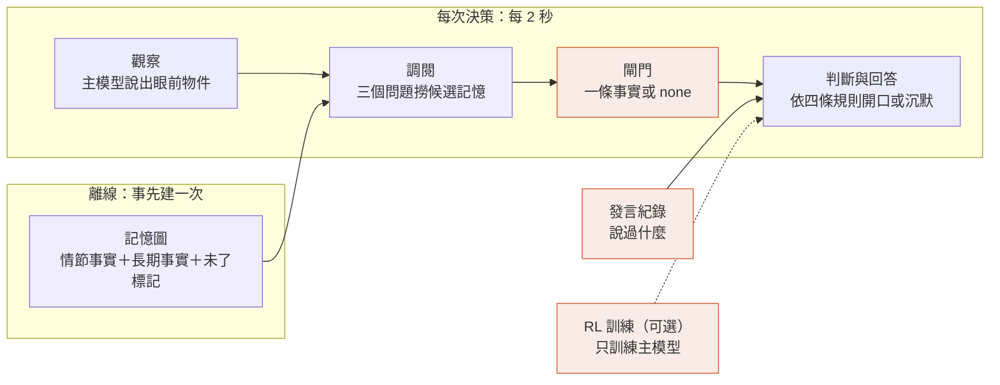
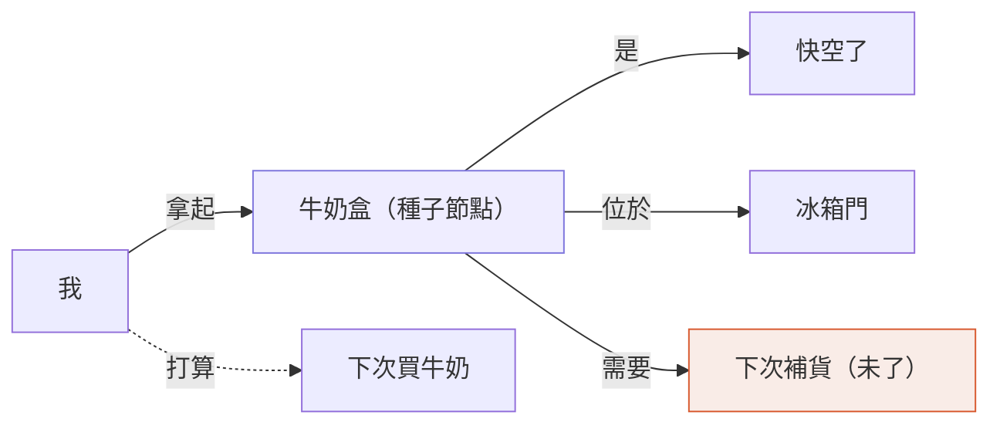
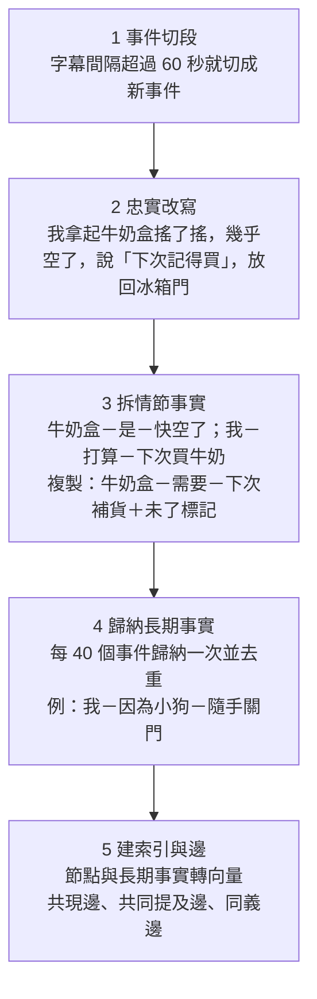
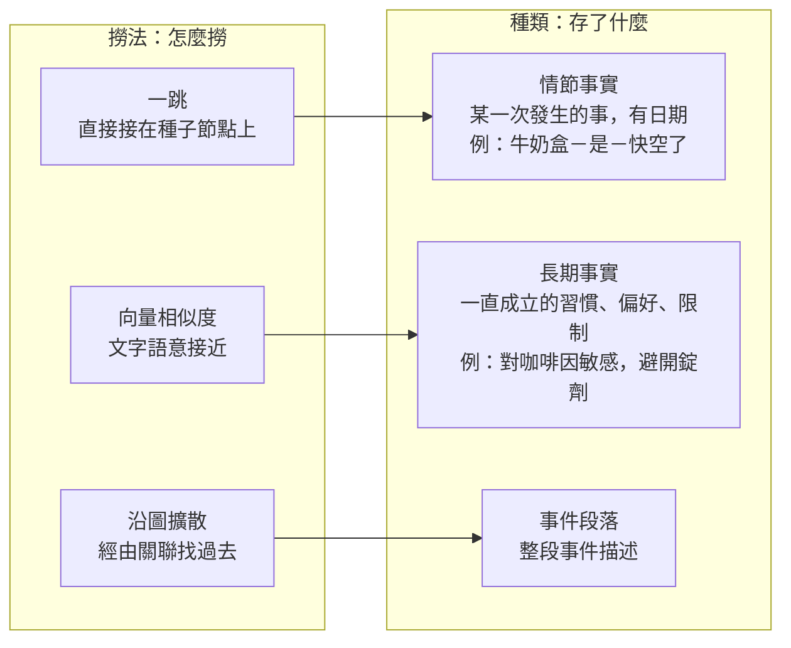

# MemoProAgent：在對的時間交給 Agent 對的證據

**來源**：[MemoProAgent: Toward Memory-Driven Proactive Assistance](https://arxiv.org/abs/2610.22671)（Meta Reality Labs、Meta Superintelligence Labs、Michigan State University 等，通訊作者 Shenglai Zeng，arXiv 2610.22671v2，2026 年 10 月；程式碼見 [facebookresearch/Memo-Pro-Agent](https://github.com/facebookresearch/Memo-Pro-Agent)，資料集見 [MemoProBench（Hugging Face 頁面為 facebook/MemProBench）](https://huggingface.co/datasets/facebook/MemProBench)）

## 前言

想像你戴著一副 AI 眼鏡逛超市。沒有人向它提問，它得自己看懂眼前畫面，決定「現在該不該開口提醒、該說什麼」。判斷的依據不在當下這幾秒，而是埋在你一整年的生活紀錄裡——例如昨天喝完最後一瓶氣泡水，今天經過飲料貨架時，它才該出聲提醒你補貨。

這篇論文的核心結論很直接：現有大型模型其實很會把話說好，真正的瓶頸在於「能不能在對的時間點，把對的證據交到模型手上」。在對照實驗中，只要在該開口的時刻把正確記憶交給 GPT-5.3，嚴格成功率（Perfect，指整段影片只說一次、時機對、內容也對）就能衝到 96.0%；一旦改成讓模型自己挑時機，成功率立刻掉到 38.0%；若改成讓它自己找記憶，更是跌到 15.3%。

針對這個診斷，作者提出不改動模型權重的外層框架 **MemoProAgent**，靠記憶圖、閘門與發言紀錄三個元件分工處理內容與時機。在 Qwen3.8-27B 上，單靠框架就把嚴格成功率從 7.0% 拉到 37.5%，再補上只訓練主模型的強化學習（RL）後達到 42.4%。以下會先看問題診斷，再拆解框架與訓練設計，接著看實驗數據，最後整理記憶設計的獨立概念與部署限制。

> 本文標示慣例：標註「（自編）」的是為了說明機制所設計的情境；標註「（推論）」的是本文作者基於原文所做的延伸判斷；原文未交代的細節會直接說明，並在〈限制與論文留白〉一節集中整理；其餘內容皆取自原始論文。

---

## 問題本質：把話說好不難，難的是在對的時間給對的證據

在這項任務中，系統每 2 秒看一次使用者的第一人稱畫面，在「保持沉默」與「說出一句提醒」之間二選一。過程中沒有任何使用者提問，開口的理由必須從長達一整年、約 61.8 萬個 token 的個人記憶裡翻出來，而真正相關的證據平均只佔其中的 0.19%。由於主動開口本質上就是打斷使用者，絕大多數時刻裡，沉默才是正確答案。

因為這套 benchmark 的個人記憶是合成的，作者手上有「哪段記憶才是標準答案」以及「哪段時間才是該開口的時段」的標註。作者藉此用 $n = 150$ 段影片做了一組 $2 \times 2$ 控制實驗，拆開檢驗「內容」與「時機」兩個變因：證據是直接給正確記憶，還是由標準檢索增強生成（Standard RAG）去撈；證據是只在該開口的時段送進模型（時機給定），還是每一個決策步驟都送進模型（讓模型自己挑時機）。

| 內容 ＼ 時機（Perfect %） | 時機給定 | 模型自己挑時機 |
| --- | --- | --- |
| 正確記憶 | 96.0 | 38.0 |
| RAG 撈的記憶 | 15.3 | 8.0 |

*表 1 — GPT-5.3-Chat 在內容與時機兩個維度下的嚴格成功率對照（$n = 150$ 段影片）。（來源：原始論文 Table 4。）*

表 1 的數字把瓶頸講得很清楚：當正確證據在正確時間出現時，模型幾乎百發百中（96.0%），表示「組織一句好提醒」根本不是問題。反過來說，不管少了內容還是少了時機，表現都會斷崖式崩盤（兩者都交給現有做法時只剩 8.0%）。

因此，方法要解決的目標非常明確：在沒有標準答案的真實場景裡，如何讓對的證據「只在值得開口的那一刻」出現在模型眼前。

---

## MemoProAgent 框架：內容與時機分工

MemoProAgent 不修改主模型權重，而是在模型外層包上一套框架，專門負責「找對證據」與「控制何時遞出證據」。除此之外，作者也提供一段可選的 RL 後訓練，用來進一步收緊主模型的開口紀律。

### 系統全貌

整套架構分成離線建圖與線上決策兩段，其中紫色元件負責「內容」，橘色元件負責「時機」：



這裡有個結構上的關鍵：「觀察」與「判斷與回答」用的是同一個主模型。系統把每 2 秒一次的決策拆成兩輪對話——第一輪先請主模型說出畫面裡有哪些關鍵物件，框架拿這個觀察去記憶圖調閱並過閘門，第二輪再把整理好的證據送回主模型，由它決定開口或沉默。

### 一次決策的完整流程

先用一個具體情境走一遍兩輪決策。假設記憶裡有一條「昨晚喝完最後一瓶氣泡水，打算補貨」，而畫面中氣泡水出現、應該開口提醒的時段是第 2 到 8 秒（自編）：

| 時間 | 觀察輸出 | 閘門交出的證據 | 發言紀錄 | 回答 |
| --- | --- | --- | --- | --- |
| 0 秒 | 購物車、穀片盒 | none | 空 | `NO_REMINDER` |
| 2 秒 | S.Pellegrino 氣泡水 | 昨晚喝完最後一瓶，打算補貨 | 空 | 「你昨晚喝完最後一瓶氣泡水了，記得帶一些」 |
| 4 秒 | S.Pellegrino 氣泡水 | 同上 | 已有上一句 | `NO_REMINDER` |

主模型預設保持沉默，只有在以下四條規則全部成立時才允許開口（整理自論文 Table 7 的提示詞）：

1. 證據提到的物件，此刻就在眼前畫面中。
2. 證據描述的是一件現在就能處理的具體未了事項。
3. 這件事先前還沒提醒過。
4. 只要發言紀錄裡已經涵蓋同一個需求，不論畫面怎麼變、換什麼說法，都不能再重複開口。

此外，提醒句必須直接複述證據裡的事實，不能講泛泛的空話或一般性建議。從上面的時間表也能看出兩個時機元件的分工：防止太早開口主要靠**閘門**擋下（第 0 秒交出 `none`），防止重複打擾則主要靠**發言紀錄**擋下（第 4 秒已說過就閉嘴）。

### 閘門：相關不等於值得打斷

調閱步驟只能回答「這段記憶跟眼前物件有沒有關」，但實務上，「相關」跟「值得打斷使用者」是兩回事。有兩種常見情況就算高度相關也不該開口：物件只是剛好在過去某段紀錄裡路過出現過，或是過去的未了事項後來已經解決了。

MemoProAgent 在調閱與主模型之間放了一道**閘門（Gate）**。它本身就是一次不需訓練的 LLM 呼叫，主實驗中直接沿用和主模型相同的 Qwen3.8-27B。輸入是眼前的物件名稱加上候選記憶，輸出嚴格限縮成單行格式：`FACT: <具體事實＋發生時間>` 或 `FACT: none`。

閘門的篩選規則整理自論文 Table 6：

| 候選記憶的情況 | 閘門輸出 |
| --- | --- |
| 有關該物件的未了事項、偏好、注意事項、過去失誤、不適經驗、缺貨，或「下次要記得」的規則 | 一定輸出 `FACT` |
| 過去的失誤 | 轉寫成「現在仍適用的規則」再輸出 |
| 後續記憶顯示事情已經解決 | `none` |
| 未了事項屬於別的物件 | `none`，不牽扯無關物件 |

論文在廚房場景給了一個直觀例子：記憶裡記錄了「6 天前沒放杯子就啟動咖啡機，結果咖啡溢出」。閘門套用「過去失誤轉規則」，將它整理成相當於「啟動前先在出水口放乾淨的杯子」的事實交給主模型，主模型便在第 24 秒照這條證據提醒使用者（見圖 1）。


*圖 1 — MemoProBench 評測集的代表案例，其中包含廚房咖啡機記憶如何轉化為第 24 秒的提醒。（來源：原始論文 Figure 10。）*

再看一組對照情境（自編）：若候選記憶同時撈出「昨晚喝完最後一瓶氣泡水、說要補貨」與「晚餐用玻璃杯喝水」，閘門只會留下前者；如果候選記憶裡還多了一條「今天早上已經買了一箱」，閘門判定事件已解決，就會直接輸出 `none`。

這道設計的巧妙之處，在於讓「有證據進來」這件事本身成為開口訊號，等於在真實場景中重現〈問題本質：把話說好不難，難的是在對的時間給對的證據〉裡的「時機給定」。不過最終要不要說話，依然由主模型照〈一次決策的完整流程〉的四條規則把關。

### 記憶圖與調閱：用三個問題找證據

為了從 61.8 萬個 token 裡精準撈出那 0.19% 的證據，框架把一整年的生活紀錄以「物件」為節點串成一張**記憶圖**。

每次調閱開始前，系統先做一步對齊：將主模型觀察到的物件名稱轉成向量，與圖上所有節點比對，挑出最接近的幾個節點當作**種子節點（seed nodes）**。這步用來處理「叫法不同」的問題——例如眼前看到的品牌商品是「Stay Awake 提神錠」，透過向量比對就能對應到圖上的「咖啡因錠劑」節點。

接著，調閱階段會同時回答三個問題。以圖 2 右側的真實案例為例，使用者在超市拿起一盒 Stay Awake 提神錠：

| 調閱的問題 | 撈法 | 撈到的記憶種類 | 提神錠例子 |
| --- | --- | --- | --- |
| ① 這個東西本身以前發生過什麼？ | 一跳：直接接在種子節點上的事實 | 情節事實（有日期） | 7 天前吃了咖啡因錠，整晚心悸、睡不好 |
| ② 有沒有關於這類東西的長期原則？ | 實體連結或文字向量相似度 | 長期事實（無日期） | 對咖啡因敏感，避開高濃度錠劑 |
| ③ 還有沒有沒提到這個名字、但有關係的事？ | 沿圖往外擴散（採 PPR 圖擴散演算法，可選） | 事件段落 | 上週熬夜後隔天精神很差，透過「睡眠」節點連過來（自編） |


*圖 2 — 兩個 MemoProBench 樣本，右側為使用者在超市拿起 Stay Awake 提神錠的情境與對應記憶。（來源：原始論文 Figure 3。）*

三個問題撈出的結果會依序合併——先放事件段落、再放長期事實、最後放情節事實——一起交給閘門審核。

這裡值得特別看清楚「一跳」的邊界。以論文 Table 19 的牛奶盒例子來說：



圖中實線直接連著「牛奶盒」這個種子節點，做一次一跳（1-hop）查詢就拿得到。但虛線那條 `[我, 打算, 下次買牛奶]` 只掛在「我」身上，從牛奶盒出發得走兩跳，一跳根本撈不到。這也是為什麼建圖時必須特別把「打算」複製一份掛到物件身上（詳見〈離線建圖：五道工序把一年字幕變成記憶圖〉）。

至於為什麼還需要問題 ② 的向量相似度檢索，是因為長期事實屬於跨事件歸納，用詞通常較概括（如「咖啡因錠劑」），未必包含眼前商品的具體名稱，只靠節點連結容易漏接（推論）；這部分的設計原則會在〈概念延伸：記憶的種類與撈法要分開設計〉深入拆解。

關於調閱細節，論文有兩處留白需要留意：
- **一跳排序的細節未公開**：情節事實會依據「與物件名的相似度」、「是否有未了標記」、「時間遠近」三個條件排序，但論文並未說明三者如何加權、最終保留幾條，也沒交代長期事實取前幾條（$k$ 值）。
- **前後敘述不一致**：論文 Algorithm 1 寫長期事實是靠向量相似度取前 $k$ 條，但附錄 I.2 寫的是「實體連結或相似度」兩者並用，原文沒有說明以哪一處為準。

### 離線建圖：五道工序把一年字幕變成記憶圖

在任何線上決策開始前，系統會先將一整年的生活字幕流離線加工成記憶圖。整個流程共有五道工序（整理自論文附錄 I.1、論文 Table 18，並以論文 Table 19 的牛奶盒為例）：



1. **事件切段**：將一年約 2.8 萬行字幕依時間間隔切分，間隔超過 60 秒就切開成獨立事件。
2. **忠實改寫**：把同一個事件裡的零碎字幕串成流暢的第一人稱段落，完整保留物件、狀態、地點、說過的話、打算與結果。這段改寫文字會附在後續抽出的事實上當作原始出處，讓調閱時能連帶拉出整段事件脈絡。
3. **拆情節事實**：利用 **OpenIE**（Open Information Extraction，源自自然語言處理，不預設關係種類，直接從句子抽出「主詞—關係—受詞」三元組），並為每條三元組附上日期、時間與事件編號。這一步藏著兩個關鍵動作：
   - **複製到物件**：把「我打算……」這類以使用者為主詞的念頭，另外複製一份掛到目標物件上（例如把「下次買牛奶」掛到「牛奶盒」），確保一跳就能命中未了事項。
   - **打未了標記**：凡是表達尚未解決的打算、限制或物件狀態的事實，都會打上未了標記。這個標記只用來幫調閱排序加分，並不是「有標記就一定要開口」。
4. **歸納長期事實**：每 40 個事件為一組，歸納出長期成立的習慣、偏好、飲食或安全限制、人際關係與反覆出現的打算，並做去重（例如「我因為小狗而隨手關門」）。
5. **建索引與邊**：把圖上節點與長期事實轉成向量，供種子節點比對與問題 ② 使用；同時補上三種邊供問題 ③ 的沿圖擴散使用——同一事件出現過的**共現邊**、同一條長期事實提及的**共同提及邊**，以及向量高度接近的**同義邊**。

論文並未交代改寫、拆事實、複製與打標記各用哪個模型，也沒說明「如何判定某個打算對應到哪一個物件」，僅表示遵循 HippoRAG 2 等常見做法。

> **現實落差提醒**：複製到物件與打未了標記，都很依賴記憶裡有人明確說出「我打算……」。MemoProBench 的合成記憶經常會把這類意圖直白寫出來，但真實生活未必如此，搬到實際場景後這套建圖機制的命中率可能會下降（推論）。

### RL 訓練：加強主模型的開口紀律

就算有閘門把關，閘門也不可能每次都遞得剛剛好，加上主模型本身就有愛插話的傾向——回頭看表 1，就算把正確記憶每一步都擺在眼前，GPT-5.3 還是從 96.0% 掉到 38.0%。因此作者多做了一階段強化學習（RL）來訓練主模型；訓練期間，閘門保持凍結，調閱流程與記憶圖也都固定不動。

#### 兩檔獎勵設計

每一個決策步驟的標準動作很單純：只有在「處於該開口的時段內，而且還沒說過」的那一步該開口，其餘每一步都該保持沉默。也就是說，在正確時段內重複提醒，跟在時段外亂開口，受到的懲罰完全一樣。

獎勵函數刻意只切兩檔：
- 該沉默時保持沉默：得 $+1$。
- 該開口時順利開口，且內容經由 LLM 裁判評為 `GOOD`：得 $+1$。
- 其餘所有情況一律給 $-1$，包含錯過時機、過早或過晚亂開口、內容只拿 `BASIC` 或更差、以及輸出格式錯誤。時機錯誤的發言根本不送裁判，直接判 $-1$。

只給 $+1$ 與 $-1$ 兩檔，目的是把鑽獎勵漏洞（reward hacking）的空間壓到最低，不讓模型靠著「亂講一堆稍微沾邊的話」去賺部分分數。

沿用氣泡水例子（該開口時段為第 2 到 8 秒），各情境的給分如下（自編）：

| 時間 | 標準動作 | 主模型的動作 | 獎勵 |
| --- | --- | --- | --- |
| 0 秒 | 沉默 | 沉默 | $+1$ |
| 0 秒 | 沉默 | 開口 | $-1$（太早，不送裁判） |
| 2 秒 | 開口 | 開口，`GOOD` | $+1$ |
| 2 秒 | 開口 | 開口，`BASIC` | $-1$ |
| 2 秒 | 開口 | 沉默 | $-1$（錯過） |
| 4 秒（2 秒已說過） | 沉默 | 又開口 | $-1$（重複） |

#### 訓練資料與 GRPO 演算法

訓練資料共 3,465 個決策時刻，取自 904 段與評測集完全不重疊的訓練影片。每個時刻先前的「發言紀錄」，都是由系統直接照標準答案預先填好；這代表訓練其實是在做單步決策最佳化，而不是讓模型從頭到尾完整跑過整段影片（推論）。

| 樣本類型 | 數量 | 標準動作 |
| --- | --- | --- |
| 時段內、還沒說過 | 1,283 | 開口 |
| 時段之前 | 642 | 沉默 |
| 時段內、已經說過 | 1,283 | 沉默 |
| 沒有證據的保護樣本 | 257 | 沉默 |

演算法採用出自 DeepSeekMath 的 **GRPO（Group Relative Policy Optimization）**。它不需要額外訓練價值網路（value network），而是對同一道題作答 $G$ 次，直接用這組作答的平均分當基準來算優勢值：

$$
A_i = \frac{R_i - \mathrm{mean}(R_1,\dots,R_G)}{\mathrm{std}(R_1,\dots,R_G)}
$$

其中 $R_i$ 是第 $i$ 次作答拿到的獎勵（$+1$ 或 $-1$），$G$ 是同一題的作答次數（這裡設為 $4$），$A_i$ 代表這次作答比組內平均好多少——正數強化這種答法，負數則加以抑制。

舉個具體算例（自編）：在第 2 秒這個該開口的時刻，模型作答 4 次，分別產出「開口 `GOOD`」、「沉默」、「開口 `BASIC`」、「開口 `GOOD`」。四次獎勵為 $+1$、$-1$、$-1$、$+1$，平均 $0$、標準差 $1$，算出的優勢值同樣是 $+1$、$-1$、$-1$、$+1$，因此兩次「開口且說好」會被強化，另外兩次被壓低。若是 4 次全對或全錯，標準差會變成 $0$，這題就不會產生學習訊號，換句話說 GRPO 只從「有時對、有時錯」的題目裡學到東西（推論，屬 GRPO 一般特性）。

最後一個工程細節很關鍵：**只更新主模型自己生成的 token**。因為證據是由框架透過工具回傳塞進對話裡的，計算損失時必須把證據段落的 token 遮罩掉，只算「觀察、判斷、回答」三段，否則模型反而會學著自己編造記憶。其餘訓練設定包含使用 LoRA、只跑 1 個 epoch，在 7 張 H100 上耗時約 14.6 小時（詳細超參數見原論文附錄 G）。

---

## 實驗結果與消融分析

先對齊四個評測指標的定義：
- **Perfect（主指標）**：整段影片只開口一次，時機落在正確時段內，且內容獲 LLM 裁判評為 `GOOD`。
- **Hit**：整段影片至少說對一次，不管有沒有多說。
- **Over-trigger**：整段影片開口超過一次。
- **Fires/clip**：每段影片平均開口次數。

評測集包含 800 段影片，主模型為 Qwen3.8-27B，並同時測試兩種畫面輸入模式：**視窗模式**每 2 秒看最近 4 張畫面；**串流模式**則是每秒加入 1 張新畫面，最多保留 30 張。

| 設定 | Perfect（視窗／串流） | Hit（視窗） | Over-trigger（視窗） | Fires/clip（視窗） |
| --- | --- | --- | --- | --- |
| Standard RAG（最佳 $k$） | 7.0 / 1.0 | 42.5 | 67.5 | 3.58 |
| 套上框架，不訓練 | 37.5 / 33.3 | 54.6 | 22.3 | 1.06 |
| 框架 ＋ RL | 42.4 / 40.6 | 54.0 | 13.5 | 0.90 |

*表 2 — Qwen3.8-27B 在 MemoProBench 800 段評測影片上的主結果比較（Perfect、Hit、Over-trigger 單位皆為 %）。（來源：原始論文 Table 5。）*

表 2 透露出兩個重要訊號：
1. **最大幅度的躍升來自免訓練框架**：單純套上 MemoProAgent，不改任何權重，視窗模式的 Perfect 就從 7.0% 跳到 37.5%（串流模式從 1.0% 跳到 33.3%），Fires/clip 也從每段亂講 3.58 次收斂到 1.06 次。
2. **RL 靠「少說話」得分，而非討好裁判**：加上 RL 後，Hit 幾乎沒動（54.6% → 54.0%），真正改變的是 Over-trigger 從 22.3% 大幅降到 13.5%。這間接證明 RL 學到的是克制開口，而不是鑽 LLM 裁判的漏洞去拼命多講。

為了確認三個元件各自的份量，作者另外抽出 150 段測試影片做消融實驗，以「套上框架、不訓練」的視窗模式為起點，每次只拿掉一個元件（對應圖 3 的 (c) 面板）：

| 拿掉什麼 | Perfect（%） | 變化（百分點） |
| --- | --- | --- |
| 不拿（起點） | 37.3 | — |
| 拿掉閘門 | 24.0 | −13.3 |
| 記憶圖換回 RAG（保留閘門） | 20.7 | −16.6 |
| 拿掉發言紀錄 | 8.0 | −29.3 |


*圖 3 — MemoProAgent 在視窗與串流模式下的進階分析，(c) 面板顯示移除任一元件都會造成 Perfect 顯著下滑。（來源：原始論文 Figure 7。）*

串流模式的消融趨勢與上表一致。記憶圖負責找對內容，閘門與發言紀錄負責守住時機，三個元件缺一不可——其中**發言紀錄的貢獻最大**，一旦拿掉，Perfect 直接暴跌 29.3 個百分點，幾乎打回原形。

---

## 概念延伸：記憶的種類與撈法要分開設計

抽離這篇論文的具體架構，裡面有個對設計任何 Agent 記憶系統都很有價值的觀念：**「記憶存了什麼種類」與「要用什麼方法去撈」是兩個獨立的維度**。同一種記憶可以用不同策略檢索，同一種檢索方法也能撈出不同種類的記憶；把兩者綁死，就一定會漏接關鍵資訊。



把情節事實與長期事實並列比較，就能看出為何兩者需要不同的撈法：

| 比較面向 | 情節事實 | 長期事實 |
| --- | --- | --- |
| 記錄內容 | 某一次發生的具體事件 | 長期成立的習慣、偏好與限制 |
| 時間屬性 | 有明確日期 | 長期有效，無日期 |
| 產生來源 | 從單一事件拆出 | 每 40 個事件歸納一次 |
| 用詞特徵 | 具體，包含明確物件名稱 | 較概括，例如「咖啡因錠劑」 |
| 適合的撈法 | 從物件節點做一跳查詢 | 靠文字向量相似度檢索 |

論文並沒有明講為什麼長期事實要獨立用向量相似度來撈，但從資料特性來看，長期事實是跨事件歸納出來的，用詞偏向概括，往往不會直接出現眼前某款商品的名稱（推論）。如果只靠「事實裡直接提到該物件」的節點連結，使用者在超市拿起 Stay Awake 提神錠時，就會漏掉「對咖啡因敏感」這條關鍵限制；相反地，情節事實因為建圖時已經把打算複製到物件節點上，直接一跳就能準確命中。

實務上還有一個常見誤區：把「情節事實」跟「一跳撈到的結果」畫上等號。前者指的是記憶種類，後者指的是撈法；在一跳範圍之外的情節事實依然存在圖裡，只是必須透過沿圖擴散才能觸及。另外如〈記憶圖與調閱：用三個問題找證據〉所述，論文在長期事實的撈法上（Algorithm 1 寫相似度、附錄 I.2 寫實體連結或相似度）存在前後不一致，實作時需自行決定採用哪一種。

---

## 限制與論文留白

把 MemoProAgent 放到真實穿戴裝置與嚴謹實驗的標準下檢視，有幾個很現實的硬傷與未交代的細節：

1. **基線與框架的提示詞差異未拆開**：Standard RAG 基線和 MemoProAgent 使用的是不同的提示詞，論文並未補做「RAG ＋ 框架提示詞」的對照組。換句話說，Perfect 從 7.0% 跳到 37.5% 這段進步裡，究竟有多少單純來自提示詞寫得更好，目前無法拆開評估。
2. **距離實際上線仍有明顯距離**：就算加上 RL，Perfect 也只有約 42%；在全程都該保持沉默的負樣本上，仍有約七分之一的影片會誤報打擾使用者。
3. **推論延遲與算力開銷未量測**：每 2 秒就要循序跑完觀察、閘門、回答共三次 LLM 呼叫，但論文完全沒有量測端對端延遲。對講求即時與省電的穿戴裝置而言，這會是落地前的最大硬傷。
4. **合成記憶與真實生活的落差**：如〈離線建圖：五道工序把一年字幕變成記憶圖〉所提，建圖高度依賴記憶裡出現明確的「我打算……」，搬到真實生活紀錄時效果可能打折（推論）。

其餘已在前文指出的論文留白，整理對照如下：

| 論文未說明或不一致之處 | 詳見章節 |
| --- | --- |
| 一跳情節事實的三項排序加權方式、保留條數，以及長期事實的 top-$k$ 數量 | 〈記憶圖與調閱：用三個問題找證據〉 |
| 長期事實檢索方式在 Algorithm 1（僅相似度）與附錄 I.2（實體連結或相似度）之間不一致 | 〈記憶圖與調閱：用三個問題找證據〉 |
| 離線建圖各工序使用的模型，以及「打算的對象是哪個物件」的判定方式 | 〈離線建圖：五道工序把一年字幕變成記憶圖〉 |

---

## 結論

MemoProAgent 替主動式 Agent 釐清了一個很務實的設計方向：與其一味期待大模型自己從海量歷史裡猜出何時該插話，不如把問題拆成「找對內容」與「守住時機」兩條線，用外層架構直接解決。

1. **內容與時機缺一不可**：GPT-5.3 在對的時間拿到對的記憶能達 96.0% 成功率，少掉任一環都會崩盤。
2. **免訓練框架帶來主要紅利**：記憶圖負責把相關事實撈出來，閘門把「相關」過濾成「值得打斷」，發言紀錄則擋掉重複碎念——三者合計把 Qwen3.8-27B 的嚴格成功率從 7.0% 推到 37.5%，其中發言紀錄貢獻最大。
3. **RL 負責收緊紀律**：靠 $+1/-1$ 兩檔獎勵與 GRPO，讓模型學會更克制地保持沉默，將成功率進一步拉到 42.4%。
4. **記憶設計要解耦**：存了什麼種類（情節 vs. 長期）跟怎麼撈（一跳 vs. 向量相似度 vs. 擴散）必須分開考量，才能避免概括性原則被具體物件名稱漏接。

```figure-map
[
  {
    "id": "img-022",
    "references_manifest_caption": "Figure 10 Representative examples from the evaluation set. Each card shows the user memory that justifies the reminder (episodic memories with their age, or semantic memories), the reminder MemoProAgent issues with its firing time, and frames sampled around the firing time. Examples continue in Figure 11.",
    "why_used": "呈現論文在廚房咖啡機案例中，過去失誤記憶如何經由閘門轉寫成適用規則並在第 24 秒觸發提醒。",
    "agent_match_hint": "四張評測集代表案例卡片（2x2 排列），左上角為廚房咖啡機案例，含使用者記憶、觸發時間與影片截圖。"
  },
  {
    "id": "img-005",
    "references_manifest_caption": "Figure 3 Two MemoProBench samples. Each card shows frames from the trigger window, the user memory that justifies an intervention (episodic memories with their age, or semantic memories), and the reference reminder. The memories shown are high-level event descriptions; in the benchmark they are rendered into the caption stream that the system receives as input (Appendix D.3). More examples are in Appendix D.2.",
    "why_used": "配合記憶圖調閱段落的 Stay Awake 提神錠案例，展示情節與長期記憶如何共同支撐超市場景的安全提醒。",
    "agent_match_hint": "左右並排的兩張 MemoProBench 樣本卡片，右側為 Retail Store Safety 場景的咖啡因錠劑範例。"
  },
  {
    "id": "img-011",
    "references_manifest_caption": "Figure 7 Further probing of MemoProAgent (Qwen3.8-27B, windowed vs. streaming): (a) zero-shot generalization to Epic-Kitchens (Perfect, %); (b) false-trigger rate on negative clips (%, lower is better); (c) ablation.",
    "why_used": "支撐消融實驗各元件貢獻的比較，並呈現負樣本誤報率以佐證部署限制。",
    "agent_match_hint": "三合一長條圖，由左至右依序為 (a) Epic-Kitchens 泛化、(b) 負樣本誤報率、(c) 元件消融結果。"
  }
]
```
