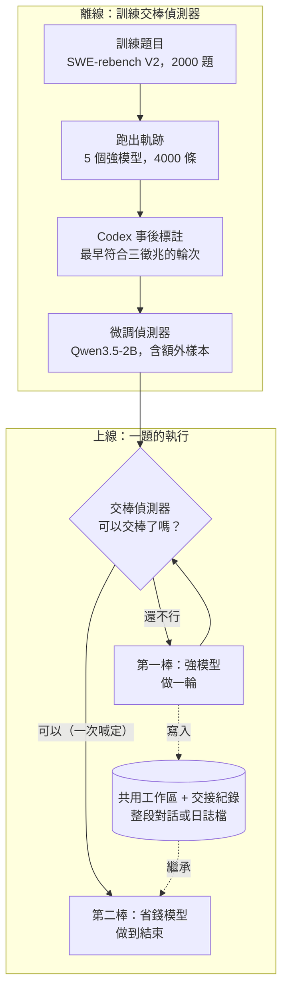

# AgentBaton：長任務 agent 中途把工作交給便宜模型

Nov 22, 2026 · @YHHW

## 論文資訊

- 標題：AgentBaton: Efficient Model Collaboration in Agentic Tasks
- 作者單位：NVIDIA、The Hong Kong University of Science and Technology、University of Illinois Urbana-Champaign
- 連結：[arXiv 2610.35959v1](https://arxiv.org/abs/2610.35959)（2026-10-25）

## 三十秒版本

**情境**：一個 coding agent 用 Kimi K3 解 DeepSWE 的題目，通過率 73.5%，每題平均花 $4.73；換成本地的 Qwen3.8-27B 雖然不花 API 費用，通過率卻只剩 29.2%。

**核心發現**：在同一題中途換模型時，方向決定一切。先讓便宜模型做、再交給強模型，幾乎省不了錢；先讓強模型做、在對的時間點一次交給便宜模型，準確率幾乎不掉，成本卻大幅下降。「對的時間點」不是做了幾輪，而是已經有成果、拿到真實回饋、而且錯在哪已經被定位。以 Kimi K3 → Qwen 為例，通過率 72.6%，每題 $1.28，成本降了 72.9%。

**方法怎麼對應**：AgentBaton 是一個 2B 的外部偵測器。強模型每做完一輪，它就判斷一次；第一次判定就緒時，就把工作區和過程紀錄交給便宜模型做到結束。它的訓練標籤由 Codex 依照上述三個條件事後標出。

## 怎麼讀

主軸只有一個問題：**長任務 agent 能不能先用強模型、中途一次交給便宜模型，而交棒時機又該由誰、依據什麼判斷？** 各節依序回答：為什麼要中途換（1）、怎麼換才划算（2）、上線時怎麼找到交棒點（3）、省了多少、比其他規則好在哪（4）、一條可遷移的設計原則（5）。

**全篇固定名稱**：強模型（capable model，貴而準）、省錢模型（efficient model，便宜或可在本地跑）、交棒（handoff）。方法一節沿用接力賽比喻：第一棒＝強模型、第二棒＝省錢模型、**交棒偵測器**（AgentBaton）＝場邊每圈看一次、決定何時喊交棒的教練。

**標示**：「自編例子」＝為說明而虛構的數字；「推論」＝非論文原文的判斷；「論文未說明」＝原文沒有交代的細節。

**【概念】索引**（可脫離主線獨立閱讀）

1. 【概念 1】交棒後反而比強模型單獨跑更準，要怎麼讀：雜訊與「第二雙眼睛」兩種讀法
2. 【概念 2】為什麼開工前的 routing 會失敗：判斷所需的資訊在執行中才出現
3. 【概念 3】用實際交棒結果當標籤的取捨：每個切點只跑一次時，標籤會系統性偏早

## 1. 問題：為什麼要在任務中途換模型

整題都用強模型太貴，整題都用省錢模型又不夠準；而「開工前一次決定整題給誰」看不到 agent 任務中途的難度變化，所以論文改在同一題中途交棒。

| DeepSWE v1.1，單獨跑 | 準確率（113 題） | 每題平均 API 成本 |
| --- | --- | --- |
| GPT-5.6 Sol（強模型） | 68.1% | $5.32 |
| Qwen3.8-27B（省錢模型） | 29.2% | $0（本地執行，論文記帳為 0） |

agent 每一輪都會改檔案、跑指令、拿回饋，「還需要多強的能力」會隨進度改變：前段要理解 repo、設計做法，後段常常只剩修小 bug、跑測試。只看題目描述的路由器看不到這種變化（實證見【概念 2】）。

**交棒的兩個設計維度**（彼此獨立）

| 維度 | 選項 | 支持的直覺 | 隱憂 |
| --- | --- | --- | --- |
| 交棒方向 | 強 → 省 | 強模型先把計畫與關鍵成果做出來 | 省錢模型接不接得住 |
|  | 省 → 強 | 雜事先交給便宜模型 | 強模型要收拾前一棒的殘局 |
| 交接方式 | **整段對話傳遞**（in-context transfer） | 接手的模型看得到完整過程 | context 變長、每輪更貴；可能被前一棒的錯誤思路帶偏 |
|  | **日誌檔傳遞**（logfile transfer） | 過程寫成檔案，需要時用 cat、grep 查 | 接手的模型可能漏看 |

不論哪種交接方式，接手的模型都會繼承同一個工作區（改過的檔案與產出物）；兩者只差在「過程紀錄」怎麼給。

## 2. 交棒分析：怎麼換才划算

結論：只有「強 → 省、在錯誤已被定位時交棒」同時省錢又保住準確率；交接方式則要依方向而定。

### 2.1 實驗設定：怎麼做出「中途交棒」

- **一次性交棒**：只交一次，接手的模型做到結束，不再換回。總成本＝交棒前模型的花費＋接手模型的花費。
- **基準軌跡**：交棒前的模型單獨把整題做完的完整紀錄。
- **交棒進度**：交棒點落在基準軌跡的百分之幾。

流程（自編例子，基準軌跡 10 輪）：\[1\] 交棒前的模型單獨做完整題 -> \[2\] 選交棒進度 30%，即第 3 輪之後 -> \[3\] 在新容器重播前 3 輪的指令，還原當時的工作區 -> \[4\] 接手的模型從第 4 輪做到結束

「重播」是把紀錄裡的指令重新執行以還原檔案狀態，不是讓模型重想一次；同一條基準軌跡因此可以在 15%–90% 各切一刀。注意：交棒進度是用「跑完才知道的總輪數」算的，只能用來分析，上線時無法使用——這正是第 3 節需要偵測器的原因。

配置：benchmark 為 Terminal-Bench 2.1（各種終端機工作）與 DeepSWE v1.1（真實開源 repo 上的長任務軟體工程題，113 題）；強模型為 GPT-5.6 Sol、Kimi K3、GLM-5.3，省錢模型為 Qwen3.8-27B；harness 為 mini-SWE-agent（只有 shell 動作、對話線性累積）。

### 2.2 交接方式：哪種比較好，要看方向

來源：Table 1，原文 caption：“Context transfer across handoff directions at 30% and 75% of the source model’s baseline trajectory.” 下表取 DeepSWE、75% 交棒點，每格為「準確率 / 每題成本」。

| 方向 | 配對 | 整段對話傳遞 | 日誌檔傳遞 |
| --- | --- | --- | --- |
| 省 → 強 | Qwen → Kimi | 37.2% / $5.76 | 50.4% / $2.52 |
| 強 → 省 | Kimi → Qwen | 76.1% / $3.34 | 76.1% / $3.34 |
| 強 → 省 | GLM → Qwen | 62.8% / $2.07 | 59.3% / $2.07 |

- **省 → 強**：日誌檔傳遞幾乎全面勝出，又準又便宜（唯一例外：Qwen → GPT，DeepSWE 30%，73.5% vs 70.8%）。整段對話傳遞讓付費的強模型每輪重讀長歷史，所以貴；準確率反而較低，可能是被前一棒的錯誤思路帶偏（推論）。
- **強 → 省**：兩種方式成本完全相同，因為接手的 Qwen 記為 $0，總成本只剩第一棒的花費，所以只比準確率。GLM、Kimi 交棒時整段對話傳遞多半較好；GPT 交棒時互有勝負。論文的假設是 GPT-5.6 Sol 不公開完整推理內容，整段對話傳遞時接手者拿不到推理，優勢消失（未驗證）。
- **定案**：省 → 強用日誌檔；強 → 省時 GLM、Kimi 用整段對話，GPT 用日誌檔。日誌檔是一個 `.jsonl`，每輪一筆：當輪回覆，加上每個指令的 return code、stdout、stderr；接手者開新 session，被指示先看最後幾筆。

### 2.3 交棒時機：只有強 → 省划算

來源：Figure 3，原文 caption：“Accuracy and mean API cost across handoff progress on DeepSWE v1.1.”（a）（b）為省 → 強，（c）（d）為強 → 省；虛線是強模型單獨跑的基準，0% 代表只有接手模型在跑。請直接看原圖。

| 方向 | 論文舉的最佳點 | 準確率（vs 強模型單獨跑） | 成本降低 |
| --- | --- | --- | --- |
| 省 → 強 | Qwen → GPT，30% | 70.8%（68.1%） | 6.1% |
| 強 → 省 | GLM → Qwen，30% | 61.1%（61.1%） | 82.4% |
| 強 → 省 | Kimi → Qwen，45% | 72.6%（73.5%） | 61.5% |
| 強 → 省 | GPT → Qwen，60% | 67.3%（68.1%） | 47.9% |

讀表時要注意：後三列是**三個不同的強模型**各自最划算的點，不能跨列比較；準確率高低主要反映模型本身的實力（單獨跑 GLM 61.1%、Kimi 73.5%、GPT 68.1%），要看的是每列與**自己的基準**差多少。「最佳點」是「準確率已接近自己的基準、成本最低」的那個點，也就是最早能安全交棒的時間點。同一個模型內，越晚交棒越準、也越貴（Table 1，DeepSWE）：

| 配對 | 30% 交棒 | 75% 交棒 |
| --- | --- | --- |
| GLM → Qwen | 61.1% / $0.56 | 62.8% / $2.07 |
| Kimi → Qwen | 69.9% / $1.11 | 76.1% / $3.34 |
| GPT → Qwen | 56.6% / $1.25 | 67.3% / $3.65 |

- **省 → 強為什麼不划算**：要省錢就得讓便宜模型做得久；但 GLM、Kimi 晚接手時準確率會掉，GPT 撐得住準確率卻幾乎沒省到錢——強模型接手後仍要重新理解、收拾殘局。
- **強 → 省為什麼有甜蜜點**：越晚交棒，強模型做得越多、成本越高，但接手越容易收尾；越早越便宜、風險也越高。
- **論文的延伸論述**：連「便宜的先做、再換強的」都不划算，每輪在兩個模型間切換的細粒度 routing 只會更難，因為每次切換都可能累積需要收拾的錯誤。這是論述，直接證據見 4.2 的 MTRouter 比較。
- 三個強模型的甜蜜點分別在 30%、45%、60%，「固定在 X% 交棒」很難一體適用；這是論文改去找「任務狀態上的徵兆」的動機（推論）。Qwen → GPT 為何反而比 GPT 單獨跑更準，見【概念 1】。

### 2.4 三個交棒就緒徵兆

來源：Figure 4，原文 caption：“Unsuccessful and successful capable-to-efficient handoffs.” 作者挑出「早一點交棒 Qwen 失敗、晚一點交棒 Qwen 成功」的軌跡，比較中間強模型多做了什麼；這些題 Qwen 單獨做都會失敗。

出發點：Qwen 擅長「目標明確的局部修補」，不擅長「搞懂問題、從頭設計」。能不能交棒，要看 Qwen 接手時需要回答的問題裡，還有沒有它答不了的難題。

| 接手者要回答的問題 | 對應的徵兆 | 由強模型先答掉，交棒才安全 |
| --- | --- | --- |
| Q1：手上有沒有東西可以改？ | ① 有實質成果 | 已有能跑的實作、原型或題目要求的產出物 |
| Q2：它現在哪裡錯了？ | ② 有真實回饋 | 已執行、測試或檢查過，知道錯在哪 |
| Q3：接下來要做多大的範圍？ | ③ 剩下的工作已收斂 | 只剩局部的診斷、修補、驗證或整理輸出 |

**並排對照：壓縮器一題**（Figure 4(c)，Terminal-Bench，GLM → Qwen）

|  | 30% 交棒 | 45% 交棒 |
| --- | --- | --- |
| 交棒當下：Q1 有東西可改嗎 | 有，編碼器已能產出壓縮檔 | 有，同一個編碼器 |
| 交棒當下：Q2 錯在哪 | 只知道「解壓會當掉」 | 已追到第一個 token 就錯，問題在 sign bit 處理與算術編碼 |
| 交棒當下：Q3 範圍 | 整條壓縮流程都可能有問題 | 只要重寫編碼器裡這一塊 |
| 交棒當下：編碼器對了嗎 | 錯 | **仍然錯** |
| Qwen 接手後的最終結果 | 失敗 | 成功（2370 bytes 的檔案解壓後完全正確） |

兩個時間點交出去的編碼器**一樣是壞的**，差別只在「錯在哪」是否已被定位。強模型多做的那一段沒有修好 bug，而是把「找錯在哪」這個難題答掉，剩下「照已知位置重寫」正是 Qwen 做得到的事。所以**回饋不必是好消息，只要它縮小了失敗的範圍**。Figure 4 另兩題卡在不同的問題：(b) Raman 擬合在 30% 時連 Q2 都還沒答（橫軸座標意義不明，強模型驗證出 x = 10^7 / x\_raw 後 Qwen 才做對）；(a) IPython 打包在 45% 時 Q3 還沒收斂（含空格路徑的 bug 還在）。

論文的結論：能不能交棒，取決於已建立多少進度與剩下工作的性質，而不是已跑了幾輪。軟體工程的對應物：值得交給新人的時刻，是 issue 從「調查型」變成「實作型」的那一刻——資深工程師已把問題縮小到某個函式、寫好重現步驟，而不是已經修好。

## 3. 方法：AgentBaton

AgentBaton 把第 2 節的三個定案組成可上線的系統：固定強 → 省、交接方式依第一棒而定、交棒時機交給一個外部的 2B 偵測器依任務狀態判斷。



上半部是離線訓練，下半部是上線時一題的執行。比喻：接力賽，偵測器是每跑完一圈（一輪）就看一次的場邊教練；不同於真實接力，兩棒沒有並跑的交接區，第一棒交出去就停。偵測器只決定「什麼時候交」，模型配對與交接方式都是事先固定的。

### 3.1 為什麼需要外部偵測器

最簡單的做法是把三個徵兆寫進 prompt，請第一棒「覺得可以時自己交棒」；結果模型不是不肯交，就是交了也不划算。來源：Table 2，原文 caption：“Prompt-based handoff to Qwen 3.8 27B on DeepSWE v1.1.”（強模型單獨跑的基準取自 Table 3）

| 第一棒 | 有交棒的題數 | 準確率（vs 單獨跑） | 每題成本（vs 單獨跑） |
| --- | --- | --- | --- |
| GLM-5.3 | 6 / 113 | 54.9%（61.1%） | $2.54（$3.16） |
| Kimi K3 | 0 / 113 | 64.6%（73.5%） | $4.89（$4.73） |
| GPT-5.6 Sol | 113 / 113 | 62.8%（68.1%） | $3.75（$5.32） |

Kimi、GLM 幾乎不放手；GPT 每題都交，但成本只降約 30%、準確率還掉 5 個百分點——每題都交不等於在對的時間交。所以論文把「何時交棒」獨立成一個專門訓練的外部判斷，類似由外部 health check 而非服務本身決定何時被替換。

補充：Kimi 一題都沒交，準確率卻從 73.5% 掉到 64.6%（83 → 73 題）、成本多約 3%。論文未說明原因，有兩種讀法：① 交棒指令本身改變了行為（每輪分心評估「能不能交」，且該段指令每輪都佔 input token）；② 單次執行的隨機差異，但 10 題約是單次標準誤的兩倍，完全用雜訊解釋較勉強（推論）。若是 ①，反而更支持讓第一棒的 prompt 保持原樣、判斷交給外部；不論哪種，「prompt 無法穩定讓模型放手」都成立。

### 3.2 上線時一題怎麼跑

第一棒每做完一輪，偵測器就判斷一次；第一次出現 `HANDOFF_READY` 就換第二棒做到結束。

```python
while not task_done:                         # 第一棒：強模型
    step = strong_model.act(history)         # 一輪：思考 + 下指令
    obs = env.execute(step)                  # 在共用工作區執行
    history.append(step, obs)
    if detector.judge(task, history) == "HANDOFF_READY":
        break                                # 第一次喊交棒就換人

# 第二棒：省錢模型，繼承工作區 + 交接紀錄
efficient_model.continue_until_done(workspace, transfer(history))
```

自編例子：強模型單獨做這題需 12 輪；偵測器在第 1–6 輪判「還不行」、第 7 輪判「可以」，Qwen 從第 8 輪接手，強模型只付 7 輪的錢。與 2.1 的分析設定不同，這裡每輪只看到目前為止的狀態，不需要知道總輪數，所以能上線。

### 3.3 偵測器看到什麼、輸出什麼

偵測器有自己一份「只追加」的對話，每輪把第一棒的動作與工具輸出接上去，回答一個二選一的 JSON。來源：Figure 5，原文 caption：“Online detection in AgentBaton with separate, growing message histories.”

第 t 輪的輸入：\[偵測指令\] -> \[原始題目\] -> \[第 1 輪：動作 + 工具輸出\] -> \[NOT\_READY\] -> \[第 2 輪：動作 + 工具輸出\] -> \[NOT\_READY\] -> … -> \[第 t 輪：動作 + 工具輸出\] -> 輸出 `{"judgement":"HANDOFF_NOT_READY"}` 或 `{"judgement":"HANDOFF_READY"}`

| 設計 | 內容 | 意義 |
| --- | --- | --- |
| 獨立對話 | 與第一棒的對話分開，只追加不重寫 | 不影響第一棒的 context |
| 看什麼 | 第一棒的動作與工具輸出；論文列出的輸入未提到第一棒的推理內容 | 依「做了什麼、得到什麼」判斷，對應三個徵兆 |
| 保留過去的判斷 | 之前每輪的 NOT\_READY 留在對話裡 | 與訓練格式一致（見 3.5） |
| 過長處理 | 超過上限時丟掉最舊的一半歷史輪次，系統指令與原始題目永遠保留 | 上限數字論文未明寫，應為訓練時的 32K（推論） |
| 速度 | 單張 H100、360 次、輸入 2K–121K tokens：中位數 338 ms，p95 1.11 秒 | 每輪多等不到一秒 |

一般知識，不是論文內容：只追加的對話每輪前綴不變，vLLM 這類引擎可重用前綴的 KV cache，只算新加的一段；這可能是延遲低的原因之一（推論）。

### 3.4 訓練資料：Codex 事後標出最早就緒點

從 SWE-rebench V2 隨機抽 2000 題，每題從 5 個強模型（GPT-6 Astra、GPT-5.6 Sol、Claude Opus 5、Kimi K3、GLM-5.3）隨機挑 2 個各跑一次，共 4000 條軌跡；再請 Codex 回頭看整條軌跡，標出「最早一個三條件同時成立」的輪次 h；從頭到尾沒有同時成立則標為「沒有明確交棒點」（比例論文未說明）。標註規則見 Appendix B：

| 條件 | 算 | 不算 |
| --- | --- | --- |
| ① 有實質成果 | 實作、能跑的原型、題目要求的產出物 | 只有調查、計畫、沒執行過的程式草稿 |
| ② 有真實回饋 | 編譯、執行、測試或檢查過並看到結果；失敗也算，只要暴露出局部問題 | 只下了指令就當成功；環境壞掉導致根本沒測到 |
| ③ 剩下的工作已收斂 | 剩下診斷、修補、強化、驗證、整理輸出 | 還在選核心做法，或主體還沒寫 |

不要求所有測試都通過；之後即使又改壞，標籤仍留在第一個符合的點。兩個容易忽略的設計：

- **Codex 只看動作與工具輸出**，模型推理、最終評分、「交給接手者後有沒有成功」都不准當證據。所以標籤代表「照規則看起來可以交」，**不是**「實際交出去確定會成功」（另一種標法的取捨見【概念 3】）。
- **標註完全沒有接手模型參與**，標籤不綁定接手者，所以同一個偵測器可同時用於交給 Qwen 與交給 GPT-5.6 Luna。

Codex 標註時看得到整條軌跡（包括後來發生的事），偵測器上線時只看得到過去；訓練的目的是讓只看得到過去的 2B 模型模仿能看到全局的標註者（推論，論文未用此說法）。

### 3.5 訓練樣本：一條軌跡展開成多筆

除了「h 之前說不行、在 h 說可以」的主樣本，h 之後的每一輪各產生一筆「這時也應該喊可以」的額外樣本。自編例子：6 輪的軌跡，h ＝ 第 4 輪。N ＝ NOT\_READY、R ＝ READY；括號＝只當上下文、不計損失；空格＝不在該樣本中。

| 樣本 | 輪 1 | 輪 2 | 輪 3 | 輪 4（h） | 輪 5 | 輪 6 |
| --- | --- | --- | --- | --- | --- | --- |
| 主樣本 | N | N | N | R |  |  |
| 額外 1 | (N) | (N) | (N) | (N) | R |  |
| 額外 2 | (N) | (N) | (N) | (N) | (N) | R |

- **括號格為何不計損失**：額外樣本裡第 4 輪被寫成 N，但正確答案是 R；若計入損失會與主樣本矛盾。它只模擬「偵測器在第 4 輪看漏了」的情境。
- **解決什麼**：只有主樣本時每條軌跡只有 1 個 R、卻有 h−1 個 N，正例太少；額外樣本補足正例，並教偵測器「之前漏喊了，現在還是要喊」。這也是 3.3 要把過去的判斷留在對話裡的原因。
- **額外樣本數 ＝ T − h**（T ＝ 總輪數），不是固定值：T ＝ 6、h ＝ 4 → 2 筆；T ＝ 20、h ＝ 5 → 15 筆；T ＝ h → 0 筆。越早就緒、之後又做很久的軌跡產生越多正例；是否對此不平衡加權或抽樣，論文未說明。
- 標為「沒有明確交棒點」的軌跡如何產生樣本，論文未說明。

模型從 Qwen3.5-2B 初始化（9B 版本無明顯改善），訓練 2 個 epoch、最長 32K tokens；其餘超參數詳見原論文。

## 4. 實驗：省多少、比其他規則好在哪

成本全面下降（論文報告 22 組設定平均降 65.9%），準確率大致持平；與同樣平均交棒時間的固定輪數相比，依任務狀態交棒多補回 2.7–4.5 個百分點。

**指標**

- **準確率**：benchmark 驗證程式判定通過的題目比例，衡量最終結果。
- **成本**：每題平均 API 花費，本地模型（Qwen）記為 $0。
- **交棒進度**：偵測器喊交棒的輪次落在第一棒基準軌跡的百分之幾。
- Table 3 下標的變化量是**相對變化**，不是百分點：60.2（−11.6%）＝ 68.1 × (1 − 0.116)，實際少 7.9 個百分點。

### 4.1 主結果

來源：Table 3，原文 caption：“AgentBaton results.” 下表只取 DeepSWE（113 題），每格為「準確率 / 每題成本」。參考：Qwen 單獨跑 29.2% / $0；GPT-5.6 Luna 單獨跑 60.2% / $0.40。

| 第一棒 | 單獨跑 | → Qwen3.8-27B | → GPT-5.6 Luna |
| --- | --- | --- | --- |
| GPT-5.6 Sol | 68.1% / $5.32 | 60.2% / $1.02 | 67.3% / $1.39 |
| Claude Opus 5 | 67.3% / $9.91 | 61.9% / $2.61 | 76.1% / $2.92 |
| GLM-5.3 | 61.1% / $3.16 | 58.4% / $0.49 | 66.4% / $0.83 |
| Kimi K3 | 73.5% / $4.73 | 72.6% / $1.28 | 77.0% / $1.58 |
| Gemini 3.8 Flash | 65.5% / $6.15 | 61.9% / $1.21 | 73.5% / $1.71 |

部署限制：Qwen 接手的成本未含本地 GPU 與每輪跑偵測器的算力；接手者付費的 Luna 列仍降 66.6%–73.9%，省錢方向成立，但幅度要扣掉自己的本地算力成本。

- 交給 Qwen 時準確率多半小幅下降；交給 Luna 時 5 個第一棒有 4 個超過自己單獨跑的成績，但**只在 DeepSWE 成立**：Terminal-Bench 上交給 Luna，5 組只有 Opus 變好（相對 +2.6%），其餘下降 1.3%–7.7%（如何解讀見【概念 1】）。
- 偵測器在 Terminal-Bench 上喊得較晚（平均交棒進度 56%–69%，DeepSWE 為 27%–41%）。
- 論文總結：22 組（配對 × benchmark）中有 12 組準確率上升或相對下降不到 5%。

### 4.2 和其他交棒規則比較

四種方法都是「決定什麼時候換成 Qwen」的規則。兩個固定門檻直接用 AgentBaton 在該設定下的平均交棒點當門檻。自編例子：假設 AgentBaton 平均在第 7 輪、35% 進度交棒，某題強模型單獨做要 20 輪：

| 規則 | 這一題怎麼換 | 上線能用嗎 |
| --- | --- | --- |
| 固定輪數 | 不管哪題，一律第 7 輪後交 | 能 |
| 固定進度 | 20 輪的 35% 即第 7 輪；40 輪的題則第 14 輪 | **不能**，需先知道總輪數 |
| AgentBaton | 每輪看狀態，此題可能第 5 輪、另一題第 15 輪 | 能 |
| MTRouter | 每一輪都重選一次模型，可來回切換 | 能 |

來源：Table 4，原文 caption：“AgentBaton versus routing and fixed handoff baselines with Qwen 3.8 27B.” 每格為「準確率 / 每題成本」；參考：Kimi 單獨跑 DeepSWE 73.5% / $4.73。

| 規則 | GLM · DeepSWE | Kimi · DeepSWE | GLM · Terminal-Bench | Kimi · Terminal-Bench |
| --- | --- | --- | --- | --- |
| MTRouter | 58.4% / $3.67 | 66.4% / $4.37 | 80.9% / $1.35 | 85.4% / $1.07 |
| 固定進度（需總輪數） | 59.3% / $0.52 | 74.3% / $1.28 | 78.7% / $0.38 | 86.5% / $0.83 |
| 固定輪數 | 54.9% / $0.48 | 69.9% / $1.15 | 76.4% / $0.18 | 82.0% / $0.37 |
| AgentBaton | 58.4% / $0.49 | 72.6% / $1.28 | 80.9% / $0.27 | 86.5% / $0.57 |

各設定均為單次執行，幾個百分點的差距接近雜訊範圍。

- **每輪切換不划算**：對 MTRouter，AgentBaton 準確率相同或更好、成本少 47%–87%，印證 2.3 的論述。
- **偵測器的價值在「每題不一樣」**：對固定輪數，四組都更準（+2.7 至 +4.5 個百分點），成本略高。
- **離上限不遠**：需先知道總輪數的固定進度，準確率與 AgentBaton 相近（Kimi · DeepSWE 高 1.7 個百分點）。
- 另一個對照是開工前只看題目描述的路由器，見【概念 2】。

## 5. 值得帶走：不要讓執行者決定自己什麼時候退場

「該停」「該換」「該升級」這類判斷，應由讀執行紀錄的外部元件做，而不是寫進執行者的 prompt。

**為什麼成立**

- 執行者的目標是把任務做完，不是控制成本，沒有放手的動機。
- 它對自己狀態的判斷未經校準：同一句 prompt，Kimi 一題都沒交（0/113）、GPT 每題都交（113/113），都不是依實際狀態在判斷（3.1）。
- 把退場判斷塞進執行者的 prompt 還可能干擾主任務：Kimi 沒交任何一題，準確率卻從 73.5% 掉到 64.6%（原因有兩種讀法，見 3.1 補充）。

**怎麼用**

- 外部元件讀 trace，輸出簡單的二選一判斷；執行者的 prompt 保持原樣。
- 這個判斷元件可以單獨評估、單獨調門檻、單獨替換。
- 適用場景：切換模型、轉交真人、停止重試、預算熔斷、結束搜尋迴圈。

軟體工程的對應物是 health check 與 circuit breaker：服務不負責判斷自己該不該被拔掉。

## 【概念 1】交棒後反而比強模型單獨跑更準，要怎麼讀

**一句話**：交棒後準確率超過強模型單獨跑，多半落在單次跑分的雜訊範圍內；就算是真的，也較像「多一次嘗試」的效果，不該讀成交棒會讓結果變好。

| 例子 | DeepSWE（113 題） | Terminal-Bench |
| --- | --- | --- |
| Qwen → GPT，30%，日誌檔 vs GPT 單獨跑 | 70.8% vs 68.1%（+3 題） | 89.9% vs 87.6%（+2.3 個百分點） |
| Opus → Luna vs Opus 單獨跑 | 76.1% vs 67.3%（+10 題） | 86.5% vs 84.3%（+2.2 個百分點） |
| 其餘 4 個第一棒 → Luna | 4 組中 3 組超過單獨跑 | 4 組全部下降 |

單次跑分的標準誤（二項分布）：

```latex
SE = \sqrt{\frac{p(1-p)}{n}}
```

p ＝ 準確率，n ＝ 題數。以 p ＝ 0.69、n ＝ 113 代入：SE ＝ √(0.69 × 0.31 / 113) ≈ 0.044，約 4.4 個百分點。Qwen → GPT 的 2.7 個百分點不到一個標準誤；Opus → Luna 的 8.8 個百分點約兩個標準誤，但只在一個 benchmark 上出現。

**兩種讀法**（論文未說明原因，兩者皆為推論）

1. **雜訊**：論文未報告重複執行的變異；差距多在一到兩個標準誤內，而且跨 benchmark 不一致。
2. **多一雙眼睛**：接手者開新 session，看得到前一棒已試過、失敗的路，等於多一次排除錯誤方向的機會；比較的其實是「單次嘗試」對「多一次嘗試的資訊」，兩邊並不對等。Qwen → GPT 在兩個 benchmark 方向一致，是這種讀法的弱證據。

不論哪種讀法，較公允的結論都是：交棒後準確率大致持平，有時小幅上升或下降；差距主要跟著「誰接手」與「哪個 benchmark」變，偵測器管的只是時機。

## 【概念 2】為什麼開工前的 routing 會失敗

**一句話**：只看題目描述、預測「省錢模型能不能自己解」的路由器，訓練集幾乎全對，上線卻幾乎全判給強模型——因為判斷所需的資訊要在執行中才出現。

**實驗**（論文 4.4 內文）：從 Qwen3.5-2B 微調；輸入只有題目描述；標籤來自 Qwen3.8-27B 在 2000 題 SWE-rebench V2 上實際跑一次的成敗，正負例平衡。訓練集準確率 99.55%，測試時只把 1 題分給 Qwen，等於全程用強模型。測試集準確率、使用哪個 benchmark、判斷門檻，論文未說明。

|  | 只看題目描述的路由器 | AgentBaton |
| --- | --- | --- |
| 何時決定 | 開工前，只一次 | 每一輪 |
| 看什麼 | 題目描述 | 至今的動作與工具輸出 |
| 標籤來源 | 省錢模型實際跑一次的成敗 | Codex 依三個徵兆標註 |
| 結果 | 幾乎全判給強模型，沒省到錢 | 成本平均降 65.9% |

**為什麼會這樣**（推論，論文只給了結果）

- **99.55% 是背答案**：2000 題對 2B 模型很少，它可以直接記住每題描述對應的標籤，不代表學到可推廣的規律。
- **資訊不在題目描述裡**：解不解得開，取決於做下去才會發現的事（repo 裡藏著什麼問題）——這正是整篇論文的核心論點。
- **標籤有雜訊**：每題只跑一次，成敗有一部分是運氣（同一問題見【概念 3】）。
- **退回保守是合理的失敗方式**：分不出來時全部交給強模型，至少不掉準確率。

這只是一個訓練設定、未調過門檻的對照組，能證明「這樣做不夠」，不能證明「開工前的 routing 一定沒用」。

## 【概念 3】用實際交棒結果當標籤的取捨

**一句話**：另一種標註法是對每條訓練軌跡在 10%、20%…… 各切一刀、實際交給接手者跑完，取最早成功的點當標籤；它貼合接手者的真實能力，但單次執行的雜訊會讓標籤系統性偏早。論文在第 2 節的分析用過這種做法，但標註訓練資料時明確禁止使用接手者的結果（Appendix B），原因論文未說明。

|  | 依規則標註（論文做法） | 窮舉切點、實際交棒 |
| --- | --- | --- |
| 標籤意義 | 照規則「看起來可以交」 | 實際交出去「真的成功了」 |
| 成本 | 每條軌跡讀一次 | 4000 條 × 9 個切點 ＝ 36,000 次完整執行，每次最長 2 小時 |
| 雜訊來源 | 標註者判斷錯誤 | 單次執行的成敗有一部分是運氣 |
| 換接手模型 | 不用重標 | 整批重跑 |
| 貼合接手者能力 | 不考慮接手者是誰 | 貼合 |

**為什麼會偏早**：「最早成功點」是在多次有雜訊的嘗試裡取最小值。若第 i 個切點的真實成功率為 p\_i、每點只跑一次，前 k 個切點至少成功一次的機率：

```latex
P = 1 - \prod_{i=1}^{k} (1 - p_i)
```

自編例子：前四個切點 p\_i 為 0.1、0.1、0.2、0.3，可靠的就緒點在之後（成功率跳到 0.6）。P ＝ 1 − 0.9 × 0.9 × 0.8 × 0.7 ≈ 0.55，超過一半的情況標籤會落在真正就緒點之前；切點越多偏得越嚴重。

**另一個問題**（推論）：用結果標籤會混進偵測器看不到的因素。接手者單獨就能解的簡單題，標籤會落在 0%，軌跡上却沒有任何就緒跡象可學；同一狀態這次成功、下次失敗的運氣成分也一樣。偵測器只看得到軌跡狀態，被要求學一個觀察不到的訊號，學到的會很模糊。

**折衷**（推論）：主要標籤用規則標註；另挑一小部分題目，每個切點跑 K 次、估計成功率，把「估計成功率第一次超過門檻」的點當比對基準，檢查規則標籤是否系統性偏早或偏晚。
