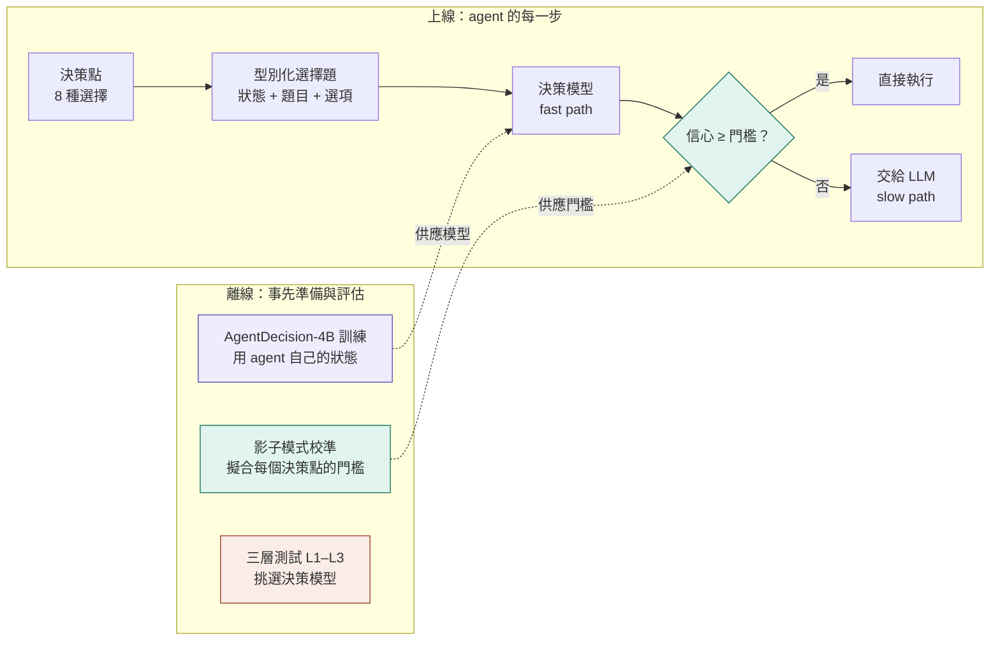
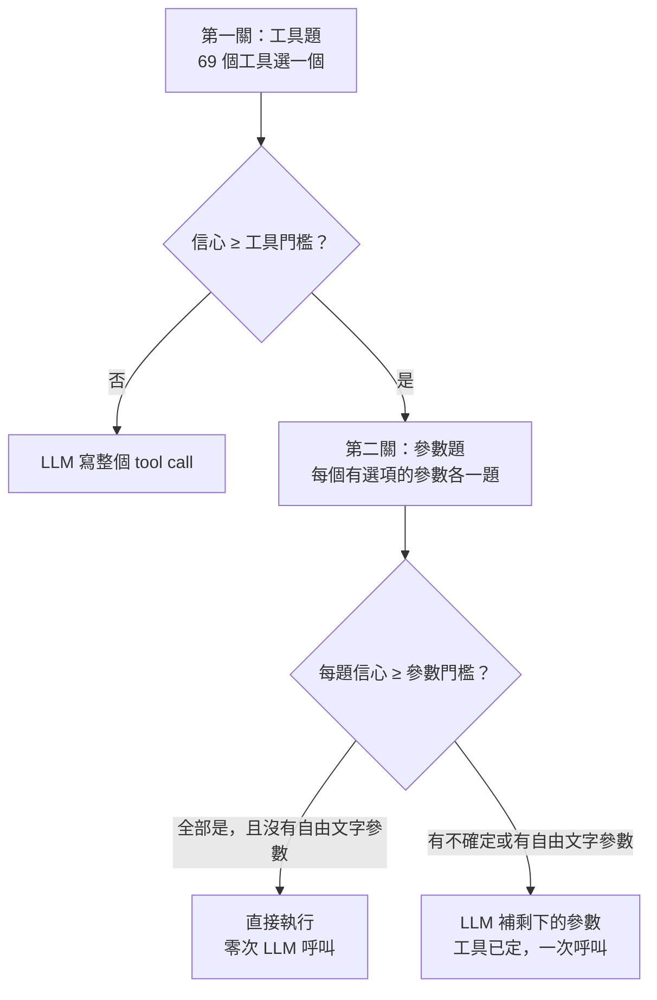
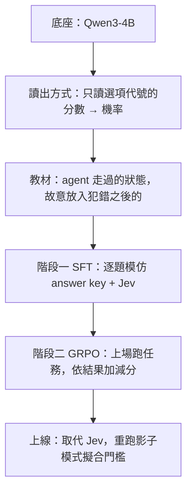

# JevAgentHarness：讓決策模型分擔 LLM agent 的例行決策

Nov 25, 2026 · @YHHW

## 論文資訊

- **標題**：JevAgentHarness: Benchmarking, Deploying and Training Decision Models That Share Control with LLMs
- **作者單位**：University of Illinois Urbana-Champaign、Princeton University、Google（Kunlun Zhu、Tao Feng、Xu Han、Heng Wang、Ling Yang、Xiangru Tang、Jiaxuan You、Heng Ji）
- **論文**：[arXiv 2610.21412v1](https://arxiv.org/abs/2610.21412)（2026-10-15）
- **程式、模型與資料**：[github.com/JevAgentHarness/JevAgentHarness](https://github.com/JevAgentHarness/JevAgentHarness)（論文寫明將釋出）

## 三十秒版本

客服 agent 每走一步都要叫一次大 LLM，但大部分步驟其實只是「從 69 個工具裡挑一個」的選擇題。這篇把這些選擇題交給 4B 的決策模型，只有在它的信心超過門檻時才採用，否則交回 LLM。

成敗取決於兩個條件。第一，門檻必須用 agent 自己的軌跡實測擬合：固定在 0.5 會讓成功率掉 21.5 分，擬合後不掉分。第二，決策模型必須用 agent 自己走過的狀態訓練，包含刻意製造的「犯錯之後」的狀態。這樣訓練出來的 4B 模型，在換過說法的任務上成功率 96.0%，老師 Jev 只有 82.0%；單題考試分數最高的模型，在 agent 裡卻只解出 69.5% 的任務。在同類任務上，整體成本比只用 LLM 少 81.1%。

**做法**：agent 每走一步，harness 先把「下一步呼叫哪個工具」包成一道選擇題，交給決策模型。決策模型對每個選項給一個機率，最高的那個就是答案，它的機率就是信心。信心過線就直接執行，不叫 LLM；沒過線，這一步照舊交給 LLM。工具確定之後，參數裡有固定選項的部分（例如訂單編號、取消原因）也照同樣方式出題，只有自由文字的部分才交給 LLM 寫。

這條線不是憑感覺訂的：先讓 agent 照常由 LLM 跑一批任務，決策模型在旁邊只答題、不執行，事後對答案，找出「決策模型多錯的次數，剛好被省下的 LLM 費用賠得起」的那個信心值。決策模型本身則是用 agent 實際走過的狀態訓練出來的，包含故意讓 agent 走錯之後的狀態。

## 怎麼讀

**主軸：agent 裡的例行選擇題，什麼時候可以放心交給便宜的決策模型？** 主線每一節回答其中一個子問題：

1. 第 1 節：直接交出去，會壞在哪裡？
2. 第 2 節：怎麼交才安全？依序回答「一步怎麼走 → 可以在哪些地方出題、怎麼分工 → 門檻從哪來 → 決策模型怎麼練 → 機制掛在迴圈的哪個 hook」。
3. 第 3 節：證據在哪？只放一張主結果表。

**標示**：「自編例子」是為了說明而設計的數字；「推論」是筆者的推斷，不是論文原文；「論文未說明」代表原文沒有交代。

**【概念】索引**

- 【概念 1】設計 agent 的 RL 獎勵：別讓省成本壓過成功（文末）

## 1. 問題：把選擇題直接交給決策模型，會壞在哪

agent harness 每一步都叫一次大 LLM，但多數步驟的產出只是從清單裡挑一個選項。決策模型（decision model，例如 Jev）專門答這種題：輸入「狀態、一道題、選項」，輸出每個選項的機率，不生成文字。論文記錄的一個 episode 裡，一次 Jev 呼叫只花一次 LLM 呼叫 28% 的時間、2.6% 的價格。

但決策模型是在「一題一題、答完就結束」的固定題目上做出來、也是在這種題目上測的。放進 agent 之後，會遇到三個問題（例子都用同一個客服任務：客人要求取消訂單）：

| 挑戰 | 例子 | 對應的設計 |
| --- | --- | --- |
| ① 單題考試分數排不出它在 agent 裡的好壞 | 單題最準的模型，放進 agent 反而解出最少任務 | 三層測試 L1 → L3（第 3 節） |
| ② 錯誤會連鎖 | 該先問客人時，很有把握地選了「取消訂單」；取消無法復原，後面再對也救不回來 | 信心門檻：只採用過線的答案（2.2、2.4） |
| ③ 會遇到沒看過的狀態 | 前一步誤用名字相近的工具，畫面上滿是無關的舊訂單；固定題庫幾乎沒有這種「犯錯之後」的狀態 | 用 agent 自己走過的狀態訓練（2.5） |

單題考試和 agent 的關鍵差別：考試答錯一題就只錯那一題；在 agent 裡，答錯會改變下一題的題目。論文因此主張，決策模型要在 agent 裡測、只在有把握時用、用 agent 自己的狀態練。

## 2. 方法

### 2.1 系統地圖

整套系統分兩層：上線層在 agent 的每一步決定「這一題誰來答」，離線層供應上線層需要的兩樣東西：門檻和決策模型。貫穿全節的比喻是軟體工程的 fast path／slow path：決策模型是便宜的 fast path，LLM 是昂貴的 slow path，信心門檻決定一個請求能不能留在 fast path。



顏色對應第 1 節的挑戰：紅＝①單題分數不準，綠＝②錯誤會連鎖，紫＝③沒看過的狀態。三層測試不參與執行，只用來挑決策模型。門檻不是一次定定：LLM、決策模型或任務規則任一個改變，就要重新擬合。

### 2.2 一次 tool call 怎麼走（CASCADE）

一次 tool call 拆成兩關：先問「用哪個工具」，再問「參數填什麼」；每一關都只在決策模型有把握時採用它的答案，其餘交回 LLM。要拆開，是因為決策模型只會從選項裡挑，不會生成文字；拆開之後，有固定選項的部分給它答，需要寫字的部分才付 LLM 的錢。



**哪些參數能出題**：只看工具的 JSON schema，把每個參數分成三類。

| 類型 | schema 上的判斷依據 | 選項從哪來 | 例子 |
| --- | --- | --- | --- |
| 有界（bounded） | enum、boolean、可能值不超過 20 個的整數 | 列出所有合法值 | 取消原因 |
| 可複製（copyable） | 數字；有 format 或 pattern 的字串；名字像識別碼或數量的字串 | harness 程式從狀態文字抽出的片段 | 訂單編號 ORD-3872 |
| 自由文字（free） | 其他全部 | 不出題，一律交給 LLM | 寫給客人的訊息 |

決策模型不會自己去對話裡找值，而是從程式先排好的候選裡挑；每題還多一個「以上皆非／需要生成」的選項，選到它就退回 LLM。片段怎麼抽，論文未說明。（推論）候選只能來自截斷過的狀態文字（只留最近 8 步、每個工具結果最多 400 字元），所以被截掉的值，或需要轉換格式的值，都只能退回 LLM。

**論文實例**（App. Figure 6，同一個取消訂單任務的兩步；門檻是 Jev 搭配 Gemini Flash 擬合出的 1.00）：

|  | 第 3 步 | 第 4 步 |
| --- | --- | --- |
| Jev 的前兩名 | ask\_user 0.63／cancel\_order 0.37 | cancel\_order 達到門檻 |
| 結果 | 沒過線，LLM 決定先問客人 | 過線；訂單編號從對話中的候選挑、取消原因從固定清單挑，兩題都有把握，直接執行 |
| 這一步付了什麼 | 決策模型 + LLM 各一次 | 只有決策模型 |

單次呼叫的成本：LLM $0.0042、809 ms；決策模型 $0.00011、223 ms。有把握的步驟省下一次 LLM 呼叫；沒把握的步驟兩邊都付，反而略貴。整體划不划算，取決於有多少步驟落在「有把握」那一邊。

### 2.3 決策點與整合模式

同一條路徑可以推廣到「選工具」以外的選擇。決策點＝迴圈裡選項列得出來、每一步都會重複出現的選擇；整合模式＝出題之後決策模型和 LLM 怎麼分工。「決策點 + 模式 + 門檻」三樣合起來叫一個**委派**（delegation），例如「選工具 + CASCADE + 1.00」。論文的目標是：在成功率比只用 LLM 低不到 3 分的前提下，找出成本最低的一組委派。

**8 個決策點**（位置見原論文 Figure 3(a)，caption：“A decision model can act at eight points of the agent loop, in five modes.”）

| 類別 | 決策點 | 要回答的問題 | 題型 |
| --- | --- | --- | --- |
| 做什麼 | 選工具 | 下一個呼叫哪個工具？ | 選擇題 |
| 做什麼 | 填參數 | 這個參數填什麼？ | 選擇題 |
| 做什麼 | 選動作 | 沒有工具時（文字遊戲），下一個動作是什麼？ | 選擇題 |
| 怎麼跑 | 讀記憶 | 要讀回哪幾則筆記？ | 選擇題 |
| 怎麼跑 | 寫記憶 | 這段內容要不要存？ | 是非題 |
| 怎麼跑 | 反思 | 失敗後要不要先反思？ | 是非題 |
| 怎麼跑 | 停止 | 任務完成了嗎？ | 是非題 |
| 怎麼跑 | 換模型 | 這一步能不能交給較便宜的 LLM？ | 是非題 |

「做什麼」這三題的答案會直接變成動作，選錯的代價高；「怎麼跑」這五題只影響流程。coding agent 的動作是自由文字指令，決策模型只能接「換模型」這一題。

**5 種整合模式**

| 模式 | 誰先提答案 | 誰拍板 | 這一步叫不叫 LLM | 換到什麼 |
| --- | --- | --- | --- | --- |
| REPLACE（取代） | 決策模型 | 決策模型，永遠 | 不叫 | 省最多，但很有把握的錯沒人攔得住 |
| CASCADE（串接） | 決策模型 | 過線時是決策模型，否則 LLM | 只有沒過線時叫 | 省錢又保住成功率（預設模式） |
| ASSIST（輔助） | 決策模型給前 k 名加「都不是」 | LLM | 每步都叫 | 只縮短 LLM 的選項清單 |
| GUARD（把關） | LLM | 決策模型審核，駁回就把說明放進上下文讓 LLM 重想 | 每步都叫，再加一次審核 | 安全性，不省錢 |
| TRIGGER（觸發） | 決策模型 | 決策模型決定「額外步驟要不要跑」 | 只有觸發且該步驟用到 LLM 時 | 反思、記憶、停止、換模型不再寫死 |

選擇題的三種模式其實是同一顆旋鈕的不同位置（論文 Table 4 註）：CASCADE 門檻設 0 就是 REPLACE，ASSIST 的 k 設成全部選項就等於不用決策模型；GUARD 門檻設 0 則等於沒有審核。TRIGGER 的門檻用的是同一套帳（見 2.4），只是帳目換成「該跑時跑了的好處、不該跑時跑了的壞處、每跑一次的成本」；當「該跑卻沒跑」的損失遠大於「多跑一次」的損失時，線可以很低（自編例子：好處 $0.20、壞處 $0.05、成本 $0.004，打平點約 21.6%）。

### 2.4 門檻：一條逐步分類的線

門檻是一條逐步分類的線：每來一步，看決策模型對這一步的信心落在線的哪一邊，走比較便宜的那條路。線的位置用記帳決定，而且只相信實測的正確率，不相信模型自稱的信心。沒有這條線，就只能憑感覺訂一個固定值：訂太低會讓錯誤連鎖，訂太高則什麼都省不到。

**記帳：線該畫在哪**（自編例子：LLM 選工具正確率 99.9%、叫一次 $0.0042、選錯一次損失 $0.5）

以 1,000 步為單位：全部交給 LLM，錯 1 次（$0.5）加上呼叫 1,000 次（$4.2），共 $4.7。交給決策模型不付呼叫費，只付答錯的錢，所以它最多可以錯 4.7 ÷ 0.5 = 9.4 次，也就是正確率至少 99.06%。直覺版：省下的 $4.2 夠賠 8.4 次額外的錯，加上 LLM 本來就會錯的 1 次。

&#91;embedded content: 自編例子 · 1,000 步，五種決策模型正確率\]

每一組是同樣 1,000 步的兩種做法：哪根矮就選哪個。交回 LLM 永遠是 $4.7，跟決策模型準不準無關；兩根一樣高的那一組就是及格線。

這條線的用法是「逐步分類」，不是「整批一起決定」。同一個模型在某些步驟有 100% 把握，在另一些步驟只有 63%：

| 做法（1,000 步：600 步信心 100%、300 步 99.5%、100 步 63%；自編） | 總損失 |
| --- | --- |
| 全部交給 LLM | $4.70 |
| 全部交給決策模型（300 步錯 1.5 次 $0.75 + 100 步錯 37 次 $18.50） | $19.25 |
| 用 99.06% 逐步分類（900 步採用 $0.75 + 100 步交回：LLM 錯 0.1 次 $0.05、呼叫費 $0.42） | **$1.22** |

**及格線與門檻是兩個數字**

|  | 及格線（例：99.06%） | 門檻（例：1.00） |
| --- | --- | --- |
| 意思 | 決策模型「實際正確率」至少要多少才划算 | 決策模型「自稱信心」要多少才放行 |
| 怎麼來 | 用帳算：LLM 正確率、呼叫費、錯一次的代價 | 把每個信心區間的實測正確率拿去跟及格線比 |

只有在「信心＝實際正確率」時，門檻才剛好等於及格線。模型過度自信時，門檻要往上移，移到「自稱的信心實際表現及格」的地方。論文的公式寫法是「門檻＝LLM 正確率 − 呼叫費 ÷ 錯一次的代價」，前提就是這個校準假設。

**影子模式：從 log 量出門檻**

「影子模式」借自軟體部署的 shadow deployment：新服務先接一份複製的正式流量，輸出只記錄不採用。這裡是讓 agent 照常由 LLM 跑任務，決策模型每一步在旁邊作答、不執行；如果真的執行它的答案，一答錯後面的狀態就變了，量不到乾淨的單題正確率。DecisionGym 在每個狀態都知道哪些下一步可接受（answer key），所以兩邊每一步對不對都查得出來。

log 節錄（自編）：

| task | step | LLM 選的（有執行） | LLM 對嗎 | 決策模型旁觀答案 | 信心 | 旁觀答案對嗎 | 任務成功嗎 |
| --- | --- | --- | --- | --- | --- | --- | --- |
| T01 | 1 | find\_user | ✓ | find\_user | 1.00 | ✓ | ✓ |
| T01 | 2 | ask\_user | ✓ | cancel\_order | 0.97 | ✗ | ✓ |
| T37 | 3 | cancel\_order | ✗ | ask\_user | 0.82 | ✓ | ✗ |

**第一步：從 log 算及格線**（自編：100 個任務、1,000 個選工具步驟）

- LLM 正確率：分母 1,000 步，LLM 錯 10 步 → 99.0%
- 一次呼叫費：1,000 筆呼叫費的平均 → $0.0042
- 錯一次的代價：分母是任務數。全對的 90 個任務成功 81 個（90%），剛好錯一次的 10 個任務成功 4 個（40%），差 50 分；每多解一個任務算 $1 → $0.50

**第二步：分箱、比錯的次數、從上往下掃**

把 1,000 筆旁觀答案依信心排序，切成筆數相同的箱子（論文規定每箱至少 20 筆；這裡每箱 200 筆）。每箱全部交給決策模型可省 200 × $0.0042 = $0.84，夠賠 0.84 ÷ 0.5 = 1.68 次額外的錯。每箱的判斷只有一條：

**決策模型在這箱錯的次數 ≤ LLM 在這箱錯的次數 + 1.68 → 及格**

| 箱 | 信心範圍 | LLM 錯幾次 | 決策模型最多可錯 | 決策模型實際錯 | 及格？ |
| --- | --- | --- | --- | --- | --- |
| B5 | 1.00 | 0 | 1.68 | 0 | ✓ |
| B4 | 0.995–0.9999 | 0 | 1.68 | 1 | ✓ |
| B3 | 0.98–0.995 | 2 | 3.68 | 8 | ✗ ← 掃到這裡停 |
| B2 | 0.90–0.98 | 2 | 3.68 | 3 | ✓，但被 B3 擋住，不用 |
| B1 | 0.40–0.90 | 6 | 7.68 | 50 | ✗ |

門檻取最後一個連續及格箱的下緣：信心 ≥ 0.995 才交給決策模型。要求「往上每箱都及格」，是防中間某箱剛好運氣好：從 B2 開始放行，會把虧錢的 B3 一起放行。每箱的 LLM 錯誤次數各自計算，因為論文是「成對」比較：困難的步驟 LLM 也容易錯，及格標準就跟著放寬。

**論文的實際設定**：每個 agent LLM 跑 150 個校準任務；Jev 搭配 Gemini Flash 時，選工具擬合出 1.00、填參數 0.99。門檻接近 1，是因為 Flash 幾乎不會選錯工具，而一次呼叫相對於「選錯一次」又便宜得多。換成較弱的 LLM，或選錯代價低的決策點，線就會往下移。

### 2.5 AgentDecision-4B：決策模型怎麼練

拿一個普通的 4B 語言模型（Qwen3-4B，LoRA 微調），教它讀出選項機率，用 agent 實際走過的狀態（含犯錯之後的）當教材，先模仿老師（SFT），再上場依結果加減分（GRPO），最後取代 Jev。自己練的理由：Jev 是按次計費的 API，學不到 harness 自己的規則；現成的決策模型則只看過固定題庫和成功的示範。



**讀出方式：把語言模型當分類器用**

輸入是套上 chat template 的一段 prompt（thinking 關閉，只打開助理回合、不寫內容）：

```text
[system]
You are a fast decision module inside an AI agent. Read the state
and answer the question with exactly one token: the label of your answer.

[user]
STATE:
TASK: The customer Lena Wang asked us to cancel their pending order.
HISTORY:
[0] find_user({"name": "Lena Wang"}) -> {"user_id": "U2883", ...}
[1] get_orders({"user_id": "U2883", "status": "pending"}) -> [ORD-3872 monitor, ORD-4002 mouse]
CURRENT OBSERVATION:
<最新一次工具結果>

QUESTION: Which tool should the agent call next?
OPTIONS:
A. ask_user -- ...
B. cancel_order -- ...
C. get_orders -- ...
...（共 69 個，每個只附說明的第一行）
Answer with the option label only.

[assistant]
```

（格式依論文 App. B.4 的 P7；工具說明為簡寫。是非題也用同一套，選項只有 A. yes／B. no。）

1. 整段 prompt 只做一次 forward pass（prefill），不生成任何字。
2. 在最後一個位置，模型對整個詞彙表（Qwen3 約 15 萬個 token）各給一個分數（logit）。
3. 只取 A、B、C… 這幾個代號 token 的分數，其餘丟掉。
4. 除以溫度 T，再做 softmax，得到每個選項的機率；最高者是答案，它的機率就是信心。

數字例子（自編）：A、B、C 的 logit 分別是 2.0、1.5、−1.0，取指數後是 7.39、4.48、0.37，總和 12.24，機率就是 0.60、0.37、0.03。信心 0.60 沒過門檻，這一步交給 LLM。

一般 LLM 每生成一個 token 就要跑一次 forward，這裡只跑一次，而且機率本身就是信心；論文量到答一題的中位數是 31 ms。溫度 T 依「題型 × 選項數」在預留任務上擬合（temperature scaling），目的是讓信心跟實際正確率對得上。選項超過 52 個時，切成每組最多 52 個用淘汰賽比出答案；（推論）52 是 A–Z 加 a–z。各組勝者怎麼再比、最後的信心怎麼算，論文未說明。

**教材：故障注入**

只用 happy path 資料訓練的模型，一碰到錯誤路徑就不會處理；就像只用合法輸入測試的服務，上線碰到格式錯誤就壞。做法：用 harness 跑 587 個訓練任務，記錄 15,694 個決策狀態；其中一部分由腳本故意重演開發期間觀察到的錯誤（例如誤用名字相近的 get\_orders\_archive），讓 agent 走歪後再記錄狀態。這些「犯錯之後」的狀態佔 30.9%，標準答案來自 answer key（例如「改叫 get\_orders」）。另外約一半訓練資料來自公開的 When2Call 訓練集。

**階段一 SFT：標準答案混入老師的機率**

- Jev 的第一名就是正確答案時：標準答案 = 30% 的 answer key + 70% 的 Jev 機率
- Jev 排錯時（拿 Jev 的第一名跟 answer key 對）：只用 answer key，不學老師的錯

混入老師機率，是為了教模型「什麼時候該沒把握」（論文只引用知識蒸餾，以下為推論）：

|  | 明確的狀態：客人已指定訂單編號 | 模糊的狀態：客人有兩張待處理訂單 |
| --- | --- | --- |
| Jev 給正確選項的機率 | 0.99 | 0.70 |
| 只用 answer key 的標準答案 | 1 | 1 |
| 混合後的標準答案 | 0.3 + 0.7 × 0.99 ≈ 0.99 | 0.3 + 0.7 × 0.70 = 0.79 |

只用 answer key，模型會被教成不管多模糊都報 100% 把握，模糊的狀態就會直接通過 1.00 的門檻。混合後，信心高低跟狀態難度對得上，門檻才分得出該交出去的步驟。loss 是交叉熵加上一項 Brier，後者直接罰「機率跟標準答案差多遠」，目的同樣是讓信心可信：

```latex
L = -\sum_a y_a \log p_a \; + \; 0.5 \sum_a (p_a - y_a)^2
```

yₐ 是選項 a 的標準答案（混合後），pₐ 是模型給的機率。例：p = \[0.60, 0.30, 0.10\]、y = \[0.79, 0.175, 0.035\] 時，交叉熵 0.695、Brier 0.056（乘 0.5 得 0.028），合計約 0.723。每次訓練都重新打亂選項順序，避免位置偏誤。Brier 項的效果論文沒有單獨消融。

**階段二 GRPO**

SFT 版接手 agent 的決策，其餘由固定的 Flash-Lite 執行；同一任務跑 8 次，每次的獎勵跟同組平均比，好於平均的那次所做的選擇就加強、差的就削弱。獎勵設計見【概念 1】。論文自己的結論是：GRPO 在 SFT 之上沒有可量測的提升，功勞幾乎都在 SFT。

**上線**：凍結模型、換掉 Jev，再跑一次影子模式重新擬合門檻，因為「自稱幾成把握時實際對幾成」是跟著模型走的。詳細超參數見原論文 App. D。

### 2.6 每個機制要掛在哪個 hook

最能省錢的 CASCADE，需要一個「在叫 LLM 之前就能直接回傳動作、跳過 LLM」的 hook；這是論文明寫的。其餘機制對應的位置，是依它們在迴圈中的位置（Figure 3(a)）和 Table 9 整理的（推論）。

agent 迴圈裡的五個 hook 時間點：

- **A**：叫 LLM 之前，能直接回傳動作、跳過 LLM
- **B**：叫 LLM 之前，能改寫或轉送這次請求（換模型、刪工具、加內容）
- **C**：LLM 提出動作之後、工具執行之前
- **D**：工具執行之後
- **E**：agent 要結束時

A 和 B 時間點相同，差在能力：B 只能改請求內容，A 要能整個跳過 LLM。常見的現成 harness 都有 B 到 E，卻沒有 A，所以接得上 GUARD、TRIGGER，接不上 CASCADE。

| 機制 | A 跳過 LLM | B 改寫請求 | C 執行前審核 | D 執行後 | E 結束時 |
| --- | --- | --- | --- | --- | --- |
| CASCADE／REPLACE 選工具 | ● |  |  |  |  |
| CASCADE 填參數 | ● |  |  |  |  |
| ASSIST 刪減工具清單 |  | ● |  |  |  |
| TRIGGER 換便宜模型 |  | ● |  |  |  |
| 讀記憶（挑哪幾則給 LLM） |  | ●（推論） |  |  |  |
| GUARD 審核工具呼叫 |  |  | ● |  |  |
| TRIGGER 寫記憶 |  |  |  | ● |  |
| TRIGGER 失敗後反思 |  |  |  | ● |  |
| GUARD／TRIGGER 停止 |  |  |  |  | ● |

B 到 E 裡，真正能省錢的只有 B 的「換便宜模型」；其餘多半換的是安全性或品質。adapter 或決策模型出錯時，這一步照原樣執行（fail-open），所以接在 hook 上的審核不能當安全邊界。

## 3. 實驗：用 agent 自己的狀態訓練，4B 贏過老師

決策模型的好壞用三層測，一層比一層接近上線：

| 指標 | 量什麼 | 錯了會不會連鎖 |
| --- | --- | --- |
| L1 單題正確率 | 孤立的選擇題（BFCL、When2Call），旁邊沒有 agent | 不會 |
| L2 逐步正確率 | 在錄好的 agent 軌跡上每一步作答，跟 answer key 比，只評分不執行 | 不會 |
| L3 任務成功率 | 決策模型接手每次選工具、沒有門檻，LLM 只寫參數，選擇真的執行 | 會 |
| 必須先問的狀態 | L2 裡「正確動作是先問客人」的那些步驟 | 最容易犯不可逆的錯 |

**Table 3**（原文 caption：“Training on the agent's own states made a 4B model accurate, even on shifted tasks.”），在換過工具名稱與請求說法的 DecisionGym-Shift 任務上（%）：

| 模型 | L1 | L2 全部 | L2 必須先問 | L3 成功率 | 比只用 LLM 省成本 |
| --- | --- | --- | --- | --- | --- |
| Qwen3-4B，未訓練 | 71.4 | 52.9 | 27.6 | 13.5 | – |
| ＋SFT | 78.4 | 98.4 | 95.0 | 96.0 | – |
| ＋GRPO | 78.8 | 98.6 | 90.8 | 96.0 | 81.1 |
| ＋公開工具資料（正式釋出版 AgentDecision-4B） | 85.1 | 94.9 | 67.4 | 91.5 | 86.3 |
| Jev（老師） | 86.4 | 91.8 | 58.3 | 82.0 | 40.7 |
| Intern-Decision-4B | 73.4 | 75.9 | 33.9 | 34.0 | – |
| StartLux-4B → 套用同一訓練法 | 83.1 → 85.5 | 86.5 → 98.5 | 36.7 → 100.0 | 49.0 → 98.0 | – |

門檻固定在 0.5 會讓成功率掉 21.5 分，用影子模式擬合則不掉分（Table 2）。

## 【概念 1】設計 agent 的 RL 獎勵：別讓省成本壓過成功

**一句話版本**：給 agent 的獎勵同時要「成功」又要「省錢」時，把成本扣分乘在成功上、給扣分設下限，再對不可逆的錯另外扣分，就能保證任何成功都比任何失敗好。

JevAgentHarness 訓練決策模型時用的獎勵（§5 式 2）：

```latex
R_i = S_i \left(1 - 0.5 \cdot \min\left(1, \frac{N_i}{10}\right)\right) - 0.2\, E_i
```

Sᵢ 是第 i 次跑有沒有成功（1 或 0），Nᵢ 是這次叫了幾次 LLM，Eᵢ 是有沒有做出不可逆的錯誤動作（1 或 0）。白話：失敗時前半一律 0 分；成功從 1 分起跳，每叫一次 LLM 扣 0.05，叫到 10 次就不再扣，最低 0.5；不可逆的錯再倒扣 0.2。

| 情境 | S | N | E | R |
| --- | --- | --- | --- | --- |
| 成功，沒叫 LLM | 1 | 0 | 0 | 1.00 |
| 成功，叫 4 次 | 1 | 4 | 0 | 0.80 |
| 成功，叫 10 次以上 | 1 | ≥ 10 | 0 | 0.50 |
| 一般的失敗 | 0 | 任意 | 0 | 0 |
| 因不可逆的錯而失敗 | 0 | 任意 | 1 | −0.20 |

**三個設計各自在防什麼**

1. **成本乘在成功上**：對照一個自編的替代設計 R = S − 0.05 × N。「成功但叫了 25 次」在論文設計下是 0.50，在替代設計下是 −0.25；「失敗、一次都沒叫」兩者都是 0。替代設計會教模型「亂猜、不叫 LLM、早早失敗」。
2. **扣分設下限**：成功永遠至少 0.5，困難任務多叫幾次 LLM 也不會被逼著放棄。
3. **不可逆的錯另外扣**：把失敗分成兩種，讓模型在「取消還是先問」這種狀態偏向保守。

GRPO 用的是同組內的相對分數，所以真正起作用的是情境之間的距離：例如「少叫 4 次 LLM」值 0.2 分，剛好等於一次不可逆錯誤的扣分。

論文未說明：0.5、10、0.2 三個常數怎麼選、有沒有消融；以及訓練時決策模型能不能把沒把握的題交給 LLM。（推論）如果不能，Nᵢ 的變化只來自它的選擇改變了路線，例如多走幾步、每步都要由 LLM 補自由文字參數。
