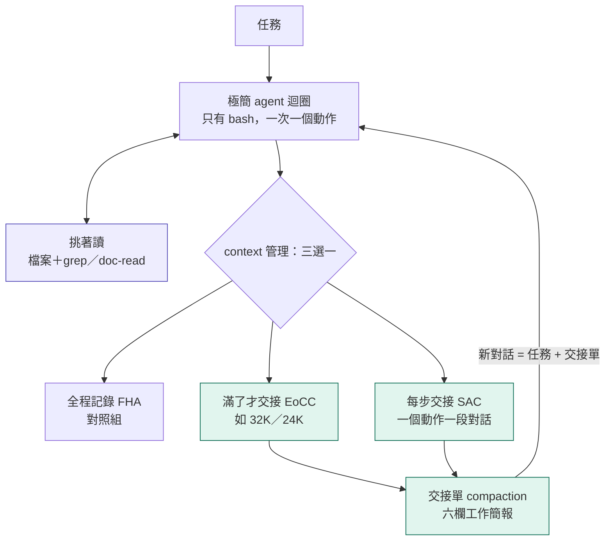
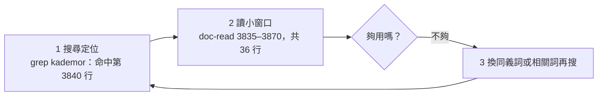

# You don't need long context — 筆記

Nov 13, 2026 · @YHHW

## 論文資訊

- 標題：You don't need long context
- 作者單位：NVIDIA（Peter Belcak、Pavlo Molchanov 等 12 人）
- arXiv：[2611.05306v1](https://arxiv.org/abs/2611.05306)，2026 年 11 月
- 主軸：長 context 的兩個來源，都能靠「挑著讀＋交接單」化解；但成本與證據範圍要先看清前提。

## 三十秒版本

NVIDIA 用一個只有 bash 的極簡 agent，比較三種對話歷史管理方式（全程記錄、滿了才交接、每步交接），並把長文件改成存檔、挑著讀。在 Opus 4.5 與 GPT 5.6 Sol 上：長流程任務壓縮後準確度大致持平；長輸入改成挑著讀後持平或更好；每做一步就交接，在兩個寫程式 benchmark 上也撐得住。關鍵在交接單：它是寫給下一班的工作簡報，不是摘要。

三個前提要看清：多數題目本來只交接 0 到 2 次；論文宣稱省 4 到 8 倍，是假設「短 context 打兩折」的估算，照現行 API 定價（含快取寫入溢價）可能省很少，甚至更貴；中小型開源模型門檻收太緊會掉分甚至崩潰。

## 怎麼讀

主線三節各回答一個問題：長 context 為什麼是問題（一）、論文怎麼避開它（二）、避開之後付出什麼代價（三）。方法節的交接單是全篇最值得直接搬走的東西；實驗節的重點是看清每個數字的前提。

標示：「自編例子」為說明用的虛構例子；「推論」是筆者的判斷，不是論文原文；「論文未說明」指原文沒有交代。

【概念】索引

- 【概念 1】前綴快取與壓縮的成本衝突：為什麼縮短 context 在 API 上可能反而更貴

## 一、問題：長 context 很貴，但真的必要嗎？

context 越長，每生成一個輸出 token 越貴、越慢。生成每個新 token 時，attention 都要讀過之前所有 token 的 KV cache（先前 token 算好、存起來重複使用的中間結果），成本隨深度線性上升。雲端 serving 還多一層效應：視窗開得越大，每個請求要預留的 KV cache 記憶體越多，一張 GPU 能同時服務的請求就越少，吞吐量隨之下降（一般知識，論文未拆分這兩個效應）。

實測（Figure 4 "Decode throughput collapses as the context window size grows."，vLLM on H100）：把視窗從 256K 開到 16K，每秒輸出 token 數增加 3.6 倍（GLM 5.2）、5.6 倍（Kimi K2.6）、7 倍（Qwen 3 Coder Next）。現行 API 對長短請求收同一單價，使用者感覺不到這個差距。

長 context 有兩個來源：

| 代號 | 名稱 | 為什麼變長 |
| --- | --- | --- |
| LCW1 | 長流程任務 | agent 每做一個動作，工具呼叫與結果都接在對話尾端 |
| LCW2 | 長輸入任務 | 任務附帶大量資料，一開始就整份塞進去 |

關鍵一步：LCW2 可以轉成 LCW1。把長輸入存成檔案、給 agent 挑著讀的工具，「讀文件」就變成一連串動作。因此只要長流程能在短 context 下完成，長輸入也跟著解決。

論文據此提出三個問題：RQ1 長流程能否在短 context 下完成；RQ2 長輸入能否；RQ3 能否做到每段對話只做一個動作。論文把「長」約定為接近 256K 的量級，「短」為 16K 到 50K。

## 二、方法：交接單取代對話歷史，檔案取代長輸入

方法全部在 harness 層：沒有訓練、沒有新模型。比喻是換班交接——工程師做到筆記本快寫滿，就寫一張交接單，下一班只看「原始任務＋交接單」繼續做。

### 系統地圖



綠色回應長流程（LCW1），紫色回應長輸入（LCW2），其餘為共用骨架或對照組。agent 刻意用最陽春的 mini-swe-agent 與其通用版 mini-agent，避免結果被複雜 harness 影響。

### 三種 context 管理做法

| 名稱 | 論文原名 | 怎麼運作 |
| --- | --- | --- |
| 全程記錄 | FHA（Full-History Accumulation） | 所有歷史一直留著；agent 的預設行為，作為對照組 |
| 滿了才交接 | EoCC（End-of-Conversation Compaction） | 對話超過門檻，就由同一模型在同一段對話裡寫交接單，再開新對話（任務＋交接單）。設定寫成「總上限／門檻」，例如 32K／24K，兩者之間留給寫交接單；寫到總上限還沒寫完，該段對話直接終止 |
| 每步交接 | SAC（Single-Action Compaction） | 每段對話只做一個動作，看完結果立刻更新交接單，再開新對話。依 Figure 3 的畫法，更新交接單是多問模型一輪，每個動作實際呼叫模型兩次（正文未明講） |

下圖以自編例子畫出三者的 context 長度如何隨動作變化（Figure 3 "Context-management regimes." 則畫出每段對話實際放了哪些訊息）。

&#91;embedded content: 三種做法的 context 長度 · 自編例子\]

全程記錄一路上升；滿了才交接超過 24K 門檻時先寫交接單（短暫跟到 28K），再掉回低點；每步交接每個動作都回到低點。

交接之後舊對話真的丟掉，模型無法再查回去；交接單沒寫到的資訊就永遠遺失。論文 3.1 節提到可把完整歷史存成檔案供需要時查詢，但實驗沒有這樣做。所以交接單的寫法直接決定成敗。

### 交接單：工作簡報，不是摘要

好的交接單只挑接下來還用得到的事，而不是重述做過什麼（Appendix A）。一般摘要會平均對待所有事實，還容易被重複出現的片段牽著走——agent 反覆跑了五次測試，摘要就花大量篇幅描述測試。

- 摘要式（自編例子）：「先看了 README，接著 grep parse\_date，打開三個檔案，跑了測試，失敗，又改了一次……」——按時間記流水帳。
- 工作簡報式：只回答「下一班接手需要知道什麼」。

論文實際使用的六個欄位（Appendix G.1 壓縮提示詞），配上自編任務：修正 `parse_date()` 遇到帶時區字串就崩潰的 bug。

| 欄位 | 要寫什麼 | 自編例子 |
| --- | --- | --- |
| 1. 目標 | 一行，說明要達成的結果 | 讓 parse\_date('2024-01-01+08:00') 不再出錯，且原有測試全過 |
| 2. 已確認的事實 | 精確的路徑、指令、觀察值與錯誤；已觀察到的與未驗證的猜測分開寫 | 錯誤在 utils/dates.py 第 42 行；（未驗證）可能是格式字串少了 %z |
| 3. 已做的修改 | 改了哪個檔案、改了什麼、驗證過沒有 | dates.py 加入 %z 分支，尚未驗證 |
| 4. 驗證紀錄 | 跑過哪些檢查、結果、遇到的障礙 | pytest tests/test\_dates.py：2 個失敗，原因是時區比較 |
| 5. 死路 | 試過但失敗、不要重複的做法 | 改用 dateutil 不行，環境不能加套件 |
| 6. 剩餘計畫 | 待辦依執行順序排列、下一個具體指令、完成條件 | 下一步修比較時的時區；完成條件是 test\_dates 全過，且 issue 的重現腳本能跑 |

另一條規則：需要的輸出被截斷時，不硬抄內容，而是寫下「用哪個指令可以再撈回來」——存指標，不存內容。同一套欄位用於所有任務類型。

背後的邏輯可濃縮成三類：原封不動的任務、目前在做什麼與下一步、未來還會用到的材料（拆好的計畫、完成條件、相關資訊或其指標）。「死路」一欄特別關鍵：舊對話已丟，沒寫下的失敗經驗會再犯一次。

> 論文未說明：Appendix A 稱比較過「摘要 vs 刪訊息」等做法並選出最好的，但沒有提供任何對照數字。

### 挑著讀：長文件放檔案，先定位再讀小窗口

長文件不進對話，存成檔案放在環境裡（Section 2.4.2、Appendix E）。真實例子（Appendix E.2）：把一句 Kalamang 語翻成英文，附帶一本約 100 萬字元、18,830 行的文法書。



grep 會掃過整個檔案，但只有命中行與 36 行窗口進入 context，約占全書 0.2%。

工具：標準指令 grep、sed、head、tail 為主力；論文另加 `docs-list`（列文件）、`doc-stats`（查大小）、`doc-read`（讀有上限的窗口，預設 6,000 字元、硬上限 8,000 字元，回傳時附「下一段怎麼讀」）、`doc-syn`（產生搜尋詞變化）。

讓它有效的是兩個限制，缺一不可：

1. 工具層硬上限：`doc-read` 一次最多給 8,000 字元，從機制上就灌不爆 context。
2. 系統提示明確要求：只讀需要的部分、每次讀小段、不要倒出整份文件；先搜尋每個選項依賴的實體或主張，讀周圍段落，再驗證。

「挑著讀」不是模型自然會做的事，是工具上限加提示詞強制出來的行為。

## 三、實驗：準確度大致持平，但每個數字都有前提

準確度是實測的，成本倍數是假設情境下的估算；讀這節時兩者要分開看。主力模型為 Claude Opus 4.5 與 GPT 5.6 Sol，共 13 個 benchmark。

### 先讀懂「成本節省倍數」

論文圖上的倍數不是實際帳單省下的錢，而是假設「短 context 的 token 可以打折賣」後估出的價格（Appendix B，估計最佳化零售成本）。

第一步，從三個開源模型的吞吐量量出折扣率：

```latex
r_M = \frac{T_M(256\text{K})}{T_M(16\text{K})}
```

T\_M(W) 是模型 M 在視窗 W 下的輸出吞吐量。GLM、Kimi、Qwen 分別為 0.2772、0.1777、0.1439，平均取整 r = 0.20：假設 16K 視窗的輸出 token 只要原價兩成。

第二步，套到閉源模型，在 16K 與最大視窗之間線性內插：

```latex
C^{\text{est}}(W) = C(W^{\max}) \left[ r + (1-r)\,\frac{\max(W,16\text{K}) - 16\text{K}}{W^{\max} - 16\text{K}} \right]
```

C(W^max) 為官方輸出價（Opus 4.5 每百萬 token $25，GPT 5.6 Sol $20），W^max 為參考視窗（Opus 200K、GPT 272K），W 為實驗設定的總上限。例：Opus 在 W = 16K 時括號內為 0.2，輸出價從 $25 變 $5；W = 48K 時約 0.34。第三步，輸入與快取價按官方比例跟著打折，再乘上實際 token 數加總。

倍數大部分來自折扣，而不是省下的 token。以 Table 3（SWE-bench Verified，16K／12K）為例，分母都是同一模型的全程記錄對照組：

| 模型 | 官方價實際花費：對照組 → 壓縮 | 實際比值 | 圖上的節省倍數 |
| --- | --- | --- | --- |
| Opus 4.5 | $420.00 → $312.65 | 便宜 1.3 倍 | 6.7× |
| GPT 5.6 Sol | $167.68 → $203.12 | 貴約 21% | 4.1× |

圖上的倍數要成立，三層假設必須同時成立：

| 層 | 假設 | 為什麼不一定成立 |
| --- | --- | --- |
| 1 | 供應商依視窗大小分級定價 | 現行 API 對長短請求收同一單價 |
| 2 | 閉源模型的成本曲線與開源模型相同 | r = 0.20 來自三個開源模型；閉源架構與 serving 未公開 |
| 3 | 對照組按最大視窗全價計 | 對照組多數任務其實很短，見 RQ1 |

此外，論文的價格模型完全沒有計入快取寫入溢價，而壓縮會打斷前綴快取，見【概念 1】。推論：前提最接近成立的是自架 serving、自付 GPU 的情境——可以直接把最大長度設小，Figure 4 的吞吐量提升是真的拿得到的，但前提是所有請求都經過壓縮、不會超過上限。

### RQ1 長流程：多數題目只交接 0 到 2 次

指標 Δ 準確度（百分點，pp）＝壓縮設定的準確度減同一模型全程記錄的準確度。6 個 benchmark，總上限從 48K 收到 16K（BFCLv3、τ²-bench 收到 12K、8K），見 Figure 5 "Long-horizon results as a function of total context limit."。

每個模型有 22 組設定。掉超過 2 pp 的：Opus 4.5 只有 1 組（FRAMES 24K，−3.7）；GPT 5.6 Sol 有 5 組（FRAMES 3 組、Terminal-Bench 2 組）。兩個模型都在 FRAMES（多跳查資料）上一致小跌——推論：這類任務要一路累積證據，交接時最容易丟東西。

為什麼大致持平？關鍵在題目原本有多長。以 Opus 在 SWE-bench Verified 為例：不壓縮時，中位數那道題整段對話 32K，最長一道 200K（Table 3 的 Total length）。

&#91;embedded content: 題目長度 vs 交接門檻 · A／B／C 三種情況\]

門檻落在灰條右邊就永遠碰不到：在最寬鬆的設定下，至少一半的題目根本沒被壓縮。

準確度「幾乎持平」主要由 A、B 類題目撐起；C 類長題被反覆交接後表現如何，被平均掉了，論文沒有按題長拆開報告（交接次數為概略值：新對話會帶著交接單，不是單純題長除以門檻）。因此 RQ1 的「是」，更精確的說法是：大部分任務只需交接 0 到 2 次，這種程度的壓縮不太傷準確度；真正長的任務只占少數，論文沒有單獨拆開看。

> 論文未報重複次數或信賴區間。以 500 題、準確度 70% 估算，單次跑分的標準誤約 2 pp（一般統計），±2 到 5 pp 的差距多半在雜訊內——「壓縮反而提升準確度」不能當結論。

### RQ2 長輸入：功勞在挑著讀，而且省的是真的 token

對照組把整份文件貼進對話；實驗組放檔案＋挑著讀，必要時交接（多數設 16K 上限）。實驗組的交接次數中位數幾乎都是 0（Appendix F），所以差異幾乎全來自挑著讀，而不是壓縮。見 Figure 6 "Long-input results as a function of total context limit."。

| 類型 | benchmark | Δ 準確度（Opus／GPT, pp） | 官方價實際省多少 |
| --- | --- | --- | --- |
| 真實文件 | LongBench v2 | −0.4／+1.8 | Opus 1.5 倍；GPT 反而貴 14% |
| 真實文件 | LOONG（多份財報、論文） | 約 +10／+3 到 +5 | 約 2.6 到 4.4 倍 |
| 真實文件 | AA-LCR（跨文件推理） | +15 到 +19／+1 | 約 1.8 到 3.5 倍 |
| 找針型（合成） | NIAH、RULER、Counting-Stars、BABILong | +4.6 到 +40 | 約 5 到 70 倍 |

Δ 相對同一模型「整份貼進去」；「官方價實際省多少」＝對照組官方價花費 ÷ 實驗組官方價花費（Table 11 到 17 的 Nominal retail cost），不含任何假設折扣。真實文件那群才有說服力；找針型的答案藏在用關鍵字找得到的句子裡，grep 天生適合，論文也承認 NIAH 的成功來自關鍵字重疊。

> 論文未說明：NIAH、RULER、BABILong 的文件長達 50 萬到 100 萬 token，超過 Opus 的 200K 視窗，對照組如何處理塞不下的文件（截斷，或用 GPT 的 1M 模式）。若是截斷，大幅提升有一部分是對照組根本看不到答案。

推論：Figure 8 "LOONG: conversation length versus document length." 中，文件較短的兩組（10K 到 100K）有不少點落在 y = x 上方——挑著讀累積的對話比直接貼整份文件還長。文件夠短時，直接貼進去可能更省。

### RQ3 每步交接：兩個寫程式 benchmark 上撐得住

峰值長度＝整個任務中最長那一段對話的長度，決定 serving 時視窗要開多大。每步交接讓峰值最多縮小約 12 倍（對照組最長 130K 到 200K → 15K 到 37K），中位數只剩 7K 到 9K（Table 2 "SAC versus FHA and EoCC."）。

| 模型／benchmark | 題數 | 全程記錄 | 每步交接 | 差幾題 |
| --- | --- | --- | --- | --- |
| Opus／SWE-bench Verified | 500 | 70.0%（350） | 70.2%（351） | +1 |
| Opus／Terminal-Bench | 89 | 47.2%（42） | 51.8%（46） | +4 |
| GPT／SWE-bench Verified | 500 | 84.4%（422） | 82.4%（412） | −10 |
| GPT／Terminal-Bench | 89 | 87.6%（78） | 84.3%（75） | −3 |

Terminal-Bench 一題就是 1.1 pp，±3 到 4 題基本是雜訊；可信的訊號是 GPT 在 SWE-bench 少解 10 題，Opus 完全持平。Table 2 的「Best EoCC」欄是四種設定中挑最高分，拿來比較會偏樂觀。範圍：只測 2 個寫程式 benchmark，且每步交接的 token 用量與成本完全沒有報告。

### 開源模型：能撐多緊是模型相依的

「壓縮不傷準確度」是在 Opus、GPT 這種頂級模型上測出來的。換成中小型開源模型，門檻收太緊就會明顯掉分，甚至整個崩潰；能撐多緊，是模型相依的（Appendix D）。

## 【概念 1】前綴快取與壓縮的成本衝突

一句話：前綴快取的寫入比讀取貴，而壓縮每次都會換掉對話開頭之後的內容，讓「縮短 context」在 API 上可能省得比預期少，甚至更貴。

定價結構（Anthropic，[pricing](https://platform.claude.com/docs/en/about-claude/pricing)）：5 分鐘快取寫入為基本輸入價的 1.25 倍，1 小時快取寫入為 2 倍，快取讀取（命中）為 0.1 倍。快取按前綴比對，前綴一變，後面全部要重新寫入。其他供應商的計費細節不同，未查證者不在此下結論。

```mermaid
flowchart LR
  subgraph 全程記錄：幾乎全部命中
    a1[系統提示＋任務<br/>命中] --> a2[先前全部歷史<br/>命中] --> a3[新增的尾巴<br/>寫入]
  end
  subgraph 交接後的新對話：交接單之後全部重寫
    b1[系統提示＋任務<br/>命中] --> b2[交接單<br/>寫入] --> b3[之後所有內容<br/>寫入]
  end
```

每步交接是最糟的情況：每一步的交接單都不同，每一步都重寫。

論文自己的數據看得到命中流失（Table 3，SWE-bench Verified，Opus 4.5，單位百萬 token）：

| 項目 | 全程記錄 | 16K／12K |
| --- | --- | --- |
| 快取命中的輸入 | 420.0 | 127.3 |
| 未命中的新輸入 | 20.0 | 28.3 |
| 輸出 | 4.4 | 4.3 |

論文的價格模型只有「新輸入 $5」與「快取 $0.50」兩種輸入價，沒有寫入溢價；「新輸入」是否包含快取寫入，論文未說明。

數字例子（推論，取上限：假設所有新輸入都按 1.25 倍計）：對照組多 $25（20.0 × $1.25），壓縮組多約 $35（28.3 × $1.25），總花費約 $445 vs $348，Opus 仍便宜約 1.3 倍，沒有翻盤。原因是對照組反覆重讀長歷史，即使只付 0.1 倍，420M token 也要 $210。

- 中低頻率壓縮（EoCC）：寫入溢價會吃掉一部分節省，但在論文的數據裡不足以讓 Opus 翻盤。
- 高頻率壓縮，尤其每步交接（SAC）：最可能變貴，但論文完全沒有報 SAC 的 token 用量與成本，無法驗證。
- 使用 1 小時快取（寫入 2 倍）時，懲罰加倍。
