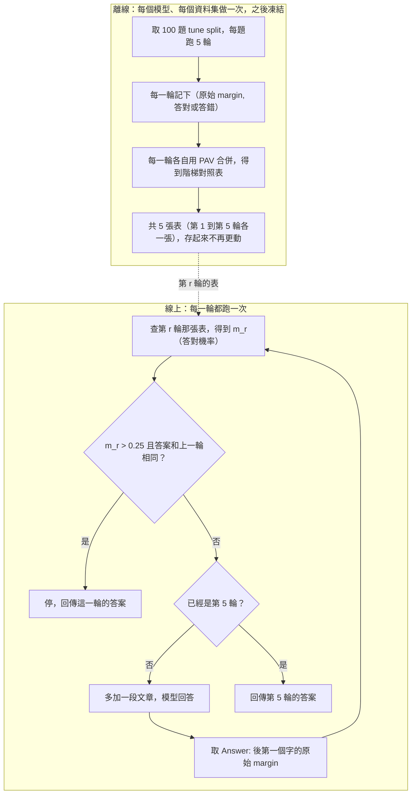

# TASR 筆記：免訓練的迭代檢索停止規則

Oct 16, 2026 · @YHHW

## 三十秒版本

TASR（Training-free Adaptive Stopping Rule）是一條決定「迭代式 RAG 何時停止檢索」的規則：這一輪的答案和上一輪相同，而且校準後的「答對機率」超過 0.25，就停。它不需要訓練任何停止用的模型，但每個模型要先用 100 題有標準答案的資料建一張校準表。

- **論文宣稱：** 在 3 個模型 × 2 個資料集上，比固定檢索 3 輪（fixed-k=3）高 3.42 F1，呼叫次數幾乎一樣（3.13 對 3.00）。
- **拆開看：** 這 3.42 是三個模型的平均，Qwen +1.46、Devstral +0.23、Gemma +8.59。提升集中在最弱的 Gemma，而且 Gemma 用的呼叫次數比 3 次多。
- **延伸實驗：** 換資料集、換檢索器、換 550B 大模型，沒有任何一組顯著變差，大多數組合是持平。
- **這份筆記最值得帶走的，是脫離這篇論文也成立的兩個技巧：** 用 isotonic regression 把模型分數校準成機率，以及用 logprob 的第一名減第二名（margin）當模型的篤定程度。

## 索引

主線依序是：問題、方法、實驗、值得帶走的東西。以下三段【概念】放在文末，脫離這篇論文也能單獨閱讀，是最容易忘、也最值得回頭看的部分：

1. 【概念】校準與 isotonic regression：怎麼把分數換成機率，分桶為什麼不能隨便切，合併時為什麼要回頭數原始紀錄
2. 【概念】用 logprob 的 margin 當篤定程度：它怎麼算、為什麼比口頭信心有用、使用前要檢查什麼
3. 【概念】一次「呼叫」是什麼：論文的成本單位到底在數什麼

## 1. 問題與挑戰

迭代式 RAG 每一輪多取一段證據、再讓 LLM 回答一次，常常答案早已定案卻還繼續檢索，白花檢索與 LLM 呼叫，論文稱為 overspending。現有解法（Adaptive-RAG、Stop-RAG、Self-RAG）都把「何時停」交給訓練出來的元件，換模型或任務就得重訓；TASR 要回答的是：不訓練停止元件，能不能用模型自己的輸出判斷「已經收斂」，而且不會停在還沒看到關鍵段落的錯誤答案上。

## 2. 方法

### 2.1 論文的設定（§3.1）

- BM25（靠關鍵字比對排名的傳統檢索）先把每題的 10 段候選文章對問題排名一次，之後不再重新檢索，也不改寫查詢。
- 第 r 輪多揭露排名第 r 的那一段，LLM 看前 r 段後回答一次。這一次回答算 1 次呼叫。
- 最多 5 輪；規則沒觸發就回傳第 5 輪的答案。
- 回覆格式固定以 "Answer:" 開頭，後面接答案，這個格式是後面取 margin 的錨點。

### 2.2 規則本體（§3.4）

每一輪檢查兩件事，兩件都成立就停：

```latex
\text{stop}_r = \mathbb{1}\big[\ \tilde a_r = \tilde a_{r-1}\ \wedge\ m_r > 0.25\ \big]
```

- r：第幾輪，1 到 5。
- ã\_r：第 r 輪的答案做過標準化（轉小寫、去冠詞、去標點、合併空白）之後的版本；ã\_{r-1} 是上一輪的。
- m\_r：第 r 輪答案「答對的機率」，範圍 0 到 1。它由答案第一個字的原始 margin 查校準表得來，做法見下一節的流程圖與文末兩段【概念】。
- 𝟙\[·\]：括號內成立為 1（停），否則為 0（繼續）。∧ 是「而且」。

白話：模型這一輪的答案跟上一輪一樣，而且它有超過 25% 的把握是對的，就停。因為第 1 輪沒有上一輪可以比，規則不可能在第 1 輪停，最少要 2 次呼叫。

論文自己的走查例子（§3.4，HotpotQA 問題 5a77e70f，標準答案 The Tempest）：

| 輪次 | 答案 | m\_r | 和上一輪答案相同？ | 停？ |
| --- | --- | --- | --- | --- |
| 1 | Titus Andronicus | 0.30 | 無法比較 | 否 |
| 2 | The Tempest | 0.81 | 否（變了） | 否 |
| 3 | The Tempest | 0.80 | 是 | 是，回傳 The Tempest |

第 2 輪關鍵段落（The Tempest 1979 年電影）進入證據，答案才改對；第 3 輪答案重複且 m\_3 = 0.80 > 0.25，停下，共用 3 次呼叫。

### 2.3 離線建表、線上查表

規則裡的 m\_r 不是模型直接給的，要先用歷史紀錄建好一組「分數 → 機率」的對照表，之後每一輪只查表。流程分成兩條線：



怎麼讀這張圖：

- **離線那條只做一件事**：把「模型的分數」翻譯成「答對機率」的對照表。tune split 是 100 題有標準答案的題目；每一輪各自收集 100 筆（原始 margin，答對與否），各自建一張表，所以每個（模型、資料集）組合共有 5 張表。建表的方法見文末【概念】校準與 isotonic regression。
- **線上那條每一輪只做查表和兩個檢查**，不訓練任何東西，也不再看那 100 題。原始 margin 的算法見文末【概念】用 logprob 的 margin 當篤定程度。
- **兩條線唯一的交接點**，是線上「查表」那一步用的表，正是離線存下來的那 5 張表之一。

**這一節最重要的一句話：原始 margin 只是模型自己的分數，對照表才把它翻譯成可以比較的答對機率，而且每個模型、每一輪都要各自翻譯。**

### 2.4 規則怎麼被挑出來（§5.3）

論文準備了八個可以當停止依據的訊號，把它們窮舉組合出共 381 條候選規則，只在 Qwen 加 HotpotQA distractor 這一個組合上用實驗比較哪一條對 fixed-k=3 的提升最好，勝出的就是上面的 AS\_m25，之後鎖定不再調整，套到其餘 31 個組態。

## 3. 實驗

### 3.1 主結果（§5.1、§5.2、§5.9）

**名詞先定義：**

- **F1**：預測答案與標準答案的字詞重疊程度，0 到 100，每題算一個再平均，衡量最終答案品質。
- **fixed-k=N**：不管答案穩不穩，固定用 N 段文章後回答，是論文最主要的對照組。
- **macro**：6 個組合（3 個模型 Qwen、Devstral、Gemma × 2 個資料集 HotpotQA、2WikiMultiHopQA，表中簡稱 hp、2w）各算一個值再簡單平均，每組用 300 題 eval。

請回論文原圖查看 **Table 2**（原文 caption："Macro results across the 3 × 2 grid (n=6 cells, 300 eval questions per cell)."）與 **Table 3**（"Per-cell TASR results. ΔF1 vs. fixed-k=3; bold CIs exclude zero."）。

**Table 2 的關鍵數字：**

| 方法 | macro F1 | macro 呼叫數 |
| --- | --- | --- |
| fixed-k=1 | 35.29 | 1.00 |
| fixed-k=3 | 53.98 | 3.00 |
| TASR | 57.40 | 3.13 |
| fixed-k=5 | 60.52 | 5.00 |

論文的標題數字是 TASR 比 fixed-k=3 高 3.42 F1，且保留 fixed-k=5 的 94.8% F1，只用 62.6% 的呼叫。

**拆開看（用 Table 3 自行計算，每個模型取兩個資料集的平均）：**

| 模型 | ΔF1 vs fixed-k=3 | TASR 平均呼叫數 |
| --- | --- | --- |
| Qwen | +1.46 | 2.68 |
| Devstral | +0.23 | 2.94 |
| Gemma | +8.59 | 3.78 |

+3.42 就是這三個數字的平均；拿掉 Gemma，Qwen 與 Devstral 平均只剩約 +0.84。6 個組合中，顯著贏過 fixed-k=3 的只有 3 個（qwen\_hp、gemma\_hp、gemma\_2w），其餘 3 個與 fixed-k=3 統計上分不出輸贏（95% 信賴區間包含 0），沒有任何一組顯著變差。

**要注意的一點：** Gemma 的 TASR 平均用了 3.78 次呼叫，比 fixed-k=3 多約 26%，所以「同成本下贏 3.42」對 Gemma 並不成立。論文沒有報 fixed-k=4，因此看不出 Gemma 的進步有多少只是多給了幾輪。

**推論（非論文原文）：** 從 Table 2，fixed-k 從 3 升到 5 平均每多一次呼叫約多 3.27 F1，多出的 0.13 次呼叫理論上只該多約 0.43 F1，實際多了 3.42，所以整體提升不只是靠多呼叫。但這是整體平均，不能拿來證明 Gemma 單獨的那一塊。

### 3.2 為什麼 Gemma 受益最多（Table 8，§5.9）

論文在 **Table 8**（caption 開頭："Cross-model evidence for Gemma's overconfidence pattern."）給出的解釋是：Gemma 單次回答最不準，原始 margin 卻最大，也就是最不準的模型最篤定（過度自信），校準把它拉回合理的尺度。數字取自三個開放領域資料集的平均：

|  | Qwen | Devstral | Gemma |
| --- | --- | --- | --- |
| fixed-k=1 的 F1（開放領域 macro） | 48.87 | 52.78 | 35.54 |
| 原始 margin（nats） | 4.66 | 3.71 | 9.50 |
| 校準後的 m\_r 平均 | 0.52 | 0.49 | 0.42 |

論文自己在 Limitations 承認，這只是觀察到的相關，沒有因果證據。

**推論（非論文原文）：** 模型越弱、答案越不穩，預期收益越大；強模型預期接近持平，主要是省呼叫。

### 3.3 三個延伸實驗（各一句）

- **換資料集：** 校準只用 HotpotQA 的 100 題建好後凍結，直接套到 9 個開放領域組合，沒有壞掉，但平均只比 fixed-k=3 高 0.68 F1（1 組顯著贏，8 組持平）。
- **換檢索器：** 把 BM25 換成向量檢索（兩種），9 組裡 2 組顯著贏（都是 Gemma）、7 組持平，沒有顯著變差。
- **換大模型：** 模型大 18 到 23 倍的 Nemotron 550B，8 組裡 1 組顯著贏、7 組持平，呼叫 2.45 到 3.33 次，等於 F1 不掉並省下呼叫。

## 4. 值得帶走的東西

按耐久度排序：越往下越依賴這篇論文的設定，越往上越脫離它也成立。

### 第一類：這篇論文本身的貢獻（很少）

- **「答案和上一輪相同，加上校準後信心過門檻」這條停止規則本身。** 可以當作迭代檢索停止規則的一個 baseline 與思路；它相對於「單純多給幾輪」的單獨功勞，論文沒有量出來。

### 第二類：讀這篇過程中學到、脫離它也成立的東西

**1. isotonic regression（PAV）：要把分數換成機率，又不想自己決定分桶時用它**

它只假設一件事：分數越高，答對機率不會越低。手動分桶的結果取決於你怎麼切，同一筆資料換個切法，查到的機率可以從 0.75 變成 0.33（數字見文末【概念】）。isotonic 讓資料自己決定桶的邊界：

```text
每筆資料各自一桶（值 = 0 或 1）
重複：找到相鄰兩桶，左邊的值 > 右邊的值
      -> 併成一桶，值 = 這桶裡實際答對的筆數 / 總筆數
直到整排只升不降
```

最容易算錯的地方：併桶後的值要回頭數原始紀錄，不能拿兩個桶的值直接平均，否則 1 筆資料會和 100 筆資料同樣重（完整例子見文末【概念】）。

什麼時候用哪一種（一般知識，不是論文內容）：

| 情況 | 較適合 |
| --- | --- |
| 資料夠多，分數和機率的關係形狀不確定 | isotonic：不預設形狀，彈性大 |
| 資料很少，或關係大致是平滑的 S 形 | Platt scaling（只擬合 2 個參數的 S 形曲線）：較不容易被雜訊帶偏 |

資料少時 isotonic 的階梯會很粗、容易過度貼合；這篇每張表只用 100 筆，所以階梯偏粗（推論）。補一個論文自己的反例：論文在 18 組對照中，Platt 有 12 組的規則 F1 略高，但仍選了 isotonic，理由是分布窄或多峰時 Platt 較不穩健。所以上表只是起點，實際選哪個要用下游任務的結果驗證。

**2. 用 logprob 的 margin 當模型的篤定程度**

模型輸出答案第一個字時，看第一名和第二名候選字的 logprob 差，差越大代表越篤定：

```latex
\text{margin} = \log p_{\text{top1}} - \log p_{\text{top2}}
```

為什麼比讓模型口頭報信心好：論文觀察到，要模型自己報 1 到 5 的信心時，96.5% 的回答都是 5，幾乎沒有資訊；margin 是連續的數字，每一筆都有差別。論文說 margin 的類別分離度比口頭信心好約 40 倍，但那是 2.75 nats 對 0.07 兩個不同單位的數字相比，不建議把「40 倍」當真；可靠的結論只有「口頭信心塌縮成同一個值」。

用它之前要檢查三件事：

| 條件 | 不成立時 |
| --- | --- |
| API 能回傳 logprob | 商用 API 常常不給，這招就用不了 |
| 答案有固定起點（例如 "Answer:" 之後），且第一個字就帶著決定 | 長篇回答的第一個字幾乎沒有訊號（論文 Limitations 自己承認） |
| 要先校準 | 原始 margin 的刻度因模型而異，不能直接設門檻，要接前面的 isotonic |

## 【概念】校準與 isotonic regression

**一句話：** 校準就是數歷史紀錄：過去分數差不多的答案，實際有幾成答對？再把這個比例當作新答案的機率。

### 目標：做一張「分數 → 答對機率」的對照表

類比：天氣預報說「降雨機率 70%」，意思不是氣象局很有信心，而是歷史上條件類似的日子，有七成真的下雨。校準做的是同一件事，只是把「條件類似」換成「分數差不多」。

資料來源是 tune split（調校用的小資料集，這篇是 100 題有標準答案的題目）：每題每一輪的答案算一筆，記下兩個東西，這筆的原始 margin，以及答案有沒有答對（1 是對，0 是錯）。

最樸素的做法是分桶數數。以下 8 筆是自編例子，不是論文的數字：

| 原始 margin | 0.5 | 1.2 | 2.0 | 3.1 | 4.5 | 6.0 | 8.0 | 10.0 |
| --- | --- | --- | --- | --- | --- | --- | --- | --- |
| 答對？ | 0 | 1 | 0 | 0 | 1 | 0 | 1 | 1 |

切成「低」「高」兩桶，各自數答對比例：

| 桶 | 包含的 margin | 答對幾筆 | 對照表的值 |
| --- | --- | --- | --- |
| 低 | 0.5、1.2、2.0、3.1 | 4 筆中 1 筆 | 0.25 |
| 高 | 4.5、6.0、8.0、10.0 | 4 筆中 3 筆 | 0.75 |

新答案的 margin 是 2.5，落在低桶，查表得 0.25。校準後的值不是模型自己報的數字，而是歷史紀錄裡「類似答案實際答對的比例」。

### 問題：桶要怎麼切？

上面為什麼剛好一桶 4 筆？沒有任何道理，是為了好講，把 8 筆從中間切成 4 加 4。這正是校準的核心難題：切法一變，對照表就變。同一份 8 筆，改切在 6.0 和 8.0 之間：

| 切法 | 低桶 | 高桶 | margin = 5.0 查到的值 |
| --- | --- | --- | --- |
| 4 加 4 | 0.5 到 3.1，答對 1/4 = 0.25 | 4.5 到 10.0，答對 3/4 = 0.75 | 0.75 |
| 6 加 2 | 0.5 到 6.0，答對 2/6 = 0.33 | 8.0、10.0，答對 2/2 = 1.0 | 0.33 |

同一個答案，一個切法說答對機率 75%，另一個說 33%，而規則的門檻只有 0.25，查到的值差這麼多，停不停就跟著變。常見的折衷是讓每桶人數一樣多。論文 **Figure 2 右圖**就是這樣畫的（原文 caption："Right: Reliability diagram: P(EM=1) in five equal-size margin buckets (n=100 each)."，請回原圖查看），不過那張圖只用來展示「margin 越大越準」，不是實際使用的校準器。實際使用的是 isotonic regression：**不用人決定桶的邊界，由資料自己決定。**

### isotonic regression 怎麼做（PAV）

isotonic 出自統計學的保序迴歸（order-restricted regression），意思是輸出和輸入保持同樣的大小順序；它也是機器學習常見的校準工具（例如 scikit-learn 內建），這篇用得正當，不是包裝。

做法叫 PAV（Pool Adjacent Violators，合併相鄰違規者）：一開始每筆自己一桶，桶的值就是 0 或 1；常識是「margin 越大，答對比例不該越低」，只有出現違反這條常識的相鄰兩桶，才把它們併起來。同一份 8 筆，每次處理一個衝突：

| 步驟 | 發現的衝突 | 怎麼處理 | 合併後的值 |
| --- | --- | --- | --- |
| 1 | 1.2 的值是 1，更大的 2.0 卻是 0 | 兩筆併桶，數答對比例 | 1/2 = 0.5 |
| 2 | 剛併好的 0.5，比後面 3.1 的 0 高 | 三筆（1.2、2.0、3.1）併桶 | 1/3 ≈ 0.33 |
| 3 | 4.5 的值是 1，更大的 6.0 是 0 | 兩筆併桶 | 1/2 = 0.5 |
| 4 | 0、0.33、0.5、1 由小到大，沒有衝突 | 停止 | 不變 |

最後的對照表（桶的大小是 1、3、2、2，沒有人決定要切幾桶、每桶幾個，合併只發生在資料自己互相矛盾的地方）：

| 桶 | 包含的 margin | 值 |
| --- | --- | --- |
| 1 | 0.5 | 0 |
| 2 | 1.2、2.0、3.1 | 0.33 |
| 3 | 4.5、6.0 | 0.5 |
| 4 | 8.0、10.0 | 1 |

新答案 margin 是 5.0，落在第 3 桶，查得 0.5。論文只寫「用 PAV 演算法做 isotonic regression」，沒有交代合併細節，也沒有說 margin 落在桶與桶之間時怎麼取值；上面的做法是一般知識，不是論文內容。

### 常見疑問：併桶時為什麼不是把兩個值平均？

上表步驟 2，剛併好的桶是 0.5，再併入 3.1 的 0，為什麼不是 (0.5 + 0) / 2 = 0.25？因為併完的桶，值必須還是「這一桶裡實際答對的比例」，要回頭數原始紀錄。0.5 這個值本身代表 2 筆紀錄，3.1 只代表 1 筆，各算一份平均，就等於把 2 筆當成 1 筆。

| 算法 | 算式 | 結果 | 對不對 |
| --- | --- | --- | --- |
| 桶的值再平均 | (0.5 + 0) / 2 | 0.25 | 不對，兩個桶的人數不同卻當成一樣重 |
| 回頭數原始紀錄 | 三筆答對 1 筆，1 / 3 | 0.33 | 對 |

等價的說法是加權平均：0.5 這桶權重 2，3.1 權重 1，(0.5 × 2 + 0 × 1) / 3 = 1/3。極端例子（自編）：某桶已有 100 筆、答對 60 筆（值 0.6），再併入 1 筆答錯，正確是 60 / 101 ≈ 0.594；用桶的值再平均會得到 0.3，一筆紀錄就把 100 筆的結果拉掉一半。

**推論（非論文原文）：** 因為階梯只升不降，「m\_r > 0.25」等價於「原始 margin 超過某個切點」（上面的 8 筆例子約在 1.2）。校準的實際作用，就是替每個模型、每一輪換算出各自的 margin 切點，所以同一個 0.25 才能通用。

## 【概念】用 logprob 的 margin 當篤定程度

**一句話：** 在模型寫下答案第一個字的那一刻，看它對「第一名」和「第二名」候選字的偏好差多少，差越大，代表它越篤定。

**先定義：**

- **logprob（對數機率）**：模型生成每個字時，會替詞表裡每個候選字打機率，logprob 就是這個機率取自然對數，永遠是 0 或負數，越接近 0 機率越高。
- **nats**：自然對數的單位，logprob 相減之後的數字就用它計量。

**論文怎麼取這個訊號（§3.2）：** 回覆固定以 "Answer:" 開頭，取 "Answer:" 之後第一個非空白字，把第一名候選字的 logprob 減掉第二名的。論文選這個位置，是因為這是模型「決定要輸出什麼答案」的那一刻。

```latex
\text{margin} = \log p_{\text{top1}} - \log p_{\text{top2}}
```

- log p\_top1：機率最高的候選字的 logprob。
- log p\_top2：機率第二高的候選字的 logprob。

**自編例子（不是論文的數字）：**

|  | 候選字 A 的 logprob | 候選字 B 的 logprob | margin | 意思 |
| --- | --- | --- | --- | --- |
| 篤定的模型 | −0.1 | −2.4 | 2.3 nats | A 的機率約是 B 的 e^2.3 ≈ 10 倍 |
| 猶豫的模型 | −0.7 | −0.9 | 0.2 nats | A 只比 B 高約 1.2 倍 |

一般知識（不是論文內容）：兩個 logprob 相減時，softmax 的正規化常數會互相抵消，所以 margin 等於這兩個字原始分數（logit）的差，不用看整個詞表就能算。

### 兩個名稱不要混

| 名稱 | 論文的欄位名 | 單位或範圍 | 是什麼 |
| --- | --- | --- | --- |
| 原始 margin | answer\_token\_margin | nats，約 0 到 15 | 模型自己的分數 |
| m\_r | calibrated\_logit\_margin | 0 到 1 | 原始 margin 查校準表之後的答對機率 |

### 為什麼原始 margin 不能直接拿來當門檻

**它有資訊。** 請回論文原圖查看 **Figure 2**（原文 caption 開頭："Logit margin distribution by correctness on the Qwen HotpotQA-distractor tune split (n=500, 100 questions × 5 rounds)."）。分母先講清楚：500 是 100 題乘上 5 輪，每一輪的答案算一筆；其中 281 筆答對、219 筆答錯（圖例上的數字）。答對的平均 margin 是 6.71 nats，答錯的是 3.96，右圖顯示 margin 越大，答對比例越高。

**但它的刻度不對，原因有兩個：**

1. **單位不對。** 規則裡的 0.25 是「答對的機率」；原始 margin 的單位是 nats，範圍約 0 到 15，「margin > 0.25」不代表「答對機率 > 25%」。
2. **不同模型的刻度不同。** 3.2 節的 Table 8 數字顯示，Gemma 單次回答最不準，原始 margin 卻最大，約是另外兩個模型的 2 倍。類比：兩位老師都給 80 分，一位的 80 分是前段班，另一位的 80 分只是平均；直接用同一個原始門檻，Gemma 會輕易通過、太早停。

所以要先校準，把每個模型自己的分數刻度換成大家共用的機率刻度，一個 0.25 才能通用。校準的做法見上一段【概念】校準與 isotonic regression。

## 【概念】一次「呼叫」是什麼

**一句話：** 一次呼叫 = 多揭露一段文章，再叫 LLM 回答一次，所以一題的呼叫次數就等於它最後用了幾輪。TASR 在某組合上的 2.71 次呼叫，意思是平均每題做了 2.71 輪。

```text
[1] BM25 先把 10 段文章對問題排名一次
 -> [2] 第 r 輪多揭露排名第 r 的那一段，LLM 看前 r 段後回答
 -> [3] 這算 1 次呼叫
```

兩個容易誤解的地方：

| 容易誤解 | 實際情況 |
| --- | --- |
| 每輪都會重新檢索 | 不會。排名只做一次，之後每輪只是把名單上的下一段亮出來，檢索本身的成本在論文裡幾乎不變 |
| 呼叫次數等於 k | 只有 fixed-k 才是。fixed-k=3 每題固定 3 次；TASR 每題次數不同，有的第 2 輪就停，有的跑到第 5 輪，2.71 是平均值 |

**成本單位的限制（論文 §4）：** 論文只算呼叫次數，沒算 token。第 r 輪 LLM 要讀前 r 段文章，所以越後面的輪次越貴。論文的說法是 TASR 跳過的正是後面比較貴的輪次，所以省下的 token 比呼叫次數看起來更多，但它沒有實際量測。
